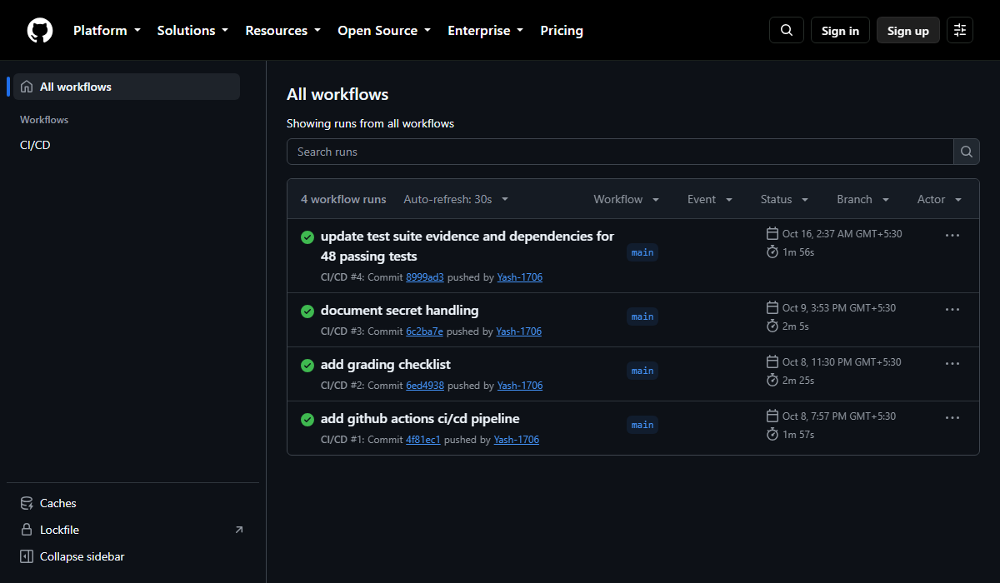
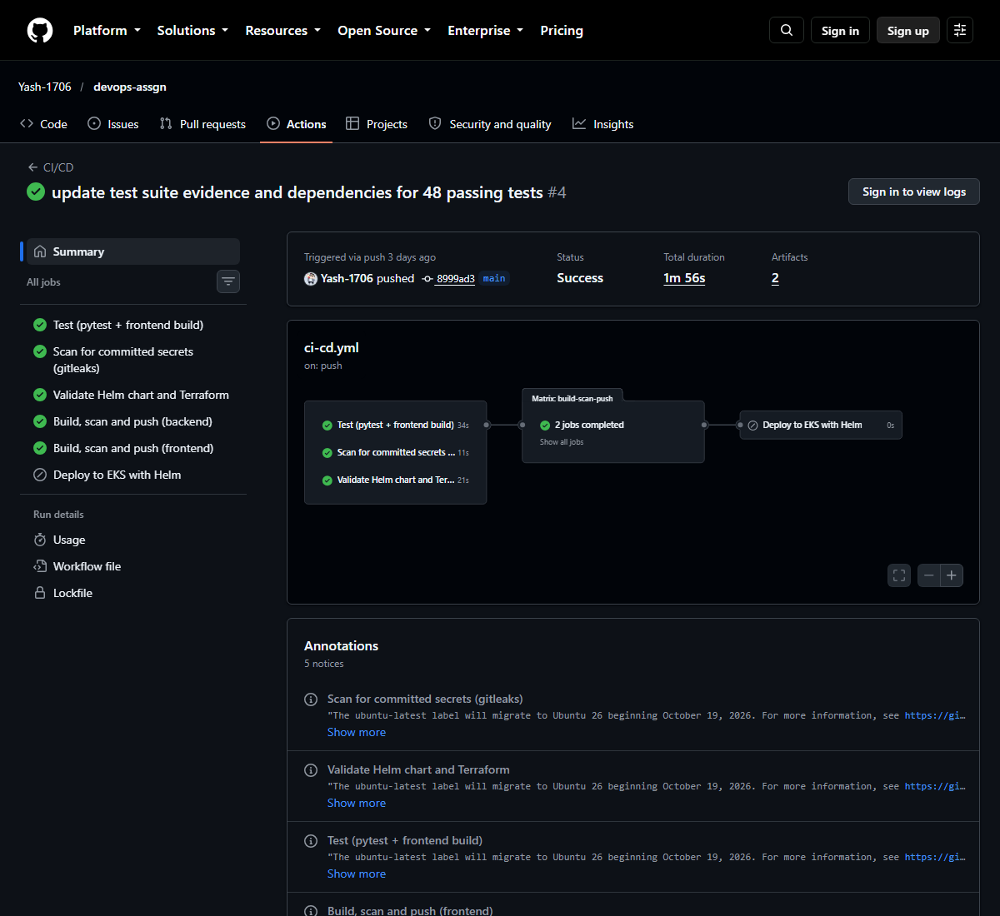
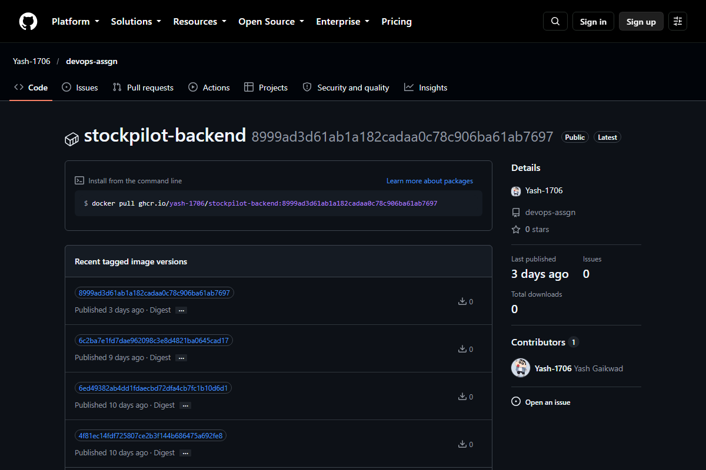
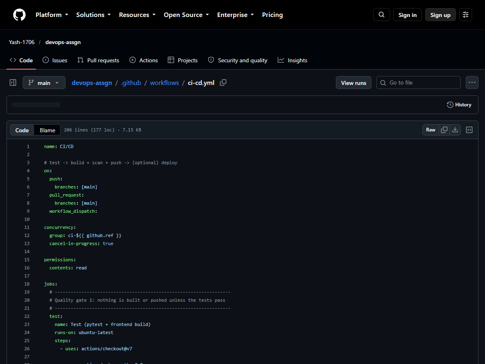
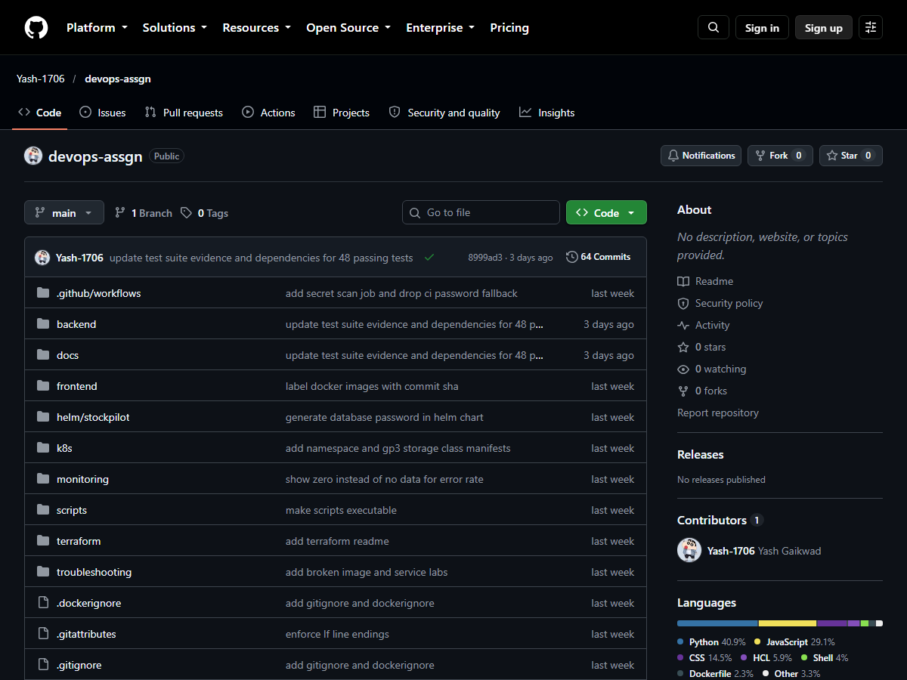

# Session 16: CI/CD and GitHub Actions

**Name:** Yash Gaikwad  |  **Roll No:** 24BCS10100

Homework: build a complete CI/CD demo project with GitHub Actions. For this session I reused my own project **StockPilot** (a FastAPI + React + PostgreSQL inventory app, public at <https://github.com/Yash-1706/devops-assgn>) because it already has a real GitHub Actions pipeline with four successful runs. I did not write a toy workflow: I studied the real one, explained it concept by concept, and checked every claim against the real run data from GitHub.

| Deliverable | Where it is |
|---|---|
| Application source code | [`application/`](../session21-final-devops-project/final-devops-project/application/) (the StockPilot code lives in Session 21; see [The application](#the-application) for a short description) |
| Dockerfile | [`dockerfiles/backend.Dockerfile`](dockerfiles/backend.Dockerfile), [`dockerfiles/frontend.Dockerfile`](dockerfiles/frontend.Dockerfile) |
| GitHub Actions workflow | [`workflows/ci-cd.yml`](workflows/ci-cd.yml) (the real one, exact copy of the file on GitHub) and [`workflows/ci-cd-with-artifacts.yml`](workflows/ci-cd-with-artifacts.yml) (improved copy, **not yet run on GitHub**) |
| CI pipeline | jobs `test`, `secret-scan`, `validate-infra`, and the build + Trivy scan steps of `build-scan-push` |
| CD pipeline | the push step of `build-scan-push` (continuous delivery to GHCR) and the `deploy` job (continuous deployment to EKS) |
| Screenshots of successful pipeline execution | [Screenshots](#screenshots-of-the-successful-pipeline) |
| README.md | this file |

| Concept in the homework | Section |
|---|---|
| CI vs CD | [CI vs CD](#ci-vs-cd) |
| CI/CD pipeline | [The pipeline](#the-pipeline) |
| GitHub Actions, Workflow | [Workflow and triggers](#1-workflow-and-triggers) |
| Jobs | [Jobs and `needs`](#2-jobs-and-needs) |
| Steps | [Steps](#3-steps-uses-vs-run) |
| Runners | [Runners and the matrix](#4-runners-and-the-matrix) |
| Secrets | [Secrets and variables](#5-secrets-and-variables) |
| Artifacts | [Artifacts](#6-artifacts) and [the improved workflow](#artifacts-the-improved-workflow-not-yet-run-on-github) |
| Build, Test | [Build and test](#7-build-and-test) |
| Pipeline execution | [Pipeline execution on GitHub](#pipeline-execution-on-github-real-data) and [Local re-run](#local-re-run-of-the-ci-steps) |

### Where each result comes from

Every output block below is real; nothing is typed in by hand. I labelled the source of each one:

| Label | Meaning |
|---|---|
| **GitHub** | read-only data pulled with the `gh` CLI (`gh run view`, `gh api` GET calls) from the real runs of the public repository, plus screenshots of public pages |
| **Local** | I re-ran the same commands on my own laptop (Windows 11, Docker Desktop, Git Bash) in a clean copy of the project |
| **Not run** | things that cannot be run without pushing: `ci-cd-with-artifacts.yml` has never run on GitHub (nothing was pushed for this homework), and the `deploy` job has never run at all |

Colour codes were removed from tool output and long outputs are cut where I say so ("output cut"). The line `# exit code: N` after a command is added by my script, it is not printed by the tool.

---

## The application

StockPilot is an inventory app for a warehouse team: items with stock levels, low-stock warnings, a reorder list and a ledger of every stock movement. It has three parts:

| Part | Technology | What the pipeline does with it |
|---|---|---|
| `backend/` | Python 3.12, FastAPI, SQLAlchemy, Alembic | install pinned dependencies, run 48 pytest tests (they use an in-memory SQLite database, so CI needs no database server), build the Docker image |
| `frontend/` | React 19 + Vite, served by Nginx | `npm ci`, `npm run build` (produces `dist/`), build the Docker image |
| `helm/`, `terraform/` | Helm chart, Terraform for AWS EKS | `helm lint`, `helm template`, `terraform fmt/validate`, and finally `helm upgrade` in the deploy job |

The full source is the project of Session 21 (`application/` there). This folder only contains the pieces that Session 16 is about: the workflows and the two Dockerfiles.

```text
session16-github-actions/
|-- README.md
|-- workflows/
|   |-- ci-cd.yml                     real workflow, copy of .github/workflows/ci-cd.yml on GitHub
|   `-- ci-cd-with-artifacts.yml      improved copy (JUnit report + dist/ artifacts), NOT run yet
|-- dockerfiles/
|   |-- backend.Dockerfile
|   `-- frontend.Dockerfile
`-- screenshots/                      public GitHub pages of the real run
```

Proof that my copy of the workflow is the file that is on GitHub (the two SHA-256 sums are identical):

_**GitHub** vs the copy in this folder._

```console
$ gh api repos/Yash-1706/devops-assgn/contents/.github/workflows/ci-cd.yml --jq .content | base64 -d | sha256sum; sha256sum workflows/ci-cd.yml
76ba7b8bb05b20290e3b27931e152014014c437e84d78b8e2abdca0e8e0e839f *-
76ba7b8bb05b20290e3b27931e152014014c437e84d78b8e2abdca0e8e0e839f *workflows/ci-cd.yml
# exit code: 0
```

### The Dockerfiles

The pipeline builds two images, one per Dockerfile. Both follow the practices from Sessions 6 and 7.

_dockerfiles/backend.Dockerfile, lines 10-21: dependencies are copied and installed before the source, so the slow pip layer is cached until requirements.txt changes_

```dockerfile
 10  # dependencies first so this layer is cached until requirements.txt changes
 11  COPY requirements.txt .
 12  RUN pip install -r requirements.txt
 13  
 14  COPY alembic.ini .
 15  COPY alembic ./alembic
 16  COPY app ./app
 17  
 18  # which commit this image was built from (CI passes the real SHA)
 19  ARG COMMIT_SHA=local
 20  LABEL org.opencontainers.image.title="stockpilot-backend" \
 21        org.opencontainers.image.revision=$COMMIT_SHA
```

_dockerfiles/backend.Dockerfile, lines 23-33: non-root numeric user (Kubernetes can verify it), a HEALTHCHECK, and migrations followed by uvicorn_

```dockerfile
 23  # numeric uid so Kubernetes can verify runAsNonRoot
 24  RUN useradd --create-home --uid 10001 appuser && chown -R appuser /app
 25  USER 10001
 26  
 27  EXPOSE 8000
 28  
 29  HEALTHCHECK --interval=30s --timeout=3s --start-period=20s --retries=3 \
 30      CMD python -c "import urllib.request; urllib.request.urlopen('http://127.0.0.1:8000/health', timeout=2)"
 31  
 32  # run migrations, then hand the process over to uvicorn
 33  CMD ["sh", "-c", "alembic upgrade head && exec uvicorn app.main:app --host 0.0.0.0 --port 8000"]
```

_dockerfiles/frontend.Dockerfile, lines 1-23: multi-stage build, Node builds the app, then only the static files go into an unprivileged Nginx image_

```dockerfile
  1  # ---- stage 1: build the React app ----
  2  FROM node:22-alpine AS build
  3  
  4  WORKDIR /app
  5  
  6  COPY package.json package-lock.json ./
  7  RUN npm ci
  8  
  9  COPY . .
 10  
 11  # the git commit shown in the UI footer; CI passes the real SHA
 12  ARG COMMIT_SHA=local
 13  ENV VITE_COMMIT_SHA=$COMMIT_SHA
 14  
 15  RUN npm run build
 16  
 17  # ---- stage 2: serve the static files with Nginx (runs as non-root uid 101) ----
 18  FROM nginxinc/nginx-unprivileged:1.30-alpine
 19  
 20  # pick up OS security fixes published after the base image was built (keeps Trivy green)
 21  USER root
 22  RUN apk upgrade --no-cache
 23  USER 101
```

Both images receive the commit SHA through `ARG COMMIT_SHA` (the workflow passes `github.sha`) and store it in the `org.opencontainers.image.revision` label, so any image can be traced back to the exact commit.

---

## CI vs CD

**Continuous Integration (CI)** means every change is merged into the shared branch often, and every change is built and tested automatically, within minutes. The goal is to find a broken test, a bad dependency or a leaked password while the change is still small and the author still remembers it. The output of CI is a **verified build**: a commit that compiled, passed its tests and passed its scans.

**Continuous Delivery / Deployment (CD)** takes the verified build and moves it towards users. The two words mean slightly different things:

- *Continuous delivery*: every verified build is automatically packaged and published (here: a Docker image in a registry) and is always **ready** to be released. A person (or a switch) decides when it actually goes to production.
- *Continuous deployment*: every verified build is **released to production automatically**, with no manual step.

| Question | CI | CD: delivery | CD: deployment |
|---|---|---|---|
| Runs when? | on every push and pull request | after CI passed, on pushes to `main` | after delivery, on pushes to `main`, only if switched on |
| Main question it answers | "Is this change correct?" | "Is there a release artifact I can ship?" | "Is the new version running for users?" |
| Typical work | build, unit tests, linters, secret scan, image scan | tag and push the image to a registry | `helm upgrade` / `kubectl apply` on the cluster |
| Output | pass/fail, test report | image `ghcr.io/yash-1706/stockpilot-backend:<commit sha>` | pods running the new image |
| Needs credentials for | nothing (read-only checkout) | the registry (`GITHUB_TOKEN`) | the cloud account (AWS keys) |
| In StockPilot | jobs `test`, `secret-scan`, `validate-infra`, build and Trivy steps | steps *Log in to GHCR* and *Push image to GHCR* | job `deploy` (skipped until `DEPLOY_ENABLED=true`) |

A pipeline that stops at delivery is the safer default for a project without a production cluster, which is why the StockPilot `deploy` job is opt-in.

---

## The pipeline

```text
   push to main / pull_request to main / manual run (workflow_dispatch)
                                  |
         +------------------------+------------------------+      these three jobs have no
         |                        |                        |      "needs", so they run in
         v                        v                        v      PARALLEL on 3 fresh runners
   +-----------+          +---------------+        +----------------+
   |   test    |          |  secret-scan  |        | validate-infra |
   | pytest    |          | gitleaks over |        | helm lint +    |
   | npm build |          | the whole     |        | template,      |
   |           |          | git history   |        | terraform      |
   +-----+-----+          +-------+-------+        | fmt + validate |
         |                        |                +--------+-------+
         +------------------------+-------------------------+          CI
                                  |   needs: [test, validate-infra, secret-scan]
   ====================================================================
                                  v
                  +-------------------------------+
                  |  build-scan-push  (matrix)    |   backend and frontend run in parallel
                  |  1. docker build  (SHA tag)   |
                  |  2. Trivy scan: exit 1 on     |   <- a vulnerable image stops here
                  |     HIGH / CRITICAL           |
                  |  3. login to GHCR   (push)    |                                    CD
                  |  4. docker push     (push)    |   steps 3-4 only on push events    (delivery)
                  +---------------+---------------+
                                  |   needs: build-scan-push
                                  |   if: push to main AND vars.DEPLOY_ENABLED == 'true'
                                  v
                  +-------------------------------+
                  |  deploy: aws eks update-      |                                    CD
                  |  kubeconfig, helm upgrade     |                                    (deployment)
                  |  --install ... --wait         |
                  +-------------------------------+
```

The order is enforced by `needs`. The slow, expensive work (image builds and pushes) only starts when the cheap checks have passed, and a failure anywhere stops everything downstream.

---

## The real workflow explained, concept by concept

All line numbers refer to [`workflows/ci-cd.yml`](workflows/ci-cd.yml), the real file. The snippets below are printed from that file by my script, not retyped.

### 1. Workflow and triggers

A **workflow** is one YAML file under `.github/workflows/` in the repository; GitHub runs it in response to **events**. A repository can have many workflows. StockPilot has one, named `CI/CD`:

_**GitHub**: the workflow list of the repository._

```console
$ gh api repos/Yash-1706/devops-assgn/actions/workflows --jq '.workflows[] | "name=\(.name)  path=\(.path)  state=\(.state)"'
name=CI/CD  path=.github/workflows/ci-cd.yml  state=active
# exit code: 0
```

_workflows/ci-cd.yml, lines 1-9: the name and the three triggers_

```yaml
  1  name: CI/CD
  2  
  3  # test -> build + scan + push -> (optional) deploy
  4  on:
  5    push:
  6      branches: [main]
  7    pull_request:
  8      branches: [main]
  9    workflow_dispatch:
```

| Trigger | When it fires | What it is for |
|---|---|---|
| `push` to `main` | someone pushes or merges to `main` | the full pipeline including the push to GHCR |
| `pull_request` to `main` | a pull request targets `main` | CI feedback before merging; the login and push steps have `if: github.event_name == 'push'`, so a pull request never publishes an image |
| `workflow_dispatch` | the "Run workflow" button, or `gh workflow run` | a manual re-run without a new commit |

All four real runs so far were triggered by `push` (see the run list below). The branch filter matters: a push to any other branch starts nothing.

### 2. Jobs and `needs`

A **job** is a group of steps that runs on **one runner** (one fresh virtual machine). Jobs run in parallel unless `needs` says otherwise. StockPilot has five jobs:

_workflows/ci-cd.yml, lines 99-113: build-scan-push waits for three other jobs and fans out into a matrix_

```yaml
 99    # ------------------------------------------------------------------
100    # Quality gate 2: build each image, scan it with Trivy, then push it.
101    # A HIGH/CRITICAL finding fails the job, so a vulnerable image is never pushed.
102    # ------------------------------------------------------------------
103    build-scan-push:
104      name: Build, scan and push (${{ matrix.service }})
105      needs: [test, validate-infra, secret-scan]
106      runs-on: ubuntu-latest
107      permissions:
108        contents: read
109        packages: write
110      strategy:
111        fail-fast: false
112        matrix:
113          service: [backend, frontend]
```

_workflows/ci-cd.yml, lines 160-170: deploy waits for build-scan-push and has its own condition_

```yaml
160    # ------------------------------------------------------------------
161    # Deploy to EKS with Helm. Skipped until the repository variable
162    # DEPLOY_ENABLED is set to "true" (see README, "Deploy from CI").
163    # ------------------------------------------------------------------
164    deploy:
165      name: Deploy to EKS with Helm
166      needs: build-scan-push
167      if: github.event_name == 'push' && github.ref == 'refs/heads/main' && vars.DEPLOY_ENABLED == 'true'
168      runs-on: ubuntu-latest
169      environment: production
170      steps:
```

The effect is visible in the real timestamps: the three CI jobs all started at the same second, and the build jobs started only after `test` (the slowest of the three) had finished. The table is in [Pipeline execution on GitHub](#pipeline-execution-on-github-real-data).

### 3. Steps: `uses` vs `run`

A **step** is one unit of work inside a job. Steps of a job run in order, on the same machine, and share its file system. There are two kinds:

- `uses:` runs a ready-made **action** (a reusable package, `owner/repo@version`), for example `actions/checkout@v7` downloads the code.
- `run:` runs a **shell command** on the runner.

`with:` passes inputs to an action, `env:` sets environment variables, `working-directory:` sets where a `run` step executes, `name:` is the label shown in the UI, and `if:` makes a step conditional.

_workflows/ci-cd.yml, lines 22-52: the whole test job (uses, with, run, working-directory)_

```yaml
 22    test:
 23      name: Test (pytest + frontend build)
 24      runs-on: ubuntu-latest
 25      steps:
 26        - uses: actions/checkout@v7
 27  
 28        - uses: actions/setup-python@v7
 29          with:
 30            python-version: "3.12"
 31            cache: pip
 32            cache-dependency-path: backend/requirements-dev.txt
 33  
 34        - name: Install backend dependencies
 35          working-directory: backend
 36          run: pip install -r requirements-dev.txt
 37  
 38        - name: Run pytest
 39          working-directory: backend
 40          run: pytest -v
 41  
 42        - uses: actions/setup-node@v7
 43          with:
 44            node-version: "22"
 45            cache: npm
 46            cache-dependency-path: frontend/package-lock.json
 47  
 48        - name: Build the React frontend
 49          working-directory: frontend
 50          run: |
 51            npm ci
 52            npm run build
```

### 4. Runners and the matrix

A **runner** is the machine that executes a job. `runs-on: ubuntu-latest` asks for a **GitHub-hosted** runner: a fresh Ubuntu virtual machine that is created for the job and thrown away afterwards. (The alternative is a *self-hosted* runner, a machine I operate myself.) Because the machine is new every time, nothing survives from one job to the next. That is exactly why artifacts and caches exist.

The `strategy.matrix` turns one job definition into several jobs. Here `service: [backend, frontend]` creates two parallel jobs, `Build, scan and push (backend)` and `Build, scan and push (frontend)`, from the same steps; `${{ matrix.service }}` selects the folder to build. `fail-fast: false` lets the other matrix job finish even if one fails, so a failing backend scan does not hide the frontend result.

_workflows/ci-cd.yml, lines 103-118: the matrix job_

```yaml
103    build-scan-push:
104      name: Build, scan and push (${{ matrix.service }})
105      needs: [test, validate-infra, secret-scan]
106      runs-on: ubuntu-latest
107      permissions:
108        contents: read
109        packages: write
110      strategy:
111        fail-fast: false
112        matrix:
113          service: [backend, frontend]
114      env:
115        # fall back to the AWS mirror if the GHCR copy of the Trivy DB is rate limited
116        TRIVY_DB_REPOSITORY: public.ecr.aws/aquasecurity/trivy-db:2,ghcr.io/aquasecurity/trivy-db:2
117        TRIVY_JAVA_DB_REPOSITORY: public.ecr.aws/aquasecurity/trivy-java-db:1,ghcr.io/aquasecurity/trivy-java-db:1
118      steps:
```

The run data confirms the label and shows which machine image was used (real log lines, **GitHub**; the full command to download the log is in the next section):

_**GitHub**: download the complete log of the run once; the next commands read from this file._

```console
$ gh run view 38807406432 --repo Yash-1706/devops-assgn --log > run.log; wc -l run.log
3961 run.log
# exit code: 0
```

_**GitHub**: the runner of the test job. (`cut -f3-` drops the first two columns of the log file, which are the job name and the step name.)_

```console
$ grep -P '^Test \(pytest' run.log | cut -f3- | grep -E 'Current runner version|Image: ubuntu|Operating System|^[0-9T:.Z-]+ 24\.04|Region:' | head -n 6
2026-10-15T21:07:21.3478887Z Current runner version: '2.337.0'
2026-10-15T21:07:21.3508344Z Region: westus
2026-10-15T21:07:21.3511143Z ##[group]Operating System
2026-10-15T21:07:21.3512422Z 24.04.5
2026-10-15T21:07:21.3515144Z Image: ubuntu-24.04
# exit code: 0
```

GitHub also added a real annotation to every job of the run (shown in the screenshot below): *"The ubuntu-latest label will migrate to Ubuntu 26 beginning October 19, 2026."* This is the downside of `ubuntu-latest`: the image underneath changes without a commit. Pinning `ubuntu-24.04` would make the runs reproducible; I kept the real workflow unchanged.

### 5. Secrets and variables

Anything sensitive must never be written into the YAML or the repository. GitHub offers two stores:

- **Secrets** (`${{ secrets.NAME }}`): encrypted values. GitHub **masks** them in the logs (they appear as `***`), and they are not passed to workflows from forks.
- **Variables** (`${{ vars.NAME }}`): plain configuration that is not secret, such as a region name or an on/off switch.

StockPilot uses them in two different ways.

**a) `GITHUB_TOKEN`, created automatically for every run.** It is a short-lived token that expires when the job ends, and its power is limited by the `permissions:` block. The push to GHCR needs no stored password at all:

_workflows/ci-cd.yml, lines 148-158: login to GHCR with the built-in token, then push (only on push events)_

```yaml
148        - name: Log in to GitHub Container Registry
149          if: github.event_name == 'push'
150          uses: docker/login-action@v4
151          with:
152            registry: ghcr.io
153            username: ${{ github.actor }}
154            password: ${{ secrets.GITHUB_TOKEN }}
155  
156        - name: Push image to GHCR
157          if: github.event_name == 'push'
158          run: docker push "$IMAGE:${{ github.sha }}"
```

**b) AWS credentials, used only by the `deploy` job.** The two access-key secrets and the optional database password appear in exactly one job, and that job is skipped unless the repository variable `DEPLOY_ENABLED` is `true`. The job also declares `environment: production`, which lets the repository add protection rules (for example required reviewers) and environment-scoped secrets.

_workflows/ci-cd.yml, lines 164-177: the deploy condition, the environment, and the only place the AWS secrets are read_

```yaml
164    deploy:
165      name: Deploy to EKS with Helm
166      needs: build-scan-push
167      if: github.event_name == 'push' && github.ref == 'refs/heads/main' && vars.DEPLOY_ENABLED == 'true'
168      runs-on: ubuntu-latest
169      environment: production
170      steps:
171        - uses: actions/checkout@v7
172  
173        - uses: aws-actions/configure-aws-credentials@v6
174          with:
175            aws-access-key-id: ${{ secrets.AWS_ACCESS_KEY_ID }}
176            aws-secret-access-key: ${{ secrets.AWS_SECRET_ACCESS_KEY }}
177            aws-region: ${{ vars.AWS_REGION || 'ap-south-1' }}
```

_workflows/ci-cd.yml, lines 184-188: the optional database password is passed through env, not pasted into the command_

```yaml
184        - name: helm upgrade --install
185          env:
186            # optional: when the secret is not set, the chart generates and keeps its own password
187            DB_PASSWORD: ${{ secrets.DB_PASSWORD }}
188          run: |
```

Evidence that secrets never show up in the log (**GitHub**, real log lines; `***` is how GitHub masks a secret value, no secret value was ever visible to me):

_**GitHub**: every credential-like input in the backend build job is masked._

```console
$ grep -P '^Build, scan and push \(backend\)' run.log | cut -f3- | grep -E '^[0-9T:.Z-]+ +(password|token|token-setup-trivy): ' | sed -E 's/^[0-9T:.Z-]+ //'
  token: ***
  token-setup-trivy: ***
  token: ***
  password: ***
# exit code: 0
```

And the repository really has no AWS credentials, which is why the deploy job could not run even if it were switched on. These are GET calls that return **names only** (values can never be read back):

_**GitHub**: no repository secrets and no repository variables are set, so `DEPLOY_ENABLED` is not `true`._

```console
$ gh api repos/Yash-1706/devops-assgn/actions/secrets --jq '{secrets: .total_count, names: [.secrets[].name]}'; gh api repos/Yash-1706/devops-assgn/actions/variables --jq '{variables: .total_count, names: [.variables[].name]}'
{"names":[],"secrets":0}
{"names":[],"variables":0}
# exit code: 0
```

### 6. Artifacts

An **artifact** is a file or folder that a job saves so that it outlives the job: a test report, a build output, a log. Artifacts can be downloaded from the run page or by a later job (`actions/upload-artifact` and `actions/download-artifact`). They solve the "fresh machine every job" problem.

The real StockPilot workflow has **no** `upload-artifact` step. Even so, the run page shows `Artifacts 2`. They come from `docker/build-push-action`, which attaches a *build record* (`.dockerbuild`, the details of every Docker build) to the run automatically:

_**GitHub**: the two artifacts of the real run._

```console
$ gh api repos/Yash-1706/devops-assgn/actions/runs/38807406432/artifacts --jq '.artifacts[] | "\(.name)\t\(.size_in_bytes) bytes\texpired=\(.expired)"'
Yash-1706~devops-assgn~OL5MOB.dockerbuild	51380 bytes	expired=false
Yash-1706~devops-assgn~EMS40U.dockerbuild	39846 bytes	expired=false
# exit code: 0
```

_**GitHub**: the log lines that created them._

```console
$ grep -E 'Uploading .*dockerbuild as an artifact|Artifact .* successfully finalized' run.log | cut -f3- | sed -E 's/^[0-9T:.Z-]+ //' | cut -c1-150
Uploading Yash-1706~devops-assgn~EMS40U.dockerbuild as an artifact
Artifact Yash-1706~devops-assgn~EMS40U.dockerbuild successfully finalized. Artifact ID 12006911920
Uploading Yash-1706~devops-assgn~OL5MOB.dockerbuild as an artifact
Artifact Yash-1706~devops-assgn~OL5MOB.dockerbuild successfully finalized. Artifact ID 12007046615
# exit code: 0
```

The artifacts I would add on purpose (the pytest report and the built frontend) are in the improved workflow, see [Artifacts: the improved workflow](#artifacts-the-improved-workflow-not-yet-run-on-github).

### 7. Build and test

*Build* means turning source into something runnable. In this pipeline there are two builds: `npm run build` (Vite compiles the React app into `dist/`) inside the `test` job, and the two `docker build` runs in `build-scan-push`. *Test* means `pytest -v`: 48 tests of the API (items, stock movements, health and readiness endpoints, configuration). The tests use SQLite in memory, so they need no PostgreSQL service and run in about a second.

The real test result on GitHub (**GitHub**, lines of the real log):

_**GitHub**: header and result of `pytest -v` in the real run._

```console
$ grep -P '^Test \(pytest' run.log | cut -f3- | sed -E 's/^[0-9T:.Z-]+ //' | grep -E 'test session starts|^platform|^collecting|passed in'
============================= test session starts ==============================
platform linux -- Python 3.12.15, pytest-9.1.1, pluggy-1.7.0 -- /opt/hostedtoolcache/Python/3.12.15/x64/bin/python
collecting ... collected 48 items
============================== 48 passed in 0.75s ==============================
# exit code: 0
```

_**GitHub**: the frontend build in the same job (`npm ci`, then Vite)._

```console
$ grep -P '^Test \(pytest' run.log | cut -f3- | sed -E 's/^[0-9T:.Z-]+ //; s/\^\[\[[0-9;]*m//g' | grep -E 'added [0-9]+ packages|vite v|modules transformed|^dist/|built in'
added 21 packages, and audited 22 packages in 3s
vite v8.3.4 building client environment for production...
✓ 28 modules transformed.
dist/index.html                   0.81 kB │ gzip:  0.49 kB
dist/assets/index-C2EGvB7B.css   10.14 kB │ gzip:  2.80 kB
dist/assets/index-DQwh6eX4.js   236.56 kB │ gzip: 73.59 kB
✓ built in 128ms
# exit code: 0
```

### 8. Caching

Because every runner starts empty, downloading the dependencies each time is slow. Caching stores them between runs. StockPilot caches three things: pip packages and npm packages through the `cache:` input of the setup actions (lines 28-32 and 42-46 above), and Docker layers through `cache-from` / `cache-to` with `type=gha` (lines 136-137). Real log lines, **GitHub**:

_**GitHub**: pip and npm cache lines of the test job._

```console
$ grep -P '^Test \(pytest' run.log | cut -f3- | sed -E 's/^[0-9T:.Z-]+ //' | grep -E '^Cache (hit|restored|saved|Size)' | cut -c1-140
Cache hit for restore-key: setup-python-Linux-x64-24.04-Ubuntu-python-3.12.15-pip-f6d5b43e16dfdf73172ce59663477dbb4af660c805813ec2ecc875003f
Cache Size: ~25 MB (26374687 B)
Cache restored successfully
Cache restored from key: setup-python-Linux-x64-24.04-Ubuntu-python-3.12.15-pip-f6d5b43e16dfdf73172ce59663477dbb4af660c805813ec2ecc875003f6e
Cache hit for: node-cache-Linux-x64-npm-b9757e14aa420012e6af2a2e8644f57d715f03a39d0f07ef0d6562cb729ee849
Cache Size: ~25 MB (26551466 B)
Cache restored successfully
Cache restored from key: node-cache-Linux-x64-npm-b9757e14aa420012e6af2a2e8644f57d715f03a39d0f07ef0d6562cb729ee849
Cache hit occurred on the primary key node-cache-Linux-x64-npm-b9757e14aa420012e6af2a2e8644f57d715f03a39d0f07ef0d6562cb729ee849, not saving 
Cache saved with the key: setup-python-Linux-x64-24.04-Ubuntu-python-3.12.15-pip-47cd8b0145bee1027fdf6464e35bd47ab50b0fed21bf7a1e8c09d48c334
# exit code: 0
```

### 9. Concurrency and permissions

`concurrency` stops two runs of the same branch from piling up: a new push cancels the run that is still in progress for the same `github.ref`, so no machine time is wasted on an outdated commit.

`permissions` follows the principle of least privilege. The default is read-only (`contents: read`); only the one job that has to publish images is raised to `packages: write`:

_workflows/ci-cd.yml, lines 11-16: concurrency and the read-only default_

```yaml
 11  concurrency:
 12    group: ci-${{ github.ref }}
 13    cancel-in-progress: true
 14  
 15  permissions:
 16    contents: read
```

_workflows/ci-cd.yml, lines 107-109: the single job that may write packages_

```yaml
107      permissions:
108        contents: read
109        packages: write
```

GitHub prints the token permissions of each job at the start of its log. The test job got read-only access, the build job got `Packages: write` (**GitHub**):

_**GitHub**: GITHUB_TOKEN permissions per job._

```console
$ for j in 'Test (pytest + frontend build)' 'Build, scan and push (backend)'; do echo "--- $j"; grep -F "$j" run.log | cut -f3- | sed -E 's/^[0-9T:.Z-]+ //' | grep -A4 'GITHUB_TOKEN Permissions' | grep -E 'Contents|Metadata|Packages'; done
--- Test (pytest + frontend build)
Contents: read
Metadata: read
--- Build, scan and push (backend)
Contents: read
Metadata: read
Packages: write
# exit code: 0
```

---

## Pipeline execution on GitHub (real data)

Everything in this section was read from the public repository with read-only `gh` commands.

_**GitHub**: all four runs of the CI/CD workflow. Columns: status, conclusion, commit message, workflow, branch, event, run id, duration, start time._

```console
$ gh run list --repo Yash-1706/devops-assgn --limit 10
completed	success	update test suite evidence and dependencies for 48 passing tests	CI/CD	main	push	38807406432	1m56s	2026-10-15T21:07:16Z
completed	success	document secret handling	CI/CD	main	push	37917276339	2m5s	2026-10-09T10:23:14Z
completed	success	add grading checklist	CI/CD	main	push	37820976245	2m25s	2026-10-08T18:00:42Z
completed	success	add github actions ci/cd pipeline	CI/CD	main	push	37792593389	1m57s	2026-10-08T14:27:20Z
# exit code: 0
```

_**GitHub**: the summary of the latest run (#4): five jobs succeeded, `deploy` is skipped (the `-`), and the two artifacts._

```console
$ gh run view 38807406432 --repo Yash-1706/devops-assgn

✓ main CI/CD · 38807406432
Triggered via push about 2 days ago

JOBS
✓ Validate Helm chart and Terraform in 21s (ID 116671709525)
✓ Scan for committed secrets (gitleaks) in 11s (ID 116671709913)
✓ Test (pytest + frontend build) in 34s (ID 116671709956)
✓ Build, scan and push (backend) in 1m14s (ID 116671994010)
✓ Build, scan and push (frontend) in 55s (ID 116671994086)
- Deploy to EKS with Helm in 0s (ID 116672568911)

ANNOTATIONS
- "The ubuntu-latest label will migrate to Ubuntu 26 beginning October 19, 2026. For more information, see https://github.com/actions/runner-images/issues/14748"
Validate Helm chart and Terraform: .github#1

- "The ubuntu-latest label will migrate to Ubuntu 26 beginning October 19, 2026. For more information, see https://github.com/actions/runner-images/issues/14748"
Scan for committed secrets (gitleaks): .github#1

- "The ubuntu-latest label will migrate to Ubuntu 26 beginning October 19, 2026. For more information, see https://github.com/actions/runner-images/issues/14748"
Test (pytest + frontend build): .github#1

- "The ubuntu-latest label will migrate to Ubuntu 26 beginning October 19, 2026. For more information, see https://github.com/actions/runner-images/issues/14748"
Build, scan and push (backend): .github#1

- "The ubuntu-latest label will migrate to Ubuntu 26 beginning October 19, 2026. For more information, see https://github.com/actions/runner-images/issues/14748"
Build, scan and push (frontend): .github#1


ARTIFACTS
Yash-1706~devops-assgn~OL5MOB.dockerbuild
Yash-1706~devops-assgn~EMS40U.dockerbuild

For more information about a job, try: gh run view --job=<job-id>
View this run on GitHub: https://github.com/Yash-1706/devops-assgn/actions/runs/38807406432
# exit code: 0
```

_**GitHub**: the run metadata from the API._

```console
$ gh api repos/Yash-1706/devops-assgn/actions/runs/38807406432 --jq '"run id: \(.id)\nrun number: \(.run_number) (attempt \(.run_attempt))\ntrigger: \(.event)\nbranch: \(.head_branch)\ncommit: \(.head_sha)\nmessage: \(.display_title)\nconclusion: \(.conclusion)\nstarted: \(.run_started_at)\nfinished: \(.updated_at)\nactor: \(.actor.login)"'
run id: 38807406432
run number: 4 (attempt 1)
trigger: push
branch: main
commit: 8999ad3d61ab1a182cadaa0c78c906ba61ab7697
message: update test suite evidence and dependencies for 48 passing tests
conclusion: success
started: 2026-10-15T21:07:16Z
finished: 2026-10-15T21:09:12Z
actor: Yash-1706
# exit code: 0
```

_**GitHub**: each job with its runner label, start/end time and duration. Note how the three CI jobs start together (21:07:20), the two build jobs start at 21:07:57 after `test` finished at 21:07:54, and `deploy` was skipped without ever getting a runner._

```console
$ gh api repos/Yash-1706/devops-assgn/actions/runs/38807406432/jobs --jq '((["JOB","RESULT","RUNNER LABEL","RUNNER","START (UTC)","END (UTC)","SECONDS"]|@tsv), (.jobs[] | [.name, .conclusion, (.labels|join(",")), (.runner_name // "-"), (.started_at|split("T")[1]), (.completed_at|split("T")[1]), (((.completed_at|fromdate) - (.started_at|fromdate))|tostring)] | @tsv))'
JOB	RESULT	RUNNER LABEL	RUNNER	START (UTC)	END (UTC)	SECONDS
Validate Helm chart and Terraform	success	ubuntu-latest	GitHub Actions 1000000652	21:07:20Z	21:07:41Z	21
Scan for committed secrets (gitleaks)	success	ubuntu-latest	GitHub Actions 1000000653	21:07:20Z	21:07:31Z	11
Test (pytest + frontend build)	success	ubuntu-latest	GitHub Actions 1000000654	21:07:20Z	21:07:54Z	34
Build, scan and push (backend)	success	ubuntu-latest	GitHub Actions 1000000655	21:07:57Z	21:09:11Z	74
Build, scan and push (frontend)	success	ubuntu-latest	GitHub Actions 1000000656	21:07:57Z	21:08:52Z	55
Deploy to EKS with Helm	skipped	ubuntu-latest	-	21:09:12Z	21:09:12Z	0
# exit code: 0
```

_**GitHub**: the steps of the `test` job with their durations (steps 8-11 are internal steps GitHub does not report)._

```console
$ gh api repos/Yash-1706/devops-assgn/actions/runs/38807406432/jobs --jq '.jobs[] | select(.name=="Test (pytest + frontend build)") | .steps[] | [.number, .name, .conclusion, (((.completed_at|fromdate) - (.started_at|fromdate))|tostring)+"s"] | @tsv'
1	Set up job	success	2s
2	Run actions/checkout@v7	success	1s
3	Run actions/setup-python@v7	success	4s
4	Install backend dependencies	success	9s
5	Run pytest	success	3s
6	Run actions/setup-node@v7	success	6s
7	Build the React frontend	success	3s
12	Post Run actions/setup-node@v7	success	0s
13	Post Run actions/setup-python@v7	success	3s
14	Post Run actions/checkout@v7	success	0s
15	Complete job	success	0s
# exit code: 0
```

_**GitHub**: the steps of the backend build job: build, Trivy scan, login and push._

```console
$ gh api repos/Yash-1706/devops-assgn/actions/runs/38807406432/jobs --jq '.jobs[] | select(.name=="Build, scan and push (backend)") | .steps[] | select(.number<=8) | [.number, .name, .conclusion, (((.completed_at|fromdate) - (.started_at|fromdate))|tostring)+"s"] | @tsv'
1	Set up job	success	6s
2	Run actions/checkout@v7	success	0s
3	Work out the image name (GHCR needs lower case)	success	1s
4	Run docker/setup-buildx-action@v4	success	7s
5	Build image	success	22s
6	Scan image with Trivy (fail on HIGH / CRITICAL)	success	20s
7	Log in to GitHub Container Registry	success	0s
8	Push image to GHCR	success	11s
# exit code: 0
```

### The CI gates on GitHub: secret scan and image scan

The same run, **GitHub** log lines. The secret scan went through the whole git history:

_**GitHub**: gitleaks result (61 commits at that time, no leaks)._

```console
$ grep -P '^Scan for committed secrets' run.log | cut -f3- | sed -E 's/\^\[\[[0-9;]*m//g; s/^[0-9T:.Z-]+ //' | grep -E 'commits scanned|scanned ~|no leaks found'
9:07PM INF 61 commits scanned.
9:07PM INF scanned ~254938 bytes (254.94 KB) in 58ms
9:07PM INF no leaks found
# exit code: 0
```

_**GitHub**: Trivy in the frontend job. The first mirror (public.ecr.aws) answered *TOOMANYREQUESTS*, so Trivy fell back to the second repository from the `TRIVY_DB_REPOSITORY` list (workflow lines 114-117), and the scan still ran. That fallback is the reason for that environment variable._

```console
$ grep -P '^Build, scan and push \(frontend\)' run.log | cut -f3- | sed -E 's/^[0-9T:.Z-]+ //' | grep -E 'vulndb|Detected OS' | grep -v MiB | cut -c1-300
2026-10-15T21:08:28Z	INFO	[vulndb] Need to update DB
2026-10-15T21:08:28Z	INFO	[vulndb] Downloading vulnerability DB...
2026-10-15T21:08:28Z	INFO	[vulndb] Downloading artifact...	repo="public.ecr.aws/aquasecurity/trivy-db:2"
2026-10-15T21:08:28Z	ERROR	[vulndb] Failed to download artifact	repo="public.ecr.aws/aquasecurity/trivy-db:2" err="OCI repository error: 1 error occurred:\n\t* GET https://public.ecr.aws/v2/aquasecurity/trivy-db/manifests/2: TOOMANYREQUESTS: Data limit exceeded\n\n"
2026-10-15T21:08:28Z	INFO	[vulndb] Trying to download artifact from other repository...
2026-10-15T21:08:28Z	INFO	[vulndb] Downloading artifact...	repo="ghcr.io/aquasecurity/trivy-db:2"
2026-10-15T21:08:37Z	INFO	Detected OS	family="alpine" version="3.24.2"
# exit code: 0
```

_**GitHub**: the Trivy result for each image: 0 vulnerabilities of severity HIGH/CRITICAL that have a fix (the exit-code 1 gate stayed open)._

```console
$ grep -P '^Build, scan and push \((backend|frontend)\)' run.log | cut -f3- | sed -E 's/^[0-9T:.Z-]+ //' | grep -E '^│ ghcr.io/' | cut -c1-140
│ ghcr.io/yash-1706/stockpilot-backend:8999ad3d61ab1a182cadaa0c78c906ba61ab7697    │   debian   │        0        │    -    │
│ ghcr.io/yash-1706/stockpilot-frontend:8999ad3d61ab1a182cadaa0c78c906ba61ab7697 │ alpine │        0        │    -    │
# exit code: 0
```

### Delivery on GitHub: push to GHCR


_**GitHub**: the login with `GITHUB_TOKEN` and the push of both images, tagged with the commit SHA (the same SHA as the run)._

```console
$ grep -P '^Build, scan and push \((backend|frontend)\)' run.log | cut -f3- | sed -E 's/^[0-9T:.Z-]+ //' | grep -E 'Login Succeeded|The push refers to repository|: digest: sha256'
Login Succeeded!
The push refers to repository [ghcr.io/yash-1706/stockpilot-backend]
8999ad3d61ab1a182cadaa0c78c906ba61ab7697: digest: sha256:5c6cb14864956601f212260c4f059d9cfd9afe4dfe374c660987db7c7b308dd5 size: 2616
Login Succeeded!
The push refers to repository [ghcr.io/yash-1706/stockpilot-frontend]
8999ad3d61ab1a182cadaa0c78c906ba61ab7697: digest: sha256:21e250763cd3e1a8bf2c32d81ebb2ac45f15272712ebf6f62193d35f7e6cd4de size: 2823
# exit code: 0
```

### The deploy job: skipped by design

The deploy job's condition (workflow line 167) is `github.event_name == 'push' && github.ref == 'refs/heads/main' && vars.DEPLOY_ENABLED == 'true'`. The repository has no variable `DEPLOY_ENABLED` (shown above), so the condition is false, GitHub marks the job **skipped**, and, as the data below proves, it never even got a runner (`runner_name` is null and it has zero steps). Nothing was deployed, and no AWS credential was ever used.

_**GitHub**: the deploy job of the real run._

```console
$ gh api repos/Yash-1706/devops-assgn/actions/runs/38807406432/jobs --jq '.jobs[] | select(.name|startswith("Deploy")) | "job=\(.name)  conclusion=\(.conclusion)  runner_name=\(.runner_name)  steps=\(.steps|length)"'
job=Deploy to EKS with Helm  conclusion=skipped  runner_name=null  steps=0
# exit code: 0
```

### Screenshots of the successful pipeline

Headless Microsoft Edge pointed at the public pages (no login). The run page only shows "Sign in to view logs" for logged-out visitors, which is why the log lines above come from `gh`.



_The Actions tab of the repository: four runs of `CI/CD`, all green._



_Run #4 (commit `8999ad3`): the job graph shows the three CI jobs, the matrix `build-scan-push` (2 jobs completed), and `Deploy to EKS with Helm` skipped. Total duration 1m 56s, 2 artifacts, and the Ubuntu-26 notice annotations._



_The GHCR package that the pipeline publishes: one image version per commit SHA, the newest is `8999ad3d...`, the SHA of run #4._



_The workflow file `.github/workflows/ci-cd.yml` on `main` (206 lines)._



_The repository page: public, last commit with a green check mark._

---

## Artifacts: the improved workflow (NOT yet run on GitHub)

> **Status: not run.** [`workflows/ci-cd-with-artifacts.yml`](workflows/ci-cd-with-artifacts.yml) has never run on GitHub because nothing was pushed for this homework. What I could do is lint it with `actionlint` and run its new commands locally; both are shown below.

It is the real workflow plus three additions:

1. `pytest -v --junitxml=pytest-report.xml` writes a JUnit XML report, uploaded with `actions/upload-artifact@v7` (`if: always()`, so the report is kept even when a test fails, which is when it is most useful).
2. The folder `frontend/dist` produced by `npm run build` is uploaded as the artifact `frontend-dist`.
3. A new job `test-report` (`needs: test`) runs on a **different runner**, downloads the report with `actions/download-artifact@v8` and prints the totals on the run summary. This is the standard way to hand files from one job to another.

The exact difference to the real workflow (`diff -u`, **Local**; `# exit code: 1` only means "the files differ"):

_Local: what changed._

```console
$ diff -u workflows/ci-cd.yml workflows/ci-cd-with-artifacts.yml
--- workflows/ci-cd.yml	2026-10-18 19:12:25.999154200 +0530
+++ workflows/ci-cd-with-artifacts.yml	2026-10-18 19:12:25.999154200 +0530
@@ -1,6 +1,14 @@
-name: CI/CD
+name: CI/CD (with artifacts)
 
-# test -> build + scan + push -> (optional) deploy
+# NOT YET RUN ON GITHUB: this is an improved copy of ci-cd.yml (nothing was pushed).
+# What is new compared with ci-cd.yml:
+#   1. pytest writes a JUnit XML report and the report is uploaded as an artifact
+#   2. the built React app (frontend/dist) is uploaded as an artifact
+#   3. a small "test-report" job downloads the report again (artifacts passed between jobs)
+#      and prints the totals on the run summary page
+#
+#   CI  = test, secret-scan, validate-infra, test-report, build-scan-push (build + scan)
+#   CD  = the push step of build-scan-push (delivery) and the deploy job (deployment)
 on:
   push:
     branches: [main]
@@ -17,7 +25,7 @@
 
 jobs:
   # ------------------------------------------------------------------
-  # Quality gate 1: nothing is built or pushed unless the tests pass
+  # CI, gate 1: nothing is built or pushed unless the tests pass
   # ------------------------------------------------------------------
   test:
     name: Test (pytest + frontend build)
@@ -35,9 +43,19 @@
         working-directory: backend
         run: pip install -r requirements-dev.txt
 
-      - name: Run pytest
+      - name: Run pytest (and write a JUnit report)
         working-directory: backend
-        run: pytest -v
+        run: pytest -v --junitxml=pytest-report.xml
+
+      # always(): the report is most useful when a test FAILED, so upload it either way
+      - name: Upload the pytest report as an artifact
+        if: always()
+        uses: actions/upload-artifact@v7
+        with:
+          name: pytest-junit-report
+          path: backend/pytest-report.xml
+          if-no-files-found: error
+          retention-days: 14
 
       - uses: actions/setup-node@v7
         with:
@@ -51,6 +69,45 @@
           npm ci
           npm run build
 
+      - name: Upload the built frontend (dist/) as an artifact
+        uses: actions/upload-artifact@v7
+        with:
+          name: frontend-dist
+          path: frontend/dist
+          if-no-files-found: error
+          retention-days: 14
+
+  # ------------------------------------------------------------------
+  # Passing an artifact from one job to another: a different job (and a
+  # different runner) downloads the report and summarises it.
+  # ------------------------------------------------------------------
+  test-report:
+    name: Summarise the test report
+    needs: test
+    if: ${{ !cancelled() && needs.test.result != 'skipped' }}
+    runs-on: ubuntu-latest
+    steps:
+      - name: Download the pytest report
+        uses: actions/download-artifact@v8
+        with:
+          name: pytest-junit-report
+          path: report
+
+      - name: Write the totals to the run summary
+        run: |
+          python3 - <<'PY' >> "$GITHUB_STEP_SUMMARY"
+          import xml.etree.ElementTree as ET
+
+          root = ET.parse("report/pytest-report.xml").getroot()
+          suite = root if root.tag == "testsuite" else root[0]
+          print("### pytest report")
+          print("| tests | failures | errors | skipped | seconds |")
+          print("|---|---|---|---|---|")
+          print("| {} | {} | {} | {} | {} |".format(
+              suite.get("tests"), suite.get("failures"), suite.get("errors"),
+              suite.get("skipped"), suite.get("time")))
+          PY
+
   # ------------------------------------------------------------------
   # Secret scanning: fails if a password, token or key was committed
   # (anywhere in the history, not only in the latest commit).
@@ -97,7 +154,7 @@
           terraform validate
 
   # ------------------------------------------------------------------
-  # Quality gate 2: build each image, scan it with Trivy, then push it.
+  # CI gate 2 + CD (delivery): build each image, scan it with Trivy, then push it.
   # A HIGH/CRITICAL finding fails the job, so a vulnerable image is never pushed.
   # ------------------------------------------------------------------
   build-scan-push:
@@ -158,8 +215,8 @@
         run: docker push "$IMAGE:${{ github.sha }}"
 
   # ------------------------------------------------------------------
-  # Deploy to EKS with Helm. Skipped until the repository variable
-  # DEPLOY_ENABLED is set to "true" (see README, "Deploy from CI").
+  # CD (deployment): Helm upgrade on EKS. Skipped until the repository
+  # variable DEPLOY_ENABLED is set to "true".
   # ------------------------------------------------------------------
   deploy:
     name: Deploy to EKS with Helm
# exit code: 1
```

### Lint with actionlint

`actionlint` checks the workflow syntax, the expressions (`${{ }}`), the `needs` graph, action inputs and the shell scripts in `run:` blocks. (The flag to switch colours off is `-no-color`.)

_**Local**: both files are clean: "Found 0 errors in 2 files"._

```console
$ docker run --rm -v ./workflows:/repo:ro -w /repo rhysd/actionlint:latest -no-color -verbose ci-cd.yml ci-cd-with-artifacts.yml
verbose: Linting 2 files
verbose: Linting ci-cd.yml
verbose: Linting ci-cd-with-artifacts.yml
verbose: Found 0 parse errors in 2 ms for ci-cd.yml
verbose: Found 0 parse errors in 2 ms for ci-cd-with-artifacts.yml
verbose: Found total 0 errors in 100 ms for ci-cd.yml
verbose: Found total 0 errors in 133 ms for ci-cd-with-artifacts.yml
verbose: Found 0 errors in 2 files
# exit code: 0
```

To make sure a clean result means something, I also linted a deliberately broken file (a typo in the `github` context, a `needs` that points to a job that does not exist, and a job without `runs-on`):

_The broken demo file (a throw-away file, not part of the deliverable)._

```console
$ cat broken/bad.yml
name: broken demo
on: [push]
jobs:
  build:
    runs-on: ubuntu-latest
    steps:
      - uses: actions/checkout@v7
      - run: echo "sha is ${{ github.shaa }}"
  deploy:
    needs: [bild]
    steps:
      - run: echo deploy
# exit code: 0
```

_**Local**: actionlint finds all three mistakes (exit code 1)._

```console
$ docker run --rm -v ./broken:/repo:ro -w /repo rhysd/actionlint:latest -no-color bad.yml
bad.yml:8:31: property "shaa" is not defined in object type {action: string; action_path: string; action_ref: string; action_repository: string; action_status: string; actor: string; actor_id: string; api_url: string; artifact_cache_size_limit: number; base_ref: string; env: string; event: object; event_name: string; event_path: string; graphql_url: string; head_ref: string; job: string; output: string; path: string; ref: string; ref_name: string; ref_protected: bool; ref_type: string; repository: string; repository_id: string; repository_owner: string; repository_owner_id: string; repository_visibility: string; repositoryurl: string; retention_days: number; run_attempt: string; run_id: string; run_number: string; secret_source: string; server_url: string; sha: string; state: string; step_summary: string; token: string; triggering_actor: string; workflow: string; workflow_ref: string; workflow_sha: string; workspace: string} [expression]
  |
8 |       - run: echo "sha is ${{ github.shaa }}"
  |                               ^~~~~~~~~~~
bad.yml:9:3: "runs-on" section is missing in job "deploy" [syntax-check]
  |
9 |   deploy:
  |   ^~~~~~~
bad.yml:9:3: job "deploy" needs job "bild" which does not exist in this workflow [job-needs]
  |
9 |   deploy:
  |   ^~~~~~~
# exit code: 1
```

---

## Local re-run of the CI steps

> **Local, not GitHub.** I re-ran what the `test` and `build-scan-push` jobs do on my laptop, in a clean copy of the project, to prove the commands work and to show their output. The container image `python:3.12-slim` matches the `python-version: "3.12"` of the workflow, and `node:22-alpine` matches `node-version: "22"`.

### Step 0: a clean copy of the project

The copy leaves out `.git`, `node_modules`, virtual environments and build output, so nothing from my machine leaks into the run. The original folder is only read.

_Local: copy the project (the commit is the same one that run #4 built)._

```console
$ tar -C "$STOCKPILOT" --exclude=.git --exclude=node_modules --exclude=.venv --exclude=dist --exclude=.pytest_cache --exclude=__pycache__ -cf - . | tar -C "$SRC" -xf - && echo "files copied: $(find "$SRC" -type f | wc -l)"; git -C "$STOCKPILOT" status --short | wc -l | xargs echo "uncommitted changes in the original:"; git -C "$STOCKPILOT" log -1 --format="copy of commit %h: %s"
files copied: 427
uncommitted changes in the original: 0
copy of commit 8999ad3: update test suite evidence and dependencies for 48 passing tests
# exit code: 0
```

### Step 1: install the backend dependencies and run pytest

I use one container named `s16-ci` as the "runner": the copy is mounted read-only, copied into `/work`, and the workflow's commands are run with `docker exec`, one per step.

_Local: start the runner and "check out" the code._

```console
$ docker run -d --name s16-ci -v "$SRC:/src:ro" python:3.12-slim sleep infinity >/dev/null && docker exec s16-ci sh -c "mkdir -p /work && cp -r /src/. /work && cd /work && python --version && ls"
Python 3.12.15
README.md
backend
docker-compose.yml
docs
frontend
helm
k8s
monitoring
scripts
terraform
troubleshooting
# exit code: 0
```

_Local: step *Install backend dependencies* (the long "Successfully installed ..." line is cut at 200 characters, only the last 5 lines are shown)._

```console
$ docker exec -w /work/backend s16-ci sh -c "pip install -r requirements-dev.txt 2>&1 | tail -n 5 | cut -c1-200"
Successfully installed Mako-1.4.3 MarkupSafe-3.0.4 alembic-1.20.0 annotated-doc-0.0.5 annotated-types-0.8.0 anyio-4.15.1 click-8.5.0 fastapi-0.143.0 greenlet-3.5.6 h11-0.16.0 httpcore2-2.13.1 httptool
WARNING: Running pip as the 'root' user can result in broken permissions and conflicting behaviour with the system package manager, possibly rendering your system unusable. It is recommended to use a 

[notice] A new release of pip is available: 25.0.1 -> 26.2.1
[notice] To update, run: pip install --upgrade pip
# exit code: 0
```

_Local: step *Run pytest*. All 48 tests pass, like on GitHub._

```console
$ docker exec -w /work/backend s16-ci pytest -v
============================= test session starts ==============================
platform linux -- Python 3.12.15, pytest-9.1.1, pluggy-1.7.0 -- /usr/local/bin/python3.12
cachedir: .pytest_cache
rootdir: /work/backend
configfile: pytest.ini
testpaths: tests
plugins: anyio-4.15.1
collecting ... collected 48 items

tests/test_config.py::test_database_url_comes_from_the_environment PASSED [  2%]
tests/test_config.py::test_missing_database_url_is_a_clear_error PASSED  [  4%]
tests/test_health.py::test_root_returns_service_info PASSED              [  6%]
tests/test_health.py::test_health_is_ok PASSED                           [  8%]
tests/test_health.py::test_ready_checks_database PASSED                  [ 10%]
tests/test_health.py::test_ready_returns_503_when_database_is_down PASSED [ 12%]
tests/test_health.py::test_metrics_exposes_prometheus_format PASSED      [ 14%]
tests/test_health.py::test_probe_endpoints_are_not_counted_in_metrics PASSED [ 16%]
tests/test_items.py::test_list_items_starts_empty PASSED                 [ 18%]
tests/test_items.py::test_create_item_applies_defaults PASSED            [ 20%]
tests/test_items.py::test_create_item_returns_price_as_number PASSED     [ 22%]
tests/test_items.py::test_create_item_rejects_duplicate_sku PASSED       [ 25%]
tests/test_items.py::test_create_item_validates_input[payload0] PASSED   [ 27%]
tests/test_items.py::test_create_item_validates_input[payload1] PASSED   [ 29%]
tests/test_items.py::test_create_item_validates_input[payload2] PASSED   [ 31%]
tests/test_items.py::test_create_item_validates_input[payload3] PASSED   [ 33%]
tests/test_items.py::test_create_item_validates_input[payload4] PASSED   [ 35%]
tests/test_items.py::test_create_item_validates_input[payload5] PASSED   [ 37%]
tests/test_items.py::test_get_item_by_id PASSED                          [ 39%]
tests/test_items.py::test_get_missing_item_returns_404 PASSED            [ 41%]
tests/test_items.py::test_list_is_sorted_by_name PASSED                  [ 43%]
tests/test_items.py::test_stock_status_boundaries PASSED                 [ 45%]
tests/test_items.py::test_list_can_filter_by_stock_status[in_stock-expected0] PASSED [ 47%]
tests/test_items.py::test_list_can_filter_by_stock_status[low_stock-expected1] PASSED [ 50%]
tests/test_items.py::test_list_can_filter_by_stock_status[out_of_stock-expected2] PASSED [ 52%]
tests/test_items.py::test_list_can_filter_by_category_and_search PASSED  [ 54%]
tests/test_items.py::test_update_item_changes_only_sent_fields PASSED    [ 56%]
tests/test_items.py::test_update_item_can_clear_optional_fields PASSED   [ 58%]
tests/test_items.py::test_update_item_ignores_null_for_required_fields PASSED [ 60%]
tests/test_items.py::test_update_item_rejects_sku_owned_by_another_item PASSED [ 62%]
tests/test_items.py::test_update_item_may_keep_its_own_sku PASSED        [ 64%]
tests/test_items.py::test_update_missing_item_returns_404 PASSED         [ 66%]
tests/test_items.py::test_delete_item_removes_it_and_its_ledger PASSED   [ 68%]
tests/test_items.py::test_delete_missing_item_returns_404 PASSED         [ 70%]
tests/test_items.py::test_stats_summarise_inventory PASSED               [ 72%]
tests/test_items.py::test_stats_on_empty_database PASSED                 [ 75%]
tests/test_stock_movements.py::test_receiving_stock_increases_quantity PASSED [ 77%]
tests/test_stock_movements.py::test_issuing_stock_decreases_quantity PASSED [ 79%]
tests/test_stock_movements.py::test_cannot_issue_more_than_is_in_stock PASSED [ 81%]
tests/test_stock_movements.py::test_adjusting_by_zero_is_rejected PASSED [ 83%]
tests/test_stock_movements.py::test_adjusting_missing_item_returns_404 PASSED [ 85%]
tests/test_stock_movements.py::test_adjustment_can_change_stock_status PASSED [ 87%]
tests/test_stock_movements.py::test_creating_item_with_stock_writes_opening_balance PASSED [ 89%]
tests/test_stock_movements.py::test_creating_item_without_stock_writes_no_movement PASSED [ 91%]
tests/test_stock_movements.py::test_movements_are_listed_newest_first_with_default_reasons PASSED [ 93%]
tests/test_stock_movements.py::test_movements_respect_limit PASSED       [ 95%]
tests/test_stock_movements.py::test_editing_quantity_directly_is_logged_as_a_movement PASSED [ 97%]
tests/test_stock_movements.py::test_editing_other_fields_does_not_write_a_movement PASSED [100%]

============================== 48 passed in 1.80s ==============================
# exit code: 0
```

### Step 2: the JUnit report that the improved workflow uploads

_Local: the same pytest command as in `ci-cd-with-artifacts.yml` with `--junitxml`: the XML file is what the artifact contains (first 420 characters shown)._

```console
$ docker exec -w /work/backend s16-ci sh -c "pytest -q --junitxml=pytest-report.xml 2>&1 | tail -n 3; ls -l pytest-report.xml; head -c 420 pytest-report.xml; echo"
................................................                         [100%]
48 passed in 1.66s
-rw-r--r-- 1 root root 5268 Oct 18 13:44 pytest-report.xml
<?xml version="1.0" encoding="utf-8"?><testsuites name="pytest tests"><testsuite name="pytest" errors="0" failures="0" skipped="0" tests="48" time="1.664" timestamp="2026-10-18T13:44:15.287991+00:00" hostname="117c7cb137e9"><testcase classname="tests.test_config" name="test_database_url_comes_from_the_environment" time="0.001" /><testcase classname="tests.test_config" name="test_missing_database_url_is_a_clear_error"
# exit code: 0
```

_Local: extract the Python script of the `test-report` job from the workflow file._

```console
$ sed -n "/<<'PY'/,/^ *PY$/p" workflows/ci-cd-with-artifacts.yml | sed '1d;$d' | sed 's/^          //' > summary.py; cat summary.py
import xml.etree.ElementTree as ET

root = ET.parse("report/pytest-report.xml").getroot()
suite = root if root.tag == "testsuite" else root[0]
print("### pytest report")
print("| tests | failures | errors | skipped | seconds |")
print("|---|---|---|---|---|")
print("| {} | {} | {} | {} | {} |".format(
    suite.get("tests"), suite.get("failures"), suite.get("errors"),
    suite.get("skipped"), suite.get("time")))
# exit code: 0
```

_Local: run that script on the report (the `report/` folder plays the role of the downloaded artifact). This is the Markdown that the job would append to the run summary._

```console
$ docker cp summary.py s16-ci:/work/summary.py && docker exec -w /work s16-ci sh -c "mkdir -p report && cp backend/pytest-report.xml report/ && python3 summary.py"
### pytest report
| tests | failures | errors | skipped | seconds |
|---|---|---|---|---|
| 48 | 0 | 0 | 0 | 1.664 |
# exit code: 0
```

### Step 3: build the frontend

Same two commands as the workflow step *Build the React frontend*, in a Node 22 container with the copy mounted read-only (the result is copied to `/app`, nothing is written to my copy).

_Local: `npm ci && npm run build`, then list `dist/`, the folder the improved workflow uploads as an artifact._

```console
$ docker run --rm --name s16-node -v "$SRC/frontend:/src:ro" node:22-alpine sh -c "cp -r /src /app && cd /app && npm ci && npm run build && echo && ls -l dist dist/assets"

added 21 packages, and audited 22 packages in 9s

9 packages are looking for funding
  run `npm fund` for details

found 0 vulnerabilities
npm notice
npm notice New major version of npm available! 10.9.9 -> 12.2.0
npm notice Changelog: https://github.com/npm/cli/releases/tag/v12.2.0
npm notice To update run: npm install -g npm@12.2.0
npm notice

> stockpilot-frontend@1.0.0 build
> vite build

vite v8.3.4 building client environment for production...
transforming...
✓ 28 modules transformed.
rendering chunks...
computing gzip size...
dist/index.html                   0.81 kB │ gzip:  0.49 kB
dist/assets/index-C2EGvB7B.css   10.14 kB │ gzip:  2.80 kB
dist/assets/index-DQwh6eX4.js   236.56 kB │ gzip: 73.59 kB

✓ built in 965ms

dist:
total 8
drwxr-xr-x    2 root     root          4096 Oct 18 13:44 assets
-rw-r--r--    1 root     root           819 Oct 18 13:44 index.html

dist/assets:
total 244
-rw-r--r--    1 root     root         10145 Oct 18 13:44 index-C2EGvB7B.css
-rw-r--r--    1 root     root        236565 Oct 18 13:44 index-DQwh6eX4.js
# exit code: 0
```

### Step 4: build the Docker images

Same builds as the workflow's *Build image* step, tagged `s16-backend:local` and `s16-frontend:local`.

_Local: build the backend image from scratch (`--no-cache`, like a fresh runner). I only print the build steps and when each finished (`grep`); the full build log has hundreds of lines._

```console
$ docker build --no-cache --progress=plain -t s16-backend:local "$SRC/backend" 2>&1 | grep -E "^#[0-9]+ (\[|DONE|naming to)"
#1 [internal] load build definition from Dockerfile
#1 DONE 0.0s
#2 [internal] load metadata for docker.io/library/python:3.12-slim
#2 DONE 0.1s
#3 [internal] load .dockerignore
#3 DONE 0.0s
#4 [1/8] FROM docker.io/library/python:3.12-slim@sha256:a6e34c598f2467ed0e9a8d349809fcd8b5c603269512df273a0bb1784edc11b1
#4 DONE 0.1s
#5 [2/8] WORKDIR /app
#6 [internal] load build context
#6 DONE 0.0s
#7 [3/8] COPY requirements.txt .
#7 DONE 0.1s
#8 [4/8] RUN pip install -r requirements.txt
#8 DONE 26.2s
#9 [5/8] COPY alembic.ini .
#9 DONE 0.1s
#10 [6/8] COPY alembic ./alembic
#10 DONE 0.1s
#11 [7/8] COPY app ./app
#11 DONE 0.1s
#12 [8/8] RUN useradd --create-home --uid 10001 appuser && chown -R appuser /app
#12 DONE 0.8s
#13 naming to docker.io/library/s16-backend:local done
#13 DONE 9.0s
# exit code: 0
```

_Local: build the frontend image from scratch (two stages: `build` and the final Nginx stage)._

```console
$ docker build --no-cache --progress=plain -t s16-frontend:local "$SRC/frontend" 2>&1 | grep -E "^#[0-9]+ (\[|DONE|naming to)"
#1 [internal] load build definition from Dockerfile
#1 DONE 0.0s
#2 [internal] load metadata for docker.io/library/node:22-alpine
#2 DONE 0.1s
#3 [internal] load metadata for docker.io/nginxinc/nginx-unprivileged:1.30-alpine
#3 DONE 3.7s
#4 [internal] load .dockerignore
#4 DONE 0.0s
#5 [internal] load build context
#5 DONE 0.0s
#6 [stage-1 1/4] FROM docker.io/nginxinc/nginx-unprivileged:1.30-alpine@sha256:782bb89768cc87b7f95c18b95baa1af250e5d451f26794f59363540161147c01
#7 [build 1/6] FROM docker.io/library/node:22-alpine@sha256:0a7108bf6c7bf5de370ffb1a3ed6be93d405b43ff159f681a8d18c0e2bc2e402
#7 DONE 0.1s
#8 [build 2/6] WORKDIR /app
#5 [internal] load build context
#5 DONE 0.0s
#9 [build 3/6] COPY package.json package-lock.json ./
#9 DONE 0.3s
#10 [stage-1 2/4] RUN apk upgrade --no-cache
#10 DONE 3.3s
#11 [build 4/6] RUN npm ci
#12 [stage-1 3/4] COPY nginx.conf.template /etc/nginx/templates/default.conf.template
#12 DONE 0.1s
#11 [build 4/6] RUN npm ci
#11 DONE 8.2s
#13 [build 5/6] COPY . .
#13 DONE 0.1s
#14 [build 6/6] RUN npm run build
#14 DONE 3.1s
#15 [stage-1 4/4] COPY --from=build /app/dist /usr/share/nginx/html
#15 DONE 0.1s
#16 naming to docker.io/library/s16-frontend:local done
#16 DONE 1.0s
# exit code: 0
```

_Local: the two images._

```console
$ docker images --filter 'reference=s16-*' --format 'table {{.Repository}}:{{.Tag}}\t{{.Size}}\t{{.CreatedSince}}'
REPOSITORY:TAG       SIZE      CREATED
s16-frontend:local   95.3MB    2 seconds ago
s16-backend:local    302MB     29 seconds ago
# exit code: 0
```

Quick smoke test of the images: the user inside the backend image is not root, the app can be imported, and the frontend container answers its health endpoint.

_Local: backend image._

```console
$ docker run --rm s16-backend:local id; docker run --rm -e DATABASE_URL=sqlite:// s16-backend:local python -c "import app.main as m; print(m.app.title, m.app.version)"
uid=10001(appuser) gid=10001(appuser) groups=10001(appuser)
StockPilot API 1.0.0
# exit code: 0
```

_Local: frontend image answers `/healthz` and runs as uid 101._

```console
$ docker run -d --name s16-frontend -p 18080:8080 s16-frontend:local >/dev/null; sleep 4; curl -s -i http://localhost:18080/healthz | head -n 5; docker inspect -f "user={{.Config.User}}" s16-frontend
HTTP/1.1 200 OK
Server: nginx/1.30.6
Date: Sun, 18 Oct 2026 13:45:43 GMT
Content-Type: text/plain
Content-Length: 3
user=101
# exit code: 0
```

### Step 5: clean up

Remove the temporary containers and images that I created for this section.

_Local: remove the s16- containers and images._

```console
$ docker rm -f s16-ci s16-frontend && docker rmi s16-backend:local s16-frontend:local | cut -c1-40
s16-ci
s16-frontend
Untagged: s16-backend:local
Deleted: sha256:7090633ae006eda0f08cfcb3
Untagged: s16-frontend:local
Deleted: sha256:8bb7f371ea4b15eed05df8d2
# exit code: 0
```

_Local: nothing is left._

```console
$ docker ps -a --filter 'name=s16-' --format '{{.Names}}' | wc -l | xargs echo 'remaining s16- containers:'; docker images --filter 'reference=s16-*' -q | wc -l | xargs echo 'remaining s16- images:'
remaining s16- containers: 0
remaining s16- images: 0
# exit code: 0
```

---

## What ran where

| Item | GitHub (real) | Local re-run | Not run |
|---|---|---|---|
| `test` job: pytest (48 passed) and frontend build | yes, run #4 | yes, same commands, same result | |
| `secret-scan` (gitleaks) | yes, no leaks in 61 commits | | |
| `validate-infra` (helm, terraform) | yes | | |
| Docker builds + Trivy gate | yes (0 HIGH/CRITICAL) | docker builds only | |
| Push to GHCR (tag = commit SHA) | yes, both images | | |
| `deploy` to EKS | **skipped by design** | | never run, no AWS secrets, `DEPLOY_ENABLED` unset |
| `ci-cd-with-artifacts.yml` | | actionlint + its new commands run locally | **has not run on GitHub** (nothing was pushed) |
| Pull-request run | | | no pull request has been opened, all 4 runs are `push` |

## What I learned

- **CI answers "is it correct?" and CD answers "is it shipped?"**. StockPilot's pipeline stops at *delivery* (a SHA-tagged image in GHCR) unless the deploy switch is turned on, which is a sensible default.
- A **workflow** is made of **jobs**, a job is made of **steps**, and every job gets its own **fresh runner**. `needs` creates the order; without it, jobs run in parallel, and the real timestamps prove it (three jobs started in the same second).
- `uses:` borrows a ready-made action, `run:` runs my own shell command. The matrix runs the same job for backend and frontend without copy-pasting YAML.
- **Secrets** are only exposed to the job that needs them and are masked in the log. The built-in `GITHUB_TOKEN` with `permissions:` set to the minimum is better than a stored password; the AWS keys are used in a single job that is switched off by default.
- Fresh runners are why **caches** (pip, npm, Docker layers) and **artifacts** (files kept after a job ends) exist. The real run did produce artifacts without me asking: Docker's build records.
- A clean `actionlint` result is only meaningful if the tool also fails on a broken file, so I checked both.
- Being honest about evidence matters: I could prove the real workflow with real data from GitHub, and I could only lint (not run) my improved copy, so the README says so instead of showing a fake green tick.
