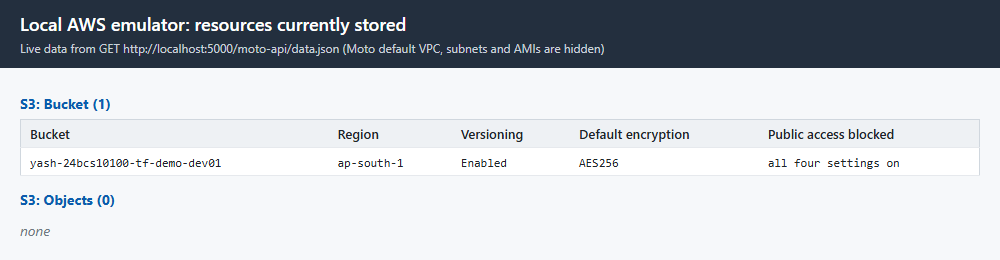

# Terraform S3 Demo

**Name:** Yash Gaikwad  |  **Roll No:** 24BCS10100

Creates one S3 bucket with Terraform and documents the complete workflow: `init`, `fmt`, `validate`, `plan`, `apply`, `show`, `output`, `destroy`. The session overview, the concepts table and the links to the Task 2 READMEs are in [../README.md](../README.md).

## Files

| File | Purpose |
|---|---|
| `provider.tf` | Terraform version, AWS provider (`hashicorp/aws`), default tags, emulator switches |
| `variables.tf` | Input variables (region, bucket name parts, environment, versioning, emulator switches) |
| `main.tf` | The bucket, versioning, default encryption and public access block |
| `outputs.tf` | Bucket name, ARN, region and versioning status |
| `terraform.tfvars` | Values for the variables |
| `emulator.tfvars` | Extra values that point the provider at a local Moto emulator |
| `.terraform.lock.hcl` | Provider version lock (created by `terraform init`) |
| `.gitignore` | Keeps `.terraform/`, state files and saved plans out of git |

## Resources created

| Resource | Purpose |
|---|---|
| `aws_s3_bucket.demo` | The bucket `yash-24bcs10100-tf-demo-<suffix>` with tags |
| `aws_s3_bucket_versioning.demo` | Keeps every version of every object |
| `aws_s3_bucket_server_side_encryption_configuration.demo` | Default AES-256 encryption |
| `aws_s3_bucket_public_access_block.demo` | Blocks all public access |

## How the commands were run

`apply` and `destroy` were executed against a **local Moto emulator** (`http://localhost:5000`) with dummy credentials, never against real AWS; see "Read this first" in [../README.md](../README.md) for the full explanation and the safety set-up. Use `-var-file=emulator.tfvars` for that. On real AWS leave it out: the same code then talks to AWS because `use_emulator` defaults to `false`. A real-AWS runbook (not executed) is at the end.

## Full transcript

All commands are run inside this folder.

### Step 0: Safety set-up (nothing here can reach real AWS)

This machine also has real AWS credentials in `~/.aws`. They must never be used for a practice run, so **every command below runs in a shell with the environment shown next**:

- `AWS_ACCESS_KEY_ID=test` and `AWS_SECRET_ACCESS_KEY=test` are dummy values. The emulator accepts anything.
- `AWS_SHARED_CREDENTIALS_FILE` and `AWS_CONFIG_FILE` point at files that do not exist, so the real profile can never be read. `AWS_EC2_METADATA_DISABLED=true` stops the SDK asking the instance metadata service for credentials.
- `HTTPS_PROXY` / `HTTP_PROXY` point at port 9, where nothing listens. Only `localhost`, `registry.terraform.io` and `releases.hashicorp.com` (needed by `terraform init` to download the provider) are listed in `NO_PROXY`. Any attempt to call a real AWS endpoint, for example `s3.ap-south-1.amazonaws.com`, is refused immediately. This is a second safety net on top of the provider settings.
- `TF_CLI_ARGS_<command>=-no-color` makes Terraform print plain text. It colours its output even when piped, which would put escape codes into this Markdown.

_The environment used for every command in this document._

```console
$ env | grep -E "^(AWS_|TF_|HTTPS?_PROXY|NO_PROXY|CHECKPOINT)" | sort
AWS_ACCESS_KEY_ID=test
AWS_CONFIG_FILE=C:/nonexistent-aws-dir/config
AWS_DEFAULT_REGION=us-east-1
AWS_EC2_METADATA_DISABLED=true
AWS_SECRET_ACCESS_KEY=test
AWS_SHARED_CREDENTIALS_FILE=C:/nonexistent-aws-dir/credentials
CHECKPOINT_DISABLE=1
HTTPS_PROXY=http://127.0.0.1:9
HTTP_PROXY=http://127.0.0.1:9
NO_PROXY=localhost,127.0.0.1,registry.terraform.io,releases.hashicorp.com
TF_CLI_ARGS_apply=-no-color
TF_CLI_ARGS_console=-no-color
TF_CLI_ARGS_destroy=-no-color
TF_CLI_ARGS_fmt=-no-color
TF_CLI_ARGS_init=-no-color
TF_CLI_ARGS_output=-no-color
TF_CLI_ARGS_plan=-no-color
TF_CLI_ARGS_show=-no-color
TF_CLI_ARGS_state_show=-no-color
TF_CLI_ARGS_validate=-no-color
```

_The credentials file the AWS SDK is told to read does not exist._

```console
$ ls -l "$AWS_SHARED_CREDENTIALS_FILE"
ls: cannot access 'C:/nonexistent-aws-dir/credentials': No such file or directory
```

The AWS API is served by a local emulator, **Moto** (`motoserver/moto`), running in Docker and published only on `127.0.0.1:5000`. Terraform is pointed at it by `emulator.tfvars` (shown in the next step).

_The emulator container: port 5000 is bound to 127.0.0.1 only._

```console
$ docker ps --filter name=tf-moto --format 'table {{.Names}}\t{{.Image}}\t{{.Ports}}\t{{.Status}}'
NAMES     IMAGE                    PORTS                      STATUS
tf-moto   motoserver/moto:latest   127.0.0.1:5000->5000/tcp   Up 43 seconds
```

_The emulator starts empty: no buckets exist yet (the aws CLI is pointed at the emulator with --endpoint-url)._

```console
$ aws --endpoint-url http://localhost:5000 --region ap-south-1 s3api list-buckets
{
    "Buckets": [],
    "Owner": {
        "DisplayName": "webfile",
        "ID": "bcaf1ffd86f41161ca5fb16fd081034f"
    },
    "Prefix": null
}
```

### Step 1: The project files

_provider.tf: the Terraform and provider settings. The `endpoints` block and the `skip_*` switches are only active when `use_emulator` or `offline_mode` is true; on real AWS they are all false._

```console
$ cat provider.tf
terraform {
  required_version = ">= 1.6.0"

  required_providers {
    aws = {
      source = "hashicorp/aws"

      # Kept on 6.22.x because 6.23 and newer read bucket tags through the S3 Control API,
      # which the Moto emulator used in README.md does not implement. Real AWS works with
      # any 6.x release, so widen this to "~> 6.0" when you deploy for real.
      version = "~> 6.22.0"
    }
  }
}

provider "aws" {
  region = var.aws_region

  # Credentials are never written here. On real AWS the provider reads them from the
  # environment (AWS_ACCESS_KEY_ID / AWS_SECRET_ACCESS_KEY) or from `aws configure`.

  default_tags {
    tags = {
      Project   = "terraform-s3-demo"
      ManagedBy = "Terraform"
      Owner     = "Yash Gaikwad 24BCS10100"
    }
  }

  # ---- Local emulator / offline switches --------------------------------------------
  # All of these stay false on real AWS. They are only turned on by emulator.tfvars
  # (apply against a local Moto server) or by -var offline_mode=true (plan with no network).
  s3_use_path_style           = var.use_emulator
  skip_credentials_validation = var.use_emulator || var.offline_mode
  skip_metadata_api_check     = var.use_emulator || var.offline_mode
  skip_requesting_account_id  = var.use_emulator || var.offline_mode

  dynamic "endpoints" {
    for_each = var.use_emulator ? [1] : []

    content {
      s3  = var.emulator_endpoint
      ec2 = var.emulator_endpoint
      sts = var.emulator_endpoint
      iam = var.emulator_endpoint
    }
  }
}
```

_variables.tf: every input with a type and description. `bucket_suffix` also has a `validation` rule._

```console
$ cat variables.tf
variable "aws_region" {
  description = "AWS region where the bucket is created."
  type        = string
  default     = "ap-south-1"
}

variable "bucket_prefix" {
  description = "Fixed part of the bucket name. S3 names are global, so it carries my roll number."
  type        = string
  default     = "yash-24bcs10100-tf-demo"
}

variable "bucket_suffix" {
  description = "Variable part of the bucket name. Change it if the name is already taken."
  type        = string
  default     = "dev01"

  validation {
    condition     = can(regex("^[a-z0-9][a-z0-9-]{0,20}$", var.bucket_suffix))
    error_message = "bucket_suffix must be 1 to 21 characters: lowercase letters, digits and hyphens, starting with a letter or digit."
  }
}

variable "environment" {
  description = "Environment tag written on the bucket."
  type        = string
  default     = "dev"
}

variable "enable_versioning" {
  description = "Keep old versions of every object (Enabled) or stop doing so (Suspended)."
  type        = bool
  default     = true
}

variable "force_destroy" {
  description = "Allow terraform destroy to delete a bucket that still holds objects. Fine for a demo, dangerous for real data."
  type        = bool
  default     = true
}

# ---- Local emulator / offline switches (see provider.tf) ----------------------------

variable "use_emulator" {
  description = "Send every API call to emulator_endpoint (a local Moto server) instead of AWS."
  type        = bool
  default     = false
}

variable "emulator_endpoint" {
  description = "URL of the local AWS emulator. Only used when use_emulator is true."
  type        = string
  default     = "http://localhost:5000"
}

variable "offline_mode" {
  description = "Skip every provider call that needs the network, so terraform plan works with dummy credentials. Real AWS is still the target."
  type        = bool
  default     = false
}
```

_main.tf: the bucket and its three companion resources (versioning, encryption, public access block)._

```console
$ cat main.tf
locals {
  bucket_name = "${var.bucket_prefix}-${var.bucket_suffix}"
}

# The bucket itself.
resource "aws_s3_bucket" "demo" {
  bucket        = local.bucket_name
  force_destroy = var.force_destroy

  tags = {
    Name        = local.bucket_name
    Environment = var.environment
  }
}

# Versioning keeps every overwritten or deleted object recoverable.
resource "aws_s3_bucket_versioning" "demo" {
  bucket = aws_s3_bucket.demo.id

  versioning_configuration {
    status = var.enable_versioning ? "Enabled" : "Suspended"
  }
}

# Default encryption at rest (SSE-S3, AES-256). No extra cost, no key to manage.
resource "aws_s3_bucket_server_side_encryption_configuration" "demo" {
  bucket = aws_s3_bucket.demo.id

  rule {
    apply_server_side_encryption_by_default {
      sse_algorithm = "AES256"
    }
  }
}

# Block every way of making the bucket public.
resource "aws_s3_bucket_public_access_block" "demo" {
  bucket = aws_s3_bucket.demo.id

  block_public_acls       = true
  block_public_policy     = true
  ignore_public_acls      = true
  restrict_public_buckets = true
}
```

_outputs.tf: values printed after `apply` and readable with `terraform output`._

```console
$ cat outputs.tf
output "bucket_name" {
  description = "Name of the S3 bucket."
  value       = aws_s3_bucket.demo.bucket
}

output "bucket_arn" {
  description = "ARN of the S3 bucket."
  value       = aws_s3_bucket.demo.arn
}

output "bucket_region" {
  description = "Region the bucket lives in."
  value       = aws_s3_bucket.demo.region
}

output "versioning_status" {
  description = "Versioning state of the bucket."
  value       = aws_s3_bucket_versioning.demo.versioning_configuration[0].status
}
```

_terraform.tfvars: values for the variables. Terraform loads this file automatically._

```console
$ cat terraform.tfvars
aws_region    = "ap-south-1"
bucket_suffix = "dev01"
environment   = "dev"
```

_emulator.tfvars: loaded only with `-var-file=emulator.tfvars`. It sends every API call to the local emulator._

```console
$ cat emulator.tfvars
# Used for the runs in README.md: every API call goes to a local Moto server, not to AWS.
#   terraform apply -var-file=emulator.tfvars
# Leave this file out (use_emulator defaults to false) to talk to real AWS.
use_emulator      = true
emulator_endpoint = "http://localhost:5000"
```

### Step 2: `terraform init`

`init` downloads the provider plugin named in `required_providers` and writes `.terraform.lock.hcl`, which records the exact provider version and its checksums.

_Terraform CLI version._

```console
$ terraform version
Terraform v1.16.6
on windows_amd64
```

_Initialise the working directory._

```console
$ terraform init
Initializing the backend...

Initializing provider plugins...
- Finding hashicorp/aws versions matching "~> 6.22.0"...
- Installing hashicorp/aws v6.22.1...
- Installed hashicorp/aws v6.22.1 (signed by HashiCorp)

Terraform has created a lock file .terraform.lock.hcl to record the provider
selections it made above. Include this file in your version control repository
so that Terraform can guarantee to make the same selections by default when
you run "terraform init" in the future.

Terraform has been successfully initialized!

You may now begin working with Terraform. Try running "terraform plan" to see
any changes that are required for your infrastructure. All Terraform commands
should now work.

If you ever set or change modules or backend configuration for Terraform,
rerun this command to reinitialize your working directory. If you forget, other
commands will detect it and remind you to do so if necessary.
```

_The lock file (first lines only: the rest is a long list of checksums). It pins the provider that was selected._

```console
$ head -n 12 .terraform.lock.hcl
# This file is maintained automatically by "terraform init".
# Manual edits may be lost in future updates.

provider "registry.terraform.io/hashicorp/aws" {
  version     = "6.22.1"
  constraints = "~> 6.22.0"
  hashes = [
    "h1:bpsgp8Spq8A5Y0NCHzsYXs+VpUEV3Ak34VPZELquUjU=",
    "zh:3995ca97e6c2c1ed9e231c453287585d3dc1ca2a304683ac0b269b3448fda7c0",
    "zh:4f69f70d2edeb0dde9c693b7cd7e8e21c781b2fac7062bed5300092dbadb71e1",
    "zh:5c76042fdf3df56a1f581bc477e5d6fc3e099d4d6544fe725b3747e9990726bd",
    "zh:6ff8221340955f4b3ba9230918bb026c4414a5aebe9d0967845c43e8e8908aec",
```

### Step 3: `terraform fmt`

`fmt` rewrites `.tf` files into the standard style. `-check` only reports, `-diff` shows what would change. To show a real diff I first make a deliberately messy file in a scratch folder (`fmt-demo/`, deleted afterwards).

_A badly formatted file._

```console
$ cat fmt-demo/messy.tf
resource "aws_s3_bucket" "messy" {
bucket="messy-example-bucket"
    force_destroy   = true
  tags = { Name="messy",
 Environment = "dev" }
}
```

_The diff `fmt` would apply. Exit code 3 means "files need formatting"._

```console
$ terraform fmt -check -diff fmt-demo; echo "exit code: $?"
fmt-demo\messy.tf
--- old/fmt-demo\messy.tf
+++ new/fmt-demo\messy.tf
@@ -1,6 +1,6 @@
 resource "aws_s3_bucket" "messy" {
-bucket="messy-example-bucket"
-    force_destroy   = true
-  tags = { Name="messy",
- Environment = "dev" }
+  bucket        = "messy-example-bucket"
+  force_destroy = true
+  tags = { Name = "messy",
+  Environment = "dev" }
 }
exit code: 3
```

_Without -check, fmt rewrites the file and prints its name._

```console
$ terraform fmt fmt-demo
fmt-demo\messy.tf
```

_The same file after formatting._

```console
$ cat fmt-demo/messy.tf
resource "aws_s3_bucket" "messy" {
  bucket        = "messy-example-bucket"
  force_destroy = true
  tags = { Name = "messy",
  Environment = "dev" }
}
```

_The real project: no output and exit code 0 means every file is already formatted._

```console
$ terraform fmt -check -diff; echo "exit code: $?"
exit code: 0
```

### Step 4: `terraform validate`

`validate` checks the syntax and the internal consistency of the configuration (types, references, required arguments). It does not call AWS.

_The configuration is valid._

```console
$ terraform validate
Success! The configuration is valid.
```

_A custom validation rule in action: an invalid bucket suffix is rejected before any API call is made._

```console
$ terraform plan -var-file=emulator.tfvars -var bucket_suffix=Bad_Name

Planning failed. Terraform encountered an error while generating this plan.


Error: Invalid value for variable

  on variables.tf line 13:
  13: variable "bucket_suffix" {
    ├────────────────
    │ var.bucket_suffix is "Bad_Name"

bucket_suffix must be 1 to 21 characters: lowercase letters, digits and
hyphens, starting with a letter or digit.

This was checked by the validation rule at variables.tf:18,3-13.
```

### Step 5: `terraform plan`

`plan` compares the configuration with the state and with the real infrastructure and prints what it would do. `-out` saves the plan so that `apply` runs exactly what was reviewed. Note `-var-file=emulator.tfvars`: **without it the same command would target real AWS.**

_The plan: 4 resources to create. Attributes marked "(known after apply)" are decided by AWS._

```console
$ terraform plan -var-file=emulator.tfvars -out=demo.tfplan

Terraform used the selected providers to generate the following execution
plan. Resource actions are indicated with the following symbols:
  + create

Terraform will perform the following actions:

  # aws_s3_bucket.demo will be created
  + resource "aws_s3_bucket" "demo" {
      + acceleration_status         = (known after apply)
      + acl                         = (known after apply)
      + arn                         = (known after apply)
      + bucket                      = "yash-24bcs10100-tf-demo-dev01"
      + bucket_domain_name          = (known after apply)
      + bucket_prefix               = (known after apply)
      + bucket_region               = (known after apply)
      + bucket_regional_domain_name = (known after apply)
      + force_destroy               = true
      + hosted_zone_id              = (known after apply)
      + id                          = (known after apply)
      + object_lock_enabled         = (known after apply)
      + policy                      = (known after apply)
      + region                      = "ap-south-1"
      + request_payer               = (known after apply)
      + tags                        = {
          + "Environment" = "dev"
          + "Name"        = "yash-24bcs10100-tf-demo-dev01"
        }
      + tags_all                    = {
          + "Environment" = "dev"
          + "ManagedBy"   = "Terraform"
          + "Name"        = "yash-24bcs10100-tf-demo-dev01"
          + "Owner"       = "Yash Gaikwad 24BCS10100"
          + "Project"     = "terraform-s3-demo"
        }
      + website_domain              = (known after apply)
      + website_endpoint            = (known after apply)

      + cors_rule (known after apply)

      + grant (known after apply)

      + lifecycle_rule (known after apply)

      + logging (known after apply)

      + object_lock_configuration (known after apply)

      + replication_configuration (known after apply)

      + server_side_encryption_configuration (known after apply)

      + versioning (known after apply)

      + website (known after apply)
    }

  # aws_s3_bucket_public_access_block.demo will be created
  + resource "aws_s3_bucket_public_access_block" "demo" {
      + block_public_acls       = true
      + block_public_policy     = true
      + bucket                  = (known after apply)
      + id                      = (known after apply)
      + ignore_public_acls      = true
      + region                  = "ap-south-1"
      + restrict_public_buckets = true
    }

  # aws_s3_bucket_server_side_encryption_configuration.demo will be created
  + resource "aws_s3_bucket_server_side_encryption_configuration" "demo" {
      + bucket = (known after apply)
      + id     = (known after apply)
      + region = "ap-south-1"

      + rule {
          + blocked_encryption_types = []

          + apply_server_side_encryption_by_default {
              + sse_algorithm     = "AES256"
                # (1 unchanged attribute hidden)
            }
        }
    }

  # aws_s3_bucket_versioning.demo will be created
  + resource "aws_s3_bucket_versioning" "demo" {
      + bucket = (known after apply)
      + id     = (known after apply)
      + region = "ap-south-1"

      + versioning_configuration {
          + mfa_delete = (known after apply)
          + status     = "Enabled"
        }
    }

Plan: 4 to add, 0 to change, 0 to destroy.

Changes to Outputs:
  + bucket_arn        = (known after apply)
  + bucket_name       = "yash-24bcs10100-tf-demo-dev01"
  + bucket_region     = "ap-south-1"
  + versioning_status = "Enabled"

─────────────────────────────────────────────────────────────────────────────

Saved the plan to: demo.tfplan

To perform exactly these actions, run the following command to apply:
    terraform apply "demo.tfplan"
```

### Step 6: `terraform apply`

_Apply the saved plan. Terraform creates the bucket first, then the three resources that reference it in parallel._

```console
$ terraform apply demo.tfplan
aws_s3_bucket.demo: Creating...
aws_s3_bucket.demo: Creation complete after 0s [id=yash-24bcs10100-tf-demo-dev01]
aws_s3_bucket_public_access_block.demo: Creating...
aws_s3_bucket_versioning.demo: Creating...
aws_s3_bucket_server_side_encryption_configuration.demo: Creating...
aws_s3_bucket_public_access_block.demo: Creation complete after 0s [id=yash-24bcs10100-tf-demo-dev01]
aws_s3_bucket_server_side_encryption_configuration.demo: Creation complete after 0s [id=yash-24bcs10100-tf-demo-dev01]
aws_s3_bucket_versioning.demo: Creation complete after 1s [id=yash-24bcs10100-tf-demo-dev01]

Apply complete! Resources: 4 added, 0 changed, 0 destroyed.

Outputs:

bucket_arn = "arn:aws:s3:::yash-24bcs10100-tf-demo-dev01"
bucket_name = "yash-24bcs10100-tf-demo-dev01"
bucket_region = "ap-south-1"
versioning_status = "Enabled"
```

### Step 7: `terraform show`, `terraform output` and the state

_show prints the whole state in readable form. One oddity worth knowing: the old inline `versioning { enabled = false }` block inside the bucket was read before the separate versioning resource ran, so it is stale; the `aws_s3_bucket_versioning` resource further down holds the truth (`Enabled`), as the emulator check in Step 8 confirms._

```console
$ terraform show
# aws_s3_bucket.demo:
resource "aws_s3_bucket" "demo" {
    acceleration_status         = null
    arn                         = "arn:aws:s3:::yash-24bcs10100-tf-demo-dev01"
    bucket                      = "yash-24bcs10100-tf-demo-dev01"
    bucket_domain_name          = "yash-24bcs10100-tf-demo-dev01.s3.amazonaws.com"
    bucket_prefix               = null
    bucket_region               = "ap-south-1"
    bucket_regional_domain_name = "yash-24bcs10100-tf-demo-dev01.s3.ap-south-1.amazonaws.com"
    force_destroy               = true
    hosted_zone_id              = "Z11RGJOFQNVJUP"
    id                          = "yash-24bcs10100-tf-demo-dev01"
    object_lock_enabled         = false
    policy                      = null
    region                      = "ap-south-1"
    request_payer               = null
    tags                        = {
        "Environment" = "dev"
        "Name"        = "yash-24bcs10100-tf-demo-dev01"
    }
    tags_all                    = {
        "Environment" = "dev"
        "ManagedBy"   = "Terraform"
        "Name"        = "yash-24bcs10100-tf-demo-dev01"
        "Owner"       = "Yash Gaikwad 24BCS10100"
        "Project"     = "terraform-s3-demo"
    }

    grant {
        id          = "75aa57f09aa0c8caeab4f8c24e99d10f8e7faeebf76c078efc7c6caea54ba06a"
        permissions = [
            "FULL_CONTROL",
        ]
        type        = "CanonicalUser"
        uri         = null
    }

    versioning {
        enabled    = false
        mfa_delete = false
    }
}

# aws_s3_bucket_public_access_block.demo:
resource "aws_s3_bucket_public_access_block" "demo" {
    block_public_acls       = true
    block_public_policy     = true
    bucket                  = "yash-24bcs10100-tf-demo-dev01"
    id                      = "yash-24bcs10100-tf-demo-dev01"
    ignore_public_acls      = true
    region                  = "ap-south-1"
    restrict_public_buckets = true
}

# aws_s3_bucket_server_side_encryption_configuration.demo:
resource "aws_s3_bucket_server_side_encryption_configuration" "demo" {
    bucket                = "yash-24bcs10100-tf-demo-dev01"
    expected_bucket_owner = null
    id                    = "yash-24bcs10100-tf-demo-dev01"
    region                = "ap-south-1"

    rule {
        blocked_encryption_types = []

        apply_server_side_encryption_by_default {
            kms_master_key_id = null
            sse_algorithm     = "AES256"
        }
    }
}

# aws_s3_bucket_versioning.demo:
resource "aws_s3_bucket_versioning" "demo" {
    bucket                = "yash-24bcs10100-tf-demo-dev01"
    expected_bucket_owner = null
    id                    = "yash-24bcs10100-tf-demo-dev01"
    region                = "ap-south-1"

    versioning_configuration {
        mfa_delete = null
        status     = "Enabled"
    }
}


Outputs:

bucket_arn = "arn:aws:s3:::yash-24bcs10100-tf-demo-dev01"
bucket_name = "yash-24bcs10100-tf-demo-dev01"
bucket_region = "ap-south-1"
versioning_status = "Enabled"
```

_All outputs._

```console
$ terraform output
bucket_arn = "arn:aws:s3:::yash-24bcs10100-tf-demo-dev01"
bucket_name = "yash-24bcs10100-tf-demo-dev01"
bucket_region = "ap-south-1"
versioning_status = "Enabled"
```

_One output, quoted._

```console
$ terraform output bucket_name
"yash-24bcs10100-tf-demo-dev01"
```

_One output without quotes (useful in scripts)._

```console
$ terraform output -raw bucket_arn; echo
arn:aws:s3:::yash-24bcs10100-tf-demo-dev01
```

_All outputs as JSON._

```console
$ terraform output -json
{
  "bucket_arn": {
    "sensitive": false,
    "type": "string",
    "value": "arn:aws:s3:::yash-24bcs10100-tf-demo-dev01"
  },
  "bucket_name": {
    "sensitive": false,
    "type": "string",
    "value": "yash-24bcs10100-tf-demo-dev01"
  },
  "bucket_region": {
    "sensitive": false,
    "type": "string",
    "value": "ap-south-1"
  },
  "versioning_status": {
    "sensitive": false,
    "type": "string",
    "value": "Enabled"
  }
}
```

_The resources Terraform manages (their addresses)._

```console
$ terraform state list
aws_s3_bucket.demo
aws_s3_bucket_public_access_block.demo
aws_s3_bucket_server_side_encryption_configuration.demo
aws_s3_bucket_versioning.demo
```

_The recorded attributes of one resource._

```console
$ terraform state show aws_s3_bucket_versioning.demo
# aws_s3_bucket_versioning.demo:
resource "aws_s3_bucket_versioning" "demo" {
    bucket                = "yash-24bcs10100-tf-demo-dev01"
    expected_bucket_owner = null
    id                    = "yash-24bcs10100-tf-demo-dev01"
    region                = "ap-south-1"

    versioning_configuration {
        mfa_delete = null
        status     = "Enabled"
    }
}
```

_The state file is plain JSON. Treat it as sensitive: it can contain secrets and it is why it is listed in .gitignore._

```console
$ ls -l terraform.tfstate; head -n 12 terraform.tfstate
-rw-r--r-- 1 gaikw 197609 6718 Oct 18 20:30 terraform.tfstate
{
  "version": 4,
  "terraform_version": "1.16.6",
  "serial": 5,
  "lineage": "61d2beca-c72a-a606-48db-bb72ca7124a6",
  "outputs": {
    "bucket_arn": {
      "value": "arn:aws:s3:::yash-24bcs10100-tf-demo-dev01",
      "type": "string"
    },
    "bucket_name": {
      "value": "yash-24bcs10100-tf-demo-dev01",
```

### Step 8: Check the result in the emulator

The `aws` CLI is pointed at the same emulator, so these calls show what Terraform really created, independently of Terraform's own state.

_The bucket exists._

```console
$ aws --endpoint-url http://localhost:5000 --region ap-south-1 s3 ls
2026-10-18 20:30:47 yash-24bcs10100-tf-demo-dev01
```

_Versioning is enabled._

```console
$ aws --endpoint-url http://localhost:5000 --region ap-south-1 s3api get-bucket-versioning --bucket $(terraform output -raw bucket_name)
{
    "Status": "Enabled"
}
```

_Default encryption is AES-256._

```console
$ aws --endpoint-url http://localhost:5000 --region ap-south-1 s3api get-bucket-encryption --bucket $(terraform output -raw bucket_name)
{
    "ServerSideEncryptionConfiguration": {
        "Rules": [
            {
                "ApplyServerSideEncryptionByDefault": {
                    "SSEAlgorithm": "AES256"
                },
                "BucketKeyEnabled": false
            }
        ]
    }
}
```

_All four public-access settings are on._

```console
$ aws --endpoint-url http://localhost:5000 --region ap-south-1 s3api get-public-access-block --bucket $(terraform output -raw bucket_name)
{
    "PublicAccessBlockConfiguration": {
        "BlockPublicAcls": true,
        "IgnorePublicAcls": true,
        "BlockPublicPolicy": true,
        "RestrictPublicBuckets": true
    }
}
```

_The five tags: Name and Environment come from main.tf, Project, ManagedBy and Owner come from default_tags in provider.tf._

```console
$ aws --endpoint-url http://localhost:5000 --region ap-south-1 s3api get-bucket-tagging --bucket $(terraform output -raw bucket_name)
{
    "TagSet": [
        {
            "Key": "Owner",
            "Value": "Yash Gaikwad 24BCS10100"
        },
        {
            "Key": "Project",
            "Value": "terraform-s3-demo"
        },
        {
            "Key": "Name",
            "Value": "yash-24bcs10100-tf-demo-dev01"
        },
        {
            "Key": "Environment",
            "Value": "dev"
        },
        {
            "Key": "ManagedBy",
            "Value": "Terraform"
        }
    ]
}
```

_Browser view of the emulator's stored data (headless Edge). The page is a small viewer I wrote that reads `http://localhost:5000/moto-api/data.json`, the emulator's own dump of everything it holds._




_The emulator's own request log (first lines): the S3 calls that `terraform apply` made. They arrived here and nowhere else._

```console
$ docker logs tf-moto 2>&1 | sed -r "s/\x1b\[[0-9;]*m//g" | grep -v moto-api | head -n 12
WARNING: This is a development server. Do not use it in a production deployment. Use a production WSGI server instead.
 * Running on all addresses (0.0.0.0)
 * Running on http://127.0.0.1:5000
 * Running on http://172.17.0.2:5000
Press CTRL+C to quit
172.17.0.1 - - [18/Oct/2026 14:59:29] "GET / HTTP/1.1" 200 -
172.17.0.1 - - [18/Oct/2026 15:00:47] "PUT /yash-24bcs10100-tf-demo-dev01 HTTP/1.1" 200 -
172.17.0.1 - - [18/Oct/2026 15:00:47] "HEAD /yash-24bcs10100-tf-demo-dev01 HTTP/1.1" 200 -
172.17.0.1 - - [18/Oct/2026 15:00:47] "GET /yash-24bcs10100-tf-demo-dev01?tagging= HTTP/1.1" 404 -
172.17.0.1 - - [18/Oct/2026 15:00:47] "PUT /yash-24bcs10100-tf-demo-dev01?tagging= HTTP/1.1" 204 -
172.17.0.1 - - [18/Oct/2026 15:00:47] "HEAD /yash-24bcs10100-tf-demo-dev01 HTTP/1.1" 200 -
172.17.0.1 - - [18/Oct/2026 15:00:47] "GET /yash-24bcs10100-tf-demo-dev01?policy= HTTP/1.1" 404 -
```

_How many HTTP requests the emulator has served so far._

```console
$ docker logs tf-moto 2>&1 | grep -c "HTTP/1.1"
64
```

### Step 9: Idempotency: run `plan` again

Terraform is declarative: if the real world already matches the code, nothing happens.

_"No changes". With -detailed-exitcode the exit code is 0 (no changes), 2 (changes) or 1 (error)._

```console
$ terraform plan -var-file=emulator.tfvars -detailed-exitcode; echo "exit code: $?"
aws_s3_bucket.demo: Refreshing state... [id=yash-24bcs10100-tf-demo-dev01]
aws_s3_bucket_public_access_block.demo: Refreshing state... [id=yash-24bcs10100-tf-demo-dev01]
aws_s3_bucket_versioning.demo: Refreshing state... [id=yash-24bcs10100-tf-demo-dev01]
aws_s3_bucket_server_side_encryption_configuration.demo: Refreshing state... [id=yash-24bcs10100-tf-demo-dev01]

No changes. Your infrastructure matches the configuration.

Terraform has compared your real infrastructure against your configuration
and found no differences, so no changes are needed.
exit code: 0
```

_Network proof: that plan ran with provider debug logging. Every AWS API request it made went to host localhost, port 5000._

```console
$ TF_LOG=DEBUG TF_LOG_PATH=tf-debug.log terraform plan -var-file=emulator.tfvars >/dev/null; grep -oE "net.peer.(name|port)=[^ ]+" tf-debug.log | sort | uniq -c; rm tf-debug.log
     20 net.peer.name=localhost
     20 net.peer.port=5000
```

### Step 10: Change a variable

Changing an input changes the desired state. These two plans are **not applied**.

_Changing the Environment tag is an in-place update (~): the bucket is kept._

```console
$ terraform plan -var-file=emulator.tfvars -var environment=staging
aws_s3_bucket.demo: Refreshing state... [id=yash-24bcs10100-tf-demo-dev01]
aws_s3_bucket_public_access_block.demo: Refreshing state... [id=yash-24bcs10100-tf-demo-dev01]
aws_s3_bucket_server_side_encryption_configuration.demo: Refreshing state... [id=yash-24bcs10100-tf-demo-dev01]
aws_s3_bucket_versioning.demo: Refreshing state... [id=yash-24bcs10100-tf-demo-dev01]

Terraform used the selected providers to generate the following execution
plan. Resource actions are indicated with the following symbols:
  ~ update in-place

Terraform will perform the following actions:

  # aws_s3_bucket.demo will be updated in-place
  ~ resource "aws_s3_bucket" "demo" {
        id                          = "yash-24bcs10100-tf-demo-dev01"
      ~ tags                        = {
          ~ "Environment" = "dev" -> "staging"
            "Name"        = "yash-24bcs10100-tf-demo-dev01"
        }
      ~ tags_all                    = {
          ~ "Environment" = "dev" -> "staging"
            # (4 unchanged elements hidden)
        }
        # (13 unchanged attributes hidden)

        # (3 unchanged blocks hidden)
    }

Plan: 0 to add, 1 to change, 0 to destroy.

─────────────────────────────────────────────────────────────────────────────

Note: You didn't use the -out option to save this plan, so Terraform can't
guarantee to take exactly these actions if you run "terraform apply" now.
```

_Changing the bucket name cannot be done in place: every resource is replaced (-/+). Only the resource lines, the attribute that forces replacement and the summary are shown._

```console
$ terraform plan -var-file=emulator.tfvars -var bucket_suffix=dev02 | grep -E '^  # |forces replacement|^Plan:'
  # aws_s3_bucket.demo must be replaced
      ~ bucket                      = "yash-24bcs10100-tf-demo-dev01" -> "yash-24bcs10100-tf-demo-dev02" # forces replacement
  # aws_s3_bucket_public_access_block.demo must be replaced
      ~ bucket                  = "yash-24bcs10100-tf-demo-dev01" -> (known after apply) # forces replacement
  # aws_s3_bucket_server_side_encryption_configuration.demo must be replaced
      ~ bucket                = "yash-24bcs10100-tf-demo-dev01" -> (known after apply) # forces replacement
  # aws_s3_bucket_versioning.demo must be replaced
      ~ bucket                = "yash-24bcs10100-tf-demo-dev01" -> (known after apply) # forces replacement
Plan: 4 to add, 0 to change, 4 to destroy.
```

### Step 11: Drift: someone changes the infrastructure by hand

Drift is a difference between the real infrastructure and the state or code, usually caused by a manual change in the console. I simulate a console click by suspending versioning directly through the emulator's S3 API, bypassing Terraform.

_The manual change (no output means success)._

```console
$ aws --endpoint-url http://localhost:5000 --region ap-south-1 s3api put-bucket-versioning --bucket $(terraform output -raw bucket_name) --versioning-configuration Status=Suspended
```

_The emulator now says Suspended._

```console
$ aws --endpoint-url http://localhost:5000 --region ap-south-1 s3api get-bucket-versioning --bucket $(terraform output -raw bucket_name)
{
    "Status": "Suspended"
}
```

_plan refreshes the real state, notices the difference and proposes to put it back (Suspended -> Enabled)._

```console
$ terraform plan -var-file=emulator.tfvars
aws_s3_bucket.demo: Refreshing state... [id=yash-24bcs10100-tf-demo-dev01]
aws_s3_bucket_public_access_block.demo: Refreshing state... [id=yash-24bcs10100-tf-demo-dev01]
aws_s3_bucket_versioning.demo: Refreshing state... [id=yash-24bcs10100-tf-demo-dev01]
aws_s3_bucket_server_side_encryption_configuration.demo: Refreshing state... [id=yash-24bcs10100-tf-demo-dev01]

Terraform used the selected providers to generate the following execution
plan. Resource actions are indicated with the following symbols:
  ~ update in-place

Terraform will perform the following actions:

  # aws_s3_bucket_versioning.demo will be updated in-place
  ~ resource "aws_s3_bucket_versioning" "demo" {
        id                    = "yash-24bcs10100-tf-demo-dev01"
        # (3 unchanged attributes hidden)

      ~ versioning_configuration {
          ~ status     = "Suspended" -> "Enabled"
            # (1 unchanged attribute hidden)
        }
    }

Plan: 0 to add, 1 to change, 0 to destroy.

─────────────────────────────────────────────────────────────────────────────

Note: You didn't use the -out option to save this plan, so Terraform can't
guarantee to take exactly these actions if you run "terraform apply" now.
```

_apply repairs the drift. -auto-approve skips the "yes" question (fine for a demo, think twice on real infrastructure)._

```console
$ terraform apply -var-file=emulator.tfvars -auto-approve
aws_s3_bucket.demo: Refreshing state... [id=yash-24bcs10100-tf-demo-dev01]
aws_s3_bucket_versioning.demo: Refreshing state... [id=yash-24bcs10100-tf-demo-dev01]
aws_s3_bucket_public_access_block.demo: Refreshing state... [id=yash-24bcs10100-tf-demo-dev01]
aws_s3_bucket_server_side_encryption_configuration.demo: Refreshing state... [id=yash-24bcs10100-tf-demo-dev01]

Terraform used the selected providers to generate the following execution
plan. Resource actions are indicated with the following symbols:
  ~ update in-place

Terraform will perform the following actions:

  # aws_s3_bucket_versioning.demo will be updated in-place
  ~ resource "aws_s3_bucket_versioning" "demo" {
        id                    = "yash-24bcs10100-tf-demo-dev01"
        # (3 unchanged attributes hidden)

      ~ versioning_configuration {
          ~ status     = "Suspended" -> "Enabled"
            # (1 unchanged attribute hidden)
        }
    }

Plan: 0 to add, 1 to change, 0 to destroy.
aws_s3_bucket_versioning.demo: Modifying... [id=yash-24bcs10100-tf-demo-dev01]
aws_s3_bucket_versioning.demo: Modifications complete after 1s [id=yash-24bcs10100-tf-demo-dev01]

Apply complete! Resources: 0 added, 1 changed, 0 destroyed.

Outputs:

bucket_arn = "arn:aws:s3:::yash-24bcs10100-tf-demo-dev01"
bucket_name = "yash-24bcs10100-tf-demo-dev01"
bucket_region = "ap-south-1"
versioning_status = "Enabled"
```

_Clean again._

```console
$ terraform plan -var-file=emulator.tfvars -detailed-exitcode; echo "exit code: $?"
aws_s3_bucket.demo: Refreshing state... [id=yash-24bcs10100-tf-demo-dev01]
aws_s3_bucket_public_access_block.demo: Refreshing state... [id=yash-24bcs10100-tf-demo-dev01]
aws_s3_bucket_versioning.demo: Refreshing state... [id=yash-24bcs10100-tf-demo-dev01]
aws_s3_bucket_server_side_encryption_configuration.demo: Refreshing state... [id=yash-24bcs10100-tf-demo-dev01]

No changes. Your infrastructure matches the configuration.

Terraform has compared your real infrastructure against your configuration
and found no differences, so no changes are needed.
exit code: 0
```

### Step 12: `terraform destroy`

`destroy` deletes everything in the state, in reverse dependency order: the three companion resources first, the bucket last.

_Destroy all four resources._

```console
$ terraform destroy -var-file=emulator.tfvars -auto-approve
aws_s3_bucket.demo: Refreshing state... [id=yash-24bcs10100-tf-demo-dev01]
aws_s3_bucket_public_access_block.demo: Refreshing state... [id=yash-24bcs10100-tf-demo-dev01]
aws_s3_bucket_versioning.demo: Refreshing state... [id=yash-24bcs10100-tf-demo-dev01]
aws_s3_bucket_server_side_encryption_configuration.demo: Refreshing state... [id=yash-24bcs10100-tf-demo-dev01]

Terraform used the selected providers to generate the following execution
plan. Resource actions are indicated with the following symbols:
  - destroy

Terraform will perform the following actions:

  # aws_s3_bucket.demo will be destroyed
  - resource "aws_s3_bucket" "demo" {
      - arn                         = "arn:aws:s3:::yash-24bcs10100-tf-demo-dev01" -> null
      - bucket                      = "yash-24bcs10100-tf-demo-dev01" -> null
      - bucket_domain_name          = "yash-24bcs10100-tf-demo-dev01.s3.amazonaws.com" -> null
      - bucket_region               = "ap-south-1" -> null
      - bucket_regional_domain_name = "yash-24bcs10100-tf-demo-dev01.s3.ap-south-1.amazonaws.com" -> null
      - force_destroy               = true -> null
      - hosted_zone_id              = "Z11RGJOFQNVJUP" -> null
      - id                          = "yash-24bcs10100-tf-demo-dev01" -> null
      - object_lock_enabled         = false -> null
      - region                      = "ap-south-1" -> null
      - tags                        = {
          - "Environment" = "dev"
          - "Name"        = "yash-24bcs10100-tf-demo-dev01"
        } -> null
      - tags_all                    = {
          - "Environment" = "dev"
          - "ManagedBy"   = "Terraform"
          - "Name"        = "yash-24bcs10100-tf-demo-dev01"
          - "Owner"       = "Yash Gaikwad 24BCS10100"
          - "Project"     = "terraform-s3-demo"
        } -> null
        # (4 unchanged attributes hidden)

      - grant {
          - id          = "75aa57f09aa0c8caeab4f8c24e99d10f8e7faeebf76c078efc7c6caea54ba06a" -> null
          - permissions = [
              - "FULL_CONTROL",
            ] -> null
          - type        = "CanonicalUser" -> null
            # (1 unchanged attribute hidden)
        }

      - server_side_encryption_configuration {
          - rule {
              - bucket_key_enabled = false -> null

              - apply_server_side_encryption_by_default {
                  - sse_algorithm     = "AES256" -> null
                    # (1 unchanged attribute hidden)
                }
            }
        }

      - versioning {
          - enabled    = true -> null
          - mfa_delete = false -> null
        }
    }

  # aws_s3_bucket_public_access_block.demo will be destroyed
  - resource "aws_s3_bucket_public_access_block" "demo" {
      - block_public_acls       = true -> null
      - block_public_policy     = true -> null
      - bucket                  = "yash-24bcs10100-tf-demo-dev01" -> null
      - id                      = "yash-24bcs10100-tf-demo-dev01" -> null
      - ignore_public_acls      = true -> null
      - region                  = "ap-south-1" -> null
      - restrict_public_buckets = true -> null
    }

  # aws_s3_bucket_server_side_encryption_configuration.demo will be destroyed
  - resource "aws_s3_bucket_server_side_encryption_configuration" "demo" {
      - bucket                = "yash-24bcs10100-tf-demo-dev01" -> null
      - id                    = "yash-24bcs10100-tf-demo-dev01" -> null
      - region                = "ap-south-1" -> null
        # (1 unchanged attribute hidden)

      - rule {
          - blocked_encryption_types = [] -> null
          - bucket_key_enabled       = false -> null

          - apply_server_side_encryption_by_default {
              - sse_algorithm     = "AES256" -> null
                # (1 unchanged attribute hidden)
            }
        }
    }

  # aws_s3_bucket_versioning.demo will be destroyed
  - resource "aws_s3_bucket_versioning" "demo" {
      - bucket                = "yash-24bcs10100-tf-demo-dev01" -> null
      - id                    = "yash-24bcs10100-tf-demo-dev01" -> null
      - region                = "ap-south-1" -> null
        # (1 unchanged attribute hidden)

      - versioning_configuration {
          - status     = "Enabled" -> null
            # (1 unchanged attribute hidden)
        }
    }

Plan: 0 to add, 0 to change, 4 to destroy.

Changes to Outputs:
  - bucket_arn        = "arn:aws:s3:::yash-24bcs10100-tf-demo-dev01" -> null
  - bucket_name       = "yash-24bcs10100-tf-demo-dev01" -> null
  - bucket_region     = "ap-south-1" -> null
  - versioning_status = "Enabled" -> null
aws_s3_bucket_public_access_block.demo: Destroying... [id=yash-24bcs10100-tf-demo-dev01]
aws_s3_bucket_versioning.demo: Destroying... [id=yash-24bcs10100-tf-demo-dev01]
aws_s3_bucket_server_side_encryption_configuration.demo: Destroying... [id=yash-24bcs10100-tf-demo-dev01]
aws_s3_bucket_server_side_encryption_configuration.demo: Destruction complete after 0s
aws_s3_bucket_versioning.demo: Destruction complete after 0s
aws_s3_bucket_public_access_block.demo: Destruction complete after 0s
aws_s3_bucket.demo: Destroying... [id=yash-24bcs10100-tf-demo-dev01]
aws_s3_bucket.demo: Destruction complete after 0s

Destroy complete! Resources: 4 destroyed.
```

_The state is empty._

```console
$ terraform state list; echo "resources left in state: $(terraform state list | wc -l)"
resources left in state: 0
```

_The emulator holds no buckets any more._

```console
$ aws --endpoint-url http://localhost:5000 --region ap-south-1 s3api list-buckets
{
    "Buckets": [],
    "Owner": {
        "DisplayName": "webfile",
        "ID": "bcaf1ffd86f41161ca5fb16fd081034f"
    },
    "Prefix": null
}
```

_The DELETE requests that destroy sent to the emulator._

```console
$ docker logs tf-moto 2>&1 | sed -r "s/\x1b\[[0-9;]*m//g" | grep -E "\"DELETE "
172.17.0.1 - - [18/Oct/2026 15:03:22] "DELETE /yash-24bcs10100-tf-demo-dev01?encryption= HTTP/1.1" 204 -
172.17.0.1 - - [18/Oct/2026 15:03:22] "DELETE /yash-24bcs10100-tf-demo-dev01?publicAccessBlock= HTTP/1.1" 204 -
172.17.0.1 - - [18/Oct/2026 15:03:22] "DELETE /yash-24bcs10100-tf-demo-dev01 HTTP/1.1" 204 -
```

### Step 13: What the real AWS provider would plan (offline)

All the runs above used the emulator. To see the plan for **real AWS** without any network or credentials, I run `plan` with `use_emulator` left at its default `false` and `offline_mode=true`, which only switches on the provider's `skip_credentials_validation`, `skip_metadata_api_check` and `skip_requesting_account_id`. There is no `-var-file=emulator.tfvars`, so there is no custom endpoint: the provider is configured exactly as it would be for real AWS. The dead proxy from Step 0 is still active as a safety net, and the state is empty, so the provider has nothing to refresh.

_The plan for real AWS (ap-south-1). It is identical to the emulator plan._

```console
$ terraform plan -var offline_mode=true

Terraform used the selected providers to generate the following execution
plan. Resource actions are indicated with the following symbols:
  + create

Terraform will perform the following actions:

  # aws_s3_bucket.demo will be created
  + resource "aws_s3_bucket" "demo" {
      + acceleration_status         = (known after apply)
      + acl                         = (known after apply)
      + arn                         = (known after apply)
      + bucket                      = "yash-24bcs10100-tf-demo-dev01"
      + bucket_domain_name          = (known after apply)
      + bucket_prefix               = (known after apply)
      + bucket_region               = (known after apply)
      + bucket_regional_domain_name = (known after apply)
      + force_destroy               = true
      + hosted_zone_id              = (known after apply)
      + id                          = (known after apply)
      + object_lock_enabled         = (known after apply)
      + policy                      = (known after apply)
      + region                      = "ap-south-1"
      + request_payer               = (known after apply)
      + tags                        = {
          + "Environment" = "dev"
          + "Name"        = "yash-24bcs10100-tf-demo-dev01"
        }
      + tags_all                    = {
          + "Environment" = "dev"
          + "ManagedBy"   = "Terraform"
          + "Name"        = "yash-24bcs10100-tf-demo-dev01"
          + "Owner"       = "Yash Gaikwad 24BCS10100"
          + "Project"     = "terraform-s3-demo"
        }
      + website_domain              = (known after apply)
      + website_endpoint            = (known after apply)

      + cors_rule (known after apply)

      + grant (known after apply)

      + lifecycle_rule (known after apply)

      + logging (known after apply)

      + object_lock_configuration (known after apply)

      + replication_configuration (known after apply)

      + server_side_encryption_configuration (known after apply)

      + versioning (known after apply)

      + website (known after apply)
    }

  # aws_s3_bucket_public_access_block.demo will be created
  + resource "aws_s3_bucket_public_access_block" "demo" {
      + block_public_acls       = true
      + block_public_policy     = true
      + bucket                  = (known after apply)
      + id                      = (known after apply)
      + ignore_public_acls      = true
      + region                  = "ap-south-1"
      + restrict_public_buckets = true
    }

  # aws_s3_bucket_server_side_encryption_configuration.demo will be created
  + resource "aws_s3_bucket_server_side_encryption_configuration" "demo" {
      + bucket = (known after apply)
      + id     = (known after apply)
      + region = "ap-south-1"

      + rule {
          + blocked_encryption_types = []

          + apply_server_side_encryption_by_default {
              + sse_algorithm     = "AES256"
                # (1 unchanged attribute hidden)
            }
        }
    }

  # aws_s3_bucket_versioning.demo will be created
  + resource "aws_s3_bucket_versioning" "demo" {
      + bucket = (known after apply)
      + id     = (known after apply)
      + region = "ap-south-1"

      + versioning_configuration {
          + mfa_delete = (known after apply)
          + status     = "Enabled"
        }
    }

Plan: 4 to add, 0 to change, 0 to destroy.

Changes to Outputs:
  + bucket_arn        = (known after apply)
  + bucket_name       = "yash-24bcs10100-tf-demo-dev01"
  + bucket_region     = "ap-south-1"
  + versioning_status = "Enabled"

─────────────────────────────────────────────────────────────────────────────

Note: You didn't use the -out option to save this plan, so Terraform can't
guarantee to take exactly these actions if you run "terraform apply" now.
```

Limitation: an offline plan never talks to AWS. It cannot tell whether the bucket name is already taken (S3 names are global), whether the credentials have permission, or what already exists in the account. Those problems only appear on a real `plan` / `apply` with real credentials.

## Running it on real AWS (not executed)

I did not run the following, because it creates real resources in a real account. With your own credentials configured and **without** `-var-file=emulator.tfvars`:

```bash
terraform init
terraform plan -out=demo.tfplan
terraform apply demo.tfplan
terraform output
terraform destroy          # always clean up, versioned buckets keep costing money
```

If the bucket name is taken, change `bucket_suffix` in `terraform.tfvars`. To use the newest AWS provider, change the version in `provider.tf` to `~> 6.0` and run `terraform init -upgrade`.
