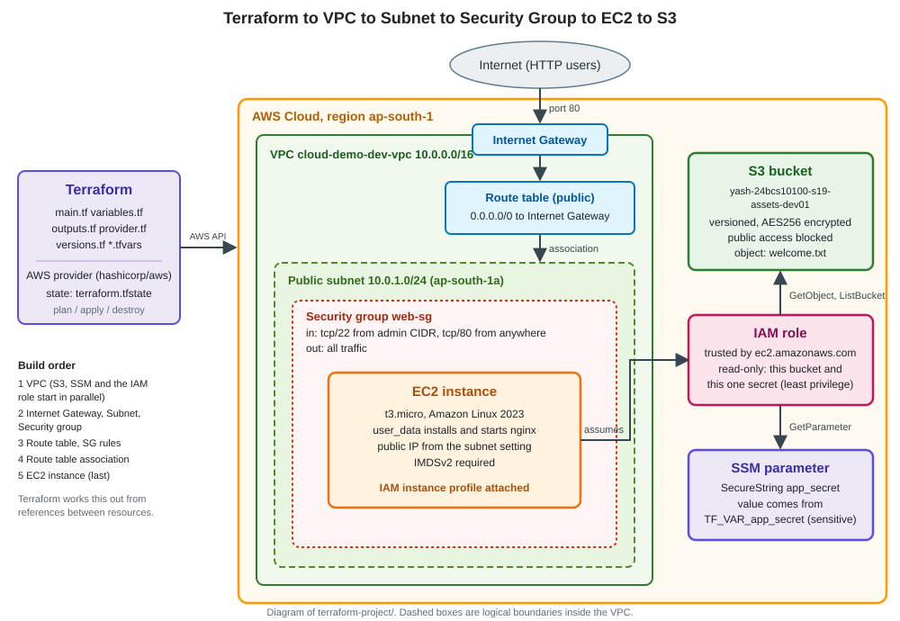
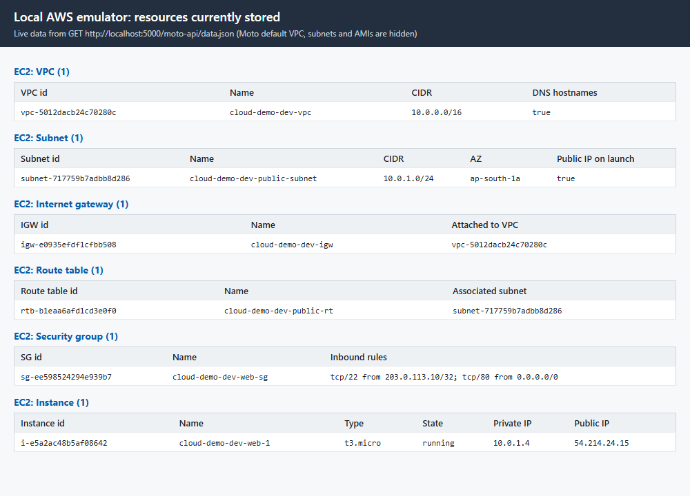
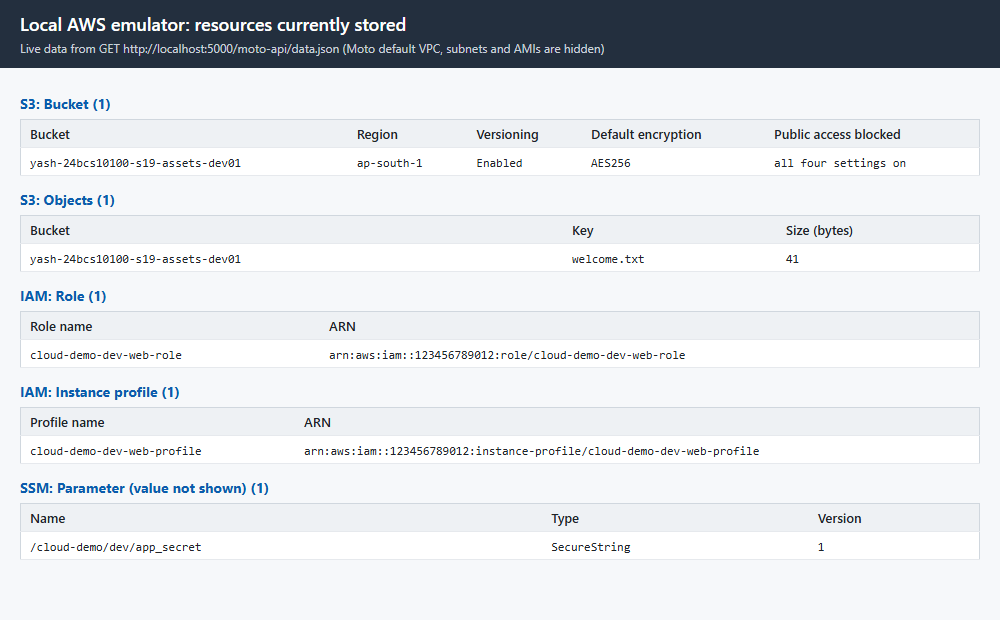
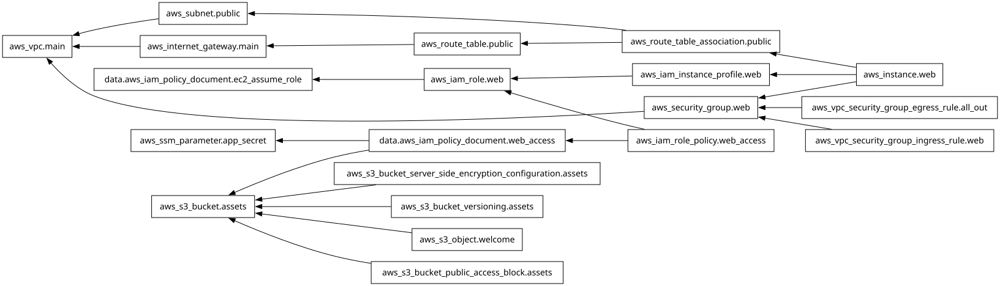

# Session 19: Cloud and Terraform in Action

**Name:** Yash Gaikwad  |  **Roll No:** 24BCS10100

## Task

Build an end-to-end cloud infrastructure project with Terraform that demonstrates providers, variables, resources, outputs, dependencies, AWS infrastructure, state, `terraform plan`, `apply` and `destroy`, using the suggested architecture *Terraform, VPC, Subnet, Security Group, EC2, S3*.

| Deliverable | Where |
|---|---|
| Terraform project | [`terraform-project/`](terraform-project) |
| AWS resources | [Resources created](#resources-created) (19 resources) |
| Architecture diagram | [`images/architecture.svg`](images/architecture.svg) (PNG copy: [`images/architecture.png`](images/architecture.png)) and the ASCII version below |
| Screenshots | [`screenshots/`](screenshots) (browser views of the emulator, plus the rendered dependency graph in [`images/`](images)) |
| Terraform commands | [Full transcript](#full-transcript) |
| README | this file |

## Read this first: how the commands were run

I did **not** create anything in my real AWS account. `init`, `fmt`, `validate` and `plan` need nothing, but `apply` creates a VPC, an EC2 instance, an IAM role and more, which cost money and are easy to leave behind. So:

- **The AWS API is emulated by [Moto](https://github.com/getmoto/moto)** (Docker image `motoserver/moto`) on `http://localhost:5000`. `emulator.tfvars` points the provider at it (`use_emulator = true`). Every `apply`, `state` and `destroy` below is a real Terraform run that really created and deleted these resources **inside the emulator**.
- **Dummy credentials only** (`test` / `test`). The shell hides my real `~/.aws` profile and blocks outbound traffic to anything except localhost and HashiCorp's provider registry (Step 0 shows the environment).
- **The same code works on real AWS**: `use_emulator` defaults to `false`. A runbook for real AWS is at the end, clearly marked as **not executed**.
- **What the emulator is not.** The EC2 "instance" is a record, not a virtual machine: `user_data` is stored but never run, so nginx is never installed and the public IP does not answer. Moto does not check IAM permissions, quotas, costs or whether an AMI exists. AWS **console screenshots** need a real account, so the screenshots here are browser views of the emulator's data instead.
- Output blocks are copied from the terminal exactly as printed. Where I shortened something with `head`, `grep`, `awk` or `tail`, the command shown contains it.

To reproduce the emulator runs yourself:

```bash
docker run -d --name tf-moto -p 127.0.0.1:5000:5000 motoserver/moto:latest
export AWS_ACCESS_KEY_ID=test AWS_SECRET_ACCESS_KEY=test AWS_DEFAULT_REGION=us-east-1
export TF_VAR_app_secret="any-dummy-value"
cd terraform-project
terraform init
terraform apply -var-file=emulator.tfvars
terraform destroy -var-file=emulator.tfvars
docker rm -f tf-moto
```

## Architecture



```
  Terraform (laptop)
       |  AWS API calls through the hashicorp/aws provider
       v
  AWS region ap-south-1
  +------------------------------------------------------------------+
  |  VPC 10.0.0.0/16                                                 |
  |                                                                  |
  |     Internet <--> Internet Gateway --- Route table               |
  |                                        (0.0.0.0/0 -> gateway)    |
  |                                               |                  |
  |  +--------------------------------------------v-------------+    |
  |  |  Public subnet 10.0.1.0/24                               |    |
  |  |  +----------------------------------------------------+  |    |
  |  |  |  Security group: in 22 (admin CIDR), 80 (anywhere) |  |    |
  |  |  |    EC2 t3.micro + nginx  (IAM instance profile)    |  |    |
  |  |  +----------------------------------------------------+  |    |
  |  +----------------------------------------------------------+    |
  +------------------------------------------------------------------+
  Also in the region, outside the VPC:

     S3 bucket  <-- read-only --  IAM role  -- read-only -->  SSM parameter
     (versioned, encrypted,       (attached to the instance   (SecureString
      private)                     by an instance profile)     app_secret)
```

How the pieces connect:

- The **VPC** is my private network. The **internet gateway** is its door to the internet, and the **route table** sends all non-local traffic (`0.0.0.0/0`) through that door; associating the table with the **public subnet** is what makes the subnet public.
- The **security group** is the instance's firewall: SSH only from one CIDR I choose, HTTP from anywhere, all traffic out.
- The **EC2 instance** lives in the subnet, behind the security group, and gets a public IP from the subnet. Its `user_data` installs nginx at first boot (on a real instance).
- The **S3 bucket** holds assets (versioned, encrypted, all public access blocked). An **IAM role** attached through an **instance profile** lets the instance read exactly that bucket and exactly one **SSM SecureString parameter**, nothing else (least privilege). The secret never appears in the code or in `user_data`.

### Resources created

| Resource | Terraform address | Count |
|---|---|---|
| VPC | `aws_vpc.main` | 1 |
| Internet gateway | `aws_internet_gateway.main` | 1 |
| Public subnet | `aws_subnet.public` | 1 |
| Route table and association | `aws_route_table.public`, `aws_route_table_association.public` | 2 |
| Security group | `aws_security_group.web` | 1 |
| Security group rules (22, 80, all out) | `aws_vpc_security_group_ingress_rule.web["ssh"]`, `["http"]`, `aws_vpc_security_group_egress_rule.all_out` | 3 |
| S3 bucket, versioning, encryption, public access block, one object | `aws_s3_bucket.assets`, `..._versioning`, `..._server_side_encryption_configuration`, `..._public_access_block`, `aws_s3_object.welcome` | 5 |
| SSM SecureString parameter | `aws_ssm_parameter.app_secret` | 1 |
| IAM role, inline policy, instance profile | `aws_iam_role.web`, `aws_iam_role_policy.web_access`, `aws_iam_instance_profile.web` | 3 |
| EC2 instance | `aws_instance.web[0]` | 1 |
| **Total** | | **19** |

(`data.aws_iam_policy_document` blocks build the JSON policies locally; they are not resources.)

## Project files

| File | Purpose |
|---|---|
| `versions.tf` | Required Terraform version and the provider version constraint |
| `provider.tf` | AWS provider settings, default tags and the emulator switches |
| `variables.tf` | All inputs, with types, validation rules and one sensitive variable |
| `main.tf` | Locals and every resource |
| `outputs.tf` | Values printed after `apply` |
| `terraform.tfvars` | Non-secret values |
| `emulator.tfvars` | Points the provider at the local emulator |
| `.terraform.lock.hcl` | Provider version lock (created by `init`) |
| `.gitignore` | Keeps `.terraform/`, state files and saved plans out of git |

## Where each required concept is in the code

### Providers

`versions.tf` declares which provider is needed and at which version; `provider.tf` configures it. `terraform init` downloads it. The `dynamic "endpoints"` block only exists when `use_emulator` is true.

_versions.tf: the provider source and version constraint (pinned to 6.22.x for the emulator; see the comment)._

```console
$ cat versions.tf
terraform {
  required_version = ">= 1.6.0"

  required_providers {
    aws = {
      source = "hashicorp/aws"

      # Kept on 6.22.x because 6.23 and newer read bucket tags through the S3 Control API,
      # which the Moto emulator used in README.md does not implement. Real AWS works with
      # any 6.x release, so widen this to "~> 6.0" when you deploy for real.
      version = "~> 6.22.0"
    }
  }
}
```

_provider.tf: region, default tags and the emulator switches (all false on real AWS)._

```console
$ cat provider.tf
provider "aws" {
  region = var.aws_region

  # Credentials are never written here. On real AWS the provider reads them from the
  # environment (AWS_ACCESS_KEY_ID / AWS_SECRET_ACCESS_KEY) or from `aws configure`.

  # Every resource the provider creates gets these tags automatically.
  default_tags {
    tags = {
      Project   = var.project_name
      ManagedBy = "Terraform"
      Owner     = "Yash Gaikwad 24BCS10100"
    }
  }

  # ---- Local emulator / offline switches --------------------------------------------
  # All of these stay false on real AWS. They are only turned on by emulator.tfvars
  # (apply against a local Moto server) or by -var offline_mode=true (plan with no network).
  s3_use_path_style           = var.use_emulator
  skip_credentials_validation = var.use_emulator || var.offline_mode
  skip_metadata_api_check     = var.use_emulator || var.offline_mode
  skip_requesting_account_id  = var.use_emulator || var.offline_mode

  dynamic "endpoints" {
    for_each = var.use_emulator ? [1] : []

    content {
      s3  = var.emulator_endpoint
      ec2 = var.emulator_endpoint
      sts = var.emulator_endpoint
      iam = var.emulator_endpoint
      ssm = var.emulator_endpoint
    }
  }
}
```

### Variables (types, validation, sensitive)

Inputs live in `variables.tf`. Below: a **validation block** that refuses SSH open to the whole internet, a **fake default** for the AMI (real AWS rejects it, so nothing can be created by accident), and a **sensitive** variable with no default that is supplied through the environment (`TF_VAR_app_secret`).

_Validation: can() turns a failed function call into false, so a malformed CIDR gives my error message instead of a crash._

```console
$ awk '/^variable "ssh_cidr"/,/^}/' variables.tf
variable "ssh_cidr" {
  description = "CIDR allowed to reach SSH (port 22). Use your own public IP as x.x.x.x/32."
  type        = string
  # No default on purpose: opening SSH must be a conscious choice.

  validation {
    condition     = can(cidrnetmask(var.ssh_cidr)) && var.ssh_cidr != "0.0.0.0/0"
    error_message = "ssh_cidr must be a valid IPv4 CIDR and must not be 0.0.0.0/0 (SSH open to the whole internet)."
  }
}
```

_A plain variable with a clearly fake default and a note on how to find a real AMI._

```console
$ awk '/^variable "ami_id"/,/^}/' variables.tf
variable "ami_id" {
  description = "AMI used for the web server."
  type        = string

  # FAKE placeholder: only the local emulator accepts it. Real AWS answers InvalidAMIID.NotFound,
  # so nothing can be created by accident. For real AWS look up a current Amazon Linux 2023 AMI
  # for your region, for example:
  #   aws ssm get-parameter --region ap-south-1 \
  #     --name /aws/service/ami-amazon-linux-latest/al2023-ami-kernel-default-x86_64 \
  #     --query Parameter.Value --output text
  default = "ami-00000000000000000"

  validation {
    condition     = can(regex("^ami-[0-9a-f]{8,17}$", var.ami_id))
    error_message = "ami_id must look like ami-0abc1234def567890."
  }
}
```

_sensitive = true hides the value in plan, apply and output._

```console
$ awk '/^variable "app_secret"/,/^}/' variables.tf
variable "app_secret" {
  description = "Secret the application reads at runtime. Supply it with TF_VAR_app_secret, never in a .tfvars file."
  type        = string
  sensitive   = true
  # No default: Terraform must be given it from the environment.
}
```

### Locals

A `locals` block names expressions so they are written once: the name prefix, the Availability Zone, the bucket name, the merged tag map and the map of firewall rules.

_locals in main.tf. merge() combines maps; the right-hand map wins on duplicate keys._

```console
$ awk '/^locals/,/^}/' main.tf
locals {
  name_prefix = "${var.project_name}-${var.environment}"
  az          = "${var.aws_region}${var.availability_zone_suffix}"
  bucket_name = "${var.bucket_prefix}-${var.bucket_suffix}"

  # merge() combines maps; keys on the right win. Used on every resource below.
  common_tags = merge(
    {
      Project     = var.project_name
      Environment = var.environment
    },
    var.extra_tags
  )

  # One entry per inbound rule. The security group rules below are created with for_each over
  # this map, so adding a port is a one-line change.
  ingress_rules = {
    ssh = {
      port        = 22
      cidr        = var.ssh_cidr
      description = "SSH from the admin CIDR only"
    }
    http = {
      port        = 80
      cidr        = "0.0.0.0/0"
      description = "HTTP from anywhere"
    }
  }
}
```

### Resources, `count` and `for_each`

Every `resource` block creates one object. Two ways to create several objects from one block:

- **`for_each`** over a map creates one security group rule per entry of `local.ingress_rules`, addressed as `...web["ssh"]` and `...web["http"]`.
- **`count`** creates `var.instance_count` web servers, addressed as `aws_instance.web[0]`, `[1]`, ...

_for_each: one rule resource per entry in the map._

```console
$ awk '/^resource "aws_vpc_security_group_ingress_rule" "web"/,/^}/' main.tf
resource "aws_vpc_security_group_ingress_rule" "web" {
  for_each = local.ingress_rules

  security_group_id = aws_security_group.web.id
  description       = each.value.description
  cidr_ipv4         = each.value.cidr
  from_port         = each.value.port
  to_port           = each.value.port
  ip_protocol       = "tcp"

  tags = merge(local.common_tags, { Name = "${local.name_prefix}-allow-${each.key}" })
}
```

_The EC2 instance: count, references to other resources, user_data, IMDSv2 and an explicit depends_on._

```console
$ awk '/^resource "aws_instance" "web"/,/^}/' main.tf
resource "aws_instance" "web" {
  count = var.instance_count # count.index is 0, 1, 2 ...

  ami                    = var.ami_id
  instance_type          = var.instance_type
  subnet_id              = aws_subnet.public.id              # implicit: subnet first
  vpc_security_group_ids = [aws_security_group.web.id]       # implicit: security group first
  iam_instance_profile   = aws_iam_instance_profile.web.name # implicit: profile first
  key_name               = var.key_name

  # No associate_public_ip_address here: map_public_ip_on_launch on the subnet already gives
  # the instance a public IP. (Setting both makes the Moto emulator report a security group
  # diff that real AWS does not.)

  # Amazon Linux 2023: install and start nginx at first boot.
  user_data = <<-EOT
    #!/bin/bash
    dnf install -y nginx
    echo "<h1>${local.name_prefix}: server ${count.index + 1}</h1>" > /usr/share/nginx/html/index.html
    systemctl enable --now nginx
  EOT

  user_data_replace_on_change = true

  # On real AWS also add: root_block_device { encrypted = true }. It is left out here because
  # the emulator cannot look up the root device of the fake AMI id.

  # IMDSv2 only: blocks the SSRF-style credential theft that IMDSv1 allows.
  metadata_options {
    http_endpoint = "enabled"
    http_tokens   = "required"
  }

  tags = merge(local.common_tags, { Name = "${local.name_prefix}-web-${count.index + 1}" })

  # Explicit dependency. Nothing in this block references the internet gateway or the route
  # table association, but user_data needs internet access (dnf install) the moment the instance
  # boots. depends_on makes Terraform finish both before it launches the instance.
  depends_on = [
    aws_internet_gateway.main,
    aws_route_table_association.public,
  ]
}
```

### Outputs

`outputs.tf` exposes IDs, the public IP, the bucket name and so on. It uses a **splat** (`aws_instance.web[*].id`) and a **for expression**. `app_secret_length` is derived from a sensitive variable, so Terraform *requires* `sensitive = true` on it.

_A for expression turning the rule resources into a readable map._

```console
$ awk '/^output "ingress_rules"/,/^}/' outputs.tf
output "ingress_rules" {
  description = "Inbound rules of the web security group (built with a for expression)."
  value = {
    for name, rule in aws_vpc_security_group_ingress_rule.web :
    name => "${rule.ip_protocol}/${rule.from_port} from ${rule.cidr_ipv4}"
  }
}
```

_A sensitive output._

```console
$ awk '/^output "app_secret_length"/,/^}/' outputs.tf
output "app_secret_length" {
  description = "Number of characters in the secret."
  value       = length(var.app_secret)
  sensitive   = true
}
```

### Dependencies

Terraform builds a graph of resources and creates them in dependency order, in parallel where it can.

- **Implicit dependencies** come from references. `vpc_id = aws_vpc.main.id` makes Terraform create the VPC before the subnet; `subnet_id = aws_subnet.public.id` makes the subnet precede the instance. No extra syntax is needed.
- **Explicit dependency** with `depends_on`. The instance never references the internet gateway or the route table association, but its `user_data` needs internet access (`dnf install`) the moment it boots. `depends_on = [aws_internet_gateway.main, aws_route_table_association.public]` (the last lines of the instance block above) tells Terraform to finish both first.

The full graph is printed and rendered in [Step 8](#step-8-the-dependency-graph).

## Full transcript

All commands are run inside `terraform-project/`.

### Step 0: Safety set-up (nothing here can reach real AWS)

This machine also has real AWS credentials in `~/.aws`. They must never be used for a practice run, so **every command below runs in a shell with the environment shown next**:

- `AWS_ACCESS_KEY_ID=test` and `AWS_SECRET_ACCESS_KEY=test` are dummy values. The emulator accepts anything.
- `AWS_SHARED_CREDENTIALS_FILE` and `AWS_CONFIG_FILE` point at files that do not exist, so the real profile can never be read. `AWS_EC2_METADATA_DISABLED=true` stops the SDK asking the instance metadata service for credentials.
- `HTTPS_PROXY` / `HTTP_PROXY` point at port 9, where nothing listens. Only `localhost`, `registry.terraform.io` and `releases.hashicorp.com` (needed by `terraform init` to download the provider) are listed in `NO_PROXY`. Any attempt to call a real AWS endpoint is refused immediately. This is a second safety net on top of the provider settings.
- `TF_CLI_ARGS_<command>=-no-color` makes Terraform print plain text (it colours its output even when piped).
- `TF_VAR_app_secret` is also set, to a placeholder string, because the sensitive variable has no default. It is not printed here.

_The environment used for every command in this document._

```console
$ env | grep -E "^(AWS_|TF_CLI_ARGS|HTTPS?_PROXY|NO_PROXY|CHECKPOINT)" | sort
AWS_ACCESS_KEY_ID=test
AWS_CONFIG_FILE=C:/nonexistent-aws-dir/config
AWS_DEFAULT_REGION=us-east-1
AWS_EC2_METADATA_DISABLED=true
AWS_SECRET_ACCESS_KEY=test
AWS_SHARED_CREDENTIALS_FILE=C:/nonexistent-aws-dir/credentials
CHECKPOINT_DISABLE=1
HTTPS_PROXY=http://127.0.0.1:9
HTTP_PROXY=http://127.0.0.1:9
NO_PROXY=localhost,127.0.0.1,registry.terraform.io,releases.hashicorp.com
TF_CLI_ARGS_apply=-no-color
TF_CLI_ARGS_console=-no-color
TF_CLI_ARGS_destroy=-no-color
TF_CLI_ARGS_fmt=-no-color
TF_CLI_ARGS_init=-no-color
TF_CLI_ARGS_output=-no-color
TF_CLI_ARGS_plan=-no-color
TF_CLI_ARGS_show=-no-color
TF_CLI_ARGS_state_show=-no-color
TF_CLI_ARGS_validate=-no-color
```

_The credentials file the AWS SDK is told to read does not exist._

```console
$ ls -l "$AWS_SHARED_CREDENTIALS_FILE"
ls: cannot access 'C:/nonexistent-aws-dir/credentials': No such file or directory
```

_The emulator container: port 5000 is bound to 127.0.0.1 only._

```console
$ docker ps --filter name=tf-moto --format 'table {{.Names}}\t{{.Image}}\t{{.Ports}}\t{{.Status}}'
NAMES     IMAGE                    PORTS                      STATUS
tf-moto   motoserver/moto:latest   127.0.0.1:5000->5000/tcp   Up 44 seconds
```

_The emulator starts empty: no instances exist yet._

```console
$ aws --endpoint-url http://localhost:5000 --region ap-south-1 ec2 describe-instances --query 'Reservations[].Instances[].InstanceId'
[]
```

### Step 1: `terraform init`

_Terraform CLI version._

```console
$ terraform version
Terraform v1.16.6
on windows_amd64
```

_Download the AWS provider and create .terraform.lock.hcl._

```console
$ terraform init
Initializing the backend...

Initializing provider plugins...
- Finding hashicorp/aws versions matching "~> 6.22.0"...
- Installing hashicorp/aws v6.22.1...
- Installed hashicorp/aws v6.22.1 (signed by HashiCorp)

Terraform has created a lock file .terraform.lock.hcl to record the provider
selections it made above. Include this file in your version control repository
so that Terraform can guarantee to make the same selections by default when
you run "terraform init" in the future.

Terraform has been successfully initialized!

You may now begin working with Terraform. Try running "terraform plan" to see
any changes that are required for your infrastructure. All Terraform commands
should now work.

If you ever set or change modules or backend configuration for Terraform,
rerun this command to reinitialize your working directory. If you forget, other
commands will detect it and remind you to do so if necessary.
```

_The provider requirements as a tree._

```console
$ terraform providers

Providers required by configuration:
.
└── provider[registry.terraform.io/hashicorp/aws] ~> 6.22.0
```

### Step 2: `terraform fmt` and `terraform validate`

_No output and exit code 0: every file is already formatted._

```console
$ terraform fmt -check -diff -recursive; echo "exit code: $?"
exit code: 0
```

_Syntax and references are consistent._

```console
$ terraform validate
Success! The configuration is valid.
```

_The validation block in action. Terraform first drafts a plan (several hundred lines, cut off here with tail) and then refuses with my error message, so nothing is created._

```console
$ terraform plan -var-file=emulator.tfvars -var ssh_cidr=0.0.0.0/0 | tail -n 12

Error: Invalid value for variable

  on variables.tf line 62:
  62: variable "ssh_cidr" {
    ├────────────────
    │ var.ssh_cidr is "0.0.0.0/0"

ssh_cidr must be a valid IPv4 CIDR and must not be 0.0.0.0/0 (SSH open to the
whole internet).

This was checked by the validation rule at variables.tf:67,3-13.
    ]
  + instance_public_ips  = [
      + (known after apply),
    ]
  + public_subnet_id     = (known after apply)
  + s3_bucket_arn        = (known after apply)
  + s3_bucket_name       = "yash-24bcs10100-s19-assets-dev01"
  + security_group_id    = (known after apply)
  + vpc_id               = (known after apply)
  + website_urls         = [
      + (known after apply),
    ]
```

_A variable without a default must be provided: with TF_VAR_app_secret removed from the environment, Terraform stops instead of guessing._

```console
$ env -u TF_VAR_app_secret terraform plan -var-file=emulator.tfvars -input=false

Error: No value for required variable

  on variables.tf line 140:
 140: variable "app_secret" {

The root module input variable "app_secret" is not set, and has no default
value. Use a -var or -var-file command line argument to provide a value for
this variable.
```

### Step 3: `terraform plan`

The full plan is several hundred lines, so I save it to `plan.txt` and show its summary and two interesting blocks. `-out` also saves the binary plan so `apply` runs exactly what was reviewed.

_Every resource Terraform will create (19) and the summary line. The first two lines belong to a data source that is read during apply, not to a resource._

```console
$ terraform plan -var-file=emulator.tfvars -out=demo.tfplan > plan.txt; grep -E "^  # |^Plan:" plan.txt
  # data.aws_iam_policy_document.web_access will be read during apply
  # (config refers to values not yet known)
  # aws_iam_instance_profile.web will be created
  # aws_iam_role.web will be created
  # aws_iam_role_policy.web_access will be created
  # aws_instance.web[0] will be created
  # aws_internet_gateway.main will be created
  # aws_route_table.public will be created
  # aws_route_table_association.public will be created
  # aws_s3_bucket.assets will be created
  # aws_s3_bucket_public_access_block.assets will be created
  # aws_s3_bucket_server_side_encryption_configuration.assets will be created
  # aws_s3_bucket_versioning.assets will be created
  # aws_s3_object.welcome will be created
  # aws_security_group.web will be created
  # aws_ssm_parameter.app_secret will be created
  # aws_subnet.public will be created
  # aws_vpc.main will be created
  # aws_vpc_security_group_egress_rule.all_out will be created
  # aws_vpc_security_group_ingress_rule.web["http"] will be created
  # aws_vpc_security_group_ingress_rule.web["ssh"] will be created
Plan: 19 to add, 0 to change, 0 to destroy.
```

_One for_each instance: the SSH rule uses the admin CIDR from the variable._

```console
$ awk '/aws_vpc_security_group_ingress_rule.web\["ssh"\] will be created/,/^$/' plan.txt
  # aws_vpc_security_group_ingress_rule.web["ssh"] will be created
  + resource "aws_vpc_security_group_ingress_rule" "web" {
      + arn                    = (known after apply)
      + cidr_ipv4              = "203.0.113.10/32"
      + description            = "SSH from the admin CIDR only"
      + from_port              = 22
      + id                     = (known after apply)
      + ip_protocol            = "tcp"
      + region                 = "ap-south-1"
      + security_group_id      = (known after apply)
      + security_group_rule_id = (known after apply)
      + tags                   = {
          + "Environment" = "dev"
          + "Name"        = "cloud-demo-dev-allow-ssh"
          + "Project"     = "cloud-demo"
        }
      + tags_all               = {
          + "Environment" = "dev"
          + "ManagedBy"   = "Terraform"
          + "Name"        = "cloud-demo-dev-allow-ssh"
          + "Owner"       = "Yash Gaikwad 24BCS10100"
          + "Project"     = "cloud-demo"
        }
      + to_port                = 22
    }
```

_The sensitive value is hidden in the plan._

```console
$ awk '/aws_ssm_parameter.app_secret will be created/,/^$/' plan.txt
  # aws_ssm_parameter.app_secret will be created
  + resource "aws_ssm_parameter" "app_secret" {
      + arn            = (known after apply)
      + data_type      = (known after apply)
      + description    = "Application secret supplied through TF_VAR_app_secret"
      + has_value_wo   = (known after apply)
      + id             = (known after apply)
      + insecure_value = (known after apply)
      + key_id         = (known after apply)
      + name           = "/cloud-demo/dev/app_secret"
      + region         = "ap-south-1"
      + tags           = {
          + "Environment" = "dev"
          + "Project"     = "cloud-demo"
        }
      + tags_all       = {
          + "Environment" = "dev"
          + "ManagedBy"   = "Terraform"
          + "Owner"       = "Yash Gaikwad 24BCS10100"
          + "Project"     = "cloud-demo"
        }
      + tier           = (known after apply)
      + type           = "SecureString"
      + value          = (sensitive value)
      + value_wo       = (write-only attribute)
      + version        = (known after apply)
    }
```

_The outputs section at the end of the plan, including the sensitive output._

```console
$ sed -n '/^Changes to Outputs/,$p' plan.txt
Changes to Outputs:
  + app_secret_length    = (sensitive value)
  + app_secret_parameter = "/cloud-demo/dev/app_secret"
  + iam_role_name        = "cloud-demo-dev-web-role"
  + ingress_rules        = {
      + http = "tcp/80 from 0.0.0.0/0"
      + ssh  = "tcp/22 from 203.0.113.10/32"
    }
  + instance_ids         = [
      + (known after apply),
    ]
  + instance_public_ips  = [
      + (known after apply),
    ]
  + public_subnet_id     = (known after apply)
  + s3_bucket_arn        = (known after apply)
  + s3_bucket_name       = "yash-24bcs10100-s19-assets-dev01"
  + security_group_id    = (known after apply)
  + vpc_id               = (known after apply)
  + website_urls         = [
      + (known after apply),
    ]

─────────────────────────────────────────────────────────────────────────────

Saved the plan to: demo.tfplan

To perform exactly these actions, run the following command to apply:
    terraform apply "demo.tfplan"
```

### Step 4: `terraform apply`

_Apply the saved plan (a saved plan needs no confirmation; with a fresh plan use -auto-approve or answer yes). Read the order: the VPC and the independent resources start first, the instance is created last._

```console
$ terraform apply -auto-approve demo.tfplan
aws_ssm_parameter.app_secret: Creating...
aws_iam_role.web: Creating...
aws_vpc.main: Creating...
aws_s3_bucket.assets: Creating...
aws_ssm_parameter.app_secret: Creation complete after 2s [id=/cloud-demo/dev/app_secret]
aws_iam_role.web: Creation complete after 2s [id=cloud-demo-dev-web-role]
aws_iam_instance_profile.web: Creating...
aws_s3_bucket.assets: Creation complete after 2s [id=yash-24bcs10100-s19-assets-dev01]
data.aws_iam_policy_document.web_access: Reading...
aws_s3_bucket_public_access_block.assets: Creating...
aws_s3_bucket_versioning.assets: Creating...
aws_s3_bucket_server_side_encryption_configuration.assets: Creating...
aws_s3_object.welcome: Creating...
data.aws_iam_policy_document.web_access: Read complete after 0s [id=96374709]
aws_iam_role_policy.web_access: Creating...
aws_s3_bucket_public_access_block.assets: Creation complete after 0s [id=yash-24bcs10100-s19-assets-dev01]
aws_s3_bucket_server_side_encryption_configuration.assets: Creation complete after 0s [id=yash-24bcs10100-s19-assets-dev01]
aws_s3_object.welcome: Creation complete after 0s [id=yash-24bcs10100-s19-assets-dev01/welcome.txt]
aws_iam_role_policy.web_access: Creation complete after 0s [id=cloud-demo-dev-web-role:read-bucket-and-secret]
aws_s3_bucket_versioning.assets: Creation complete after 1s [id=yash-24bcs10100-s19-assets-dev01]
aws_iam_instance_profile.web: Creation complete after 5s [id=cloud-demo-dev-web-profile]
aws_vpc.main: Still creating... [00m10s elapsed]
aws_vpc.main: Creation complete after 11s [id=vpc-6c62b18cae93d0845]
aws_internet_gateway.main: Creating...
aws_subnet.public: Creating...
aws_security_group.web: Creating...
aws_internet_gateway.main: Creation complete after 0s [id=igw-4c954fa1148c51d92]
aws_route_table.public: Creating...
aws_security_group.web: Creation complete after 0s [id=sg-dc9fcb19cd85acade]
aws_route_table.public: Creation complete after 0s [id=rtb-a3a5236c331733dc6]
aws_vpc_security_group_ingress_rule.web["http"]: Creating...
aws_vpc_security_group_egress_rule.all_out: Creating...
aws_vpc_security_group_ingress_rule.web["ssh"]: Creating...
aws_vpc_security_group_ingress_rule.web["http"]: Creation complete after 0s [id=sgr-70f47f06dd5e7e1f2]
aws_vpc_security_group_egress_rule.all_out: Creation complete after 0s [id=sgr-16991d83b0a847c58]
aws_vpc_security_group_ingress_rule.web["ssh"]: Creation complete after 0s [id=sgr-4c85356374b294330]
aws_subnet.public: Still creating... [00m10s elapsed]
aws_subnet.public: Creation complete after 10s [id=subnet-9aaf63a6460e7d073]
aws_route_table_association.public: Creating...
aws_route_table_association.public: Creation complete after 0s [id=rtbassoc-470f0cf6b708166be]
aws_instance.web[0]: Creating...
aws_instance.web[0]: Still creating... [00m10s elapsed]
aws_instance.web[0]: Creation complete after 10s [id=i-bad75f9cbecdd2581]

Apply complete! Resources: 19 added, 0 changed, 0 destroyed.

Outputs:

app_secret_length = <sensitive>
app_secret_parameter = "/cloud-demo/dev/app_secret"
iam_role_name = "cloud-demo-dev-web-role"
ingress_rules = {
  "http" = "tcp/80 from 0.0.0.0/0"
  "ssh" = "tcp/22 from 203.0.113.10/32"
}
instance_ids = [
  "i-bad75f9cbecdd2581",
]
instance_public_ips = [
  "54.214.200.4",
]
public_subnet_id = "subnet-9aaf63a6460e7d073"
s3_bucket_arn = "arn:aws:s3:::yash-24bcs10100-s19-assets-dev01"
s3_bucket_name = "yash-24bcs10100-s19-assets-dev01"
security_group_id = "sg-dc9fcb19cd85acade"
vpc_id = "vpc-6c62b18cae93d0845"
website_urls = [
  "http://54.214.200.4",
]
```

### Step 5: Outputs and state

_All outputs. app_secret_length is hidden because it is sensitive._

```console
$ terraform output
app_secret_length = <sensitive>
app_secret_parameter = "/cloud-demo/dev/app_secret"
iam_role_name = "cloud-demo-dev-web-role"
ingress_rules = {
  "http" = "tcp/80 from 0.0.0.0/0"
  "ssh" = "tcp/22 from 203.0.113.10/32"
}
instance_ids = [
  "i-bad75f9cbecdd2581",
]
instance_public_ips = [
  "54.214.200.4",
]
public_subnet_id = "subnet-9aaf63a6460e7d073"
s3_bucket_arn = "arn:aws:s3:::yash-24bcs10100-s19-assets-dev01"
s3_bucket_name = "yash-24bcs10100-s19-assets-dev01"
security_group_id = "sg-dc9fcb19cd85acade"
vpc_id = "vpc-6c62b18cae93d0845"
website_urls = [
  "http://54.214.200.4",
]
```

_One output without quotes._

```console
$ terraform output -raw s3_bucket_name; echo
yash-24bcs10100-s19-assets-dev01
```

_Everything in the state: the 19 resources plus 2 data sources. Note the [0] of the count and the ["ssh"] / ["http"] keys of the for_each._

```console
$ terraform state list
data.aws_iam_policy_document.ec2_assume_role
data.aws_iam_policy_document.web_access
aws_iam_instance_profile.web
aws_iam_role.web
aws_iam_role_policy.web_access
aws_instance.web[0]
aws_internet_gateway.main
aws_route_table.public
aws_route_table_association.public
aws_s3_bucket.assets
aws_s3_bucket_public_access_block.assets
aws_s3_bucket_server_side_encryption_configuration.assets
aws_s3_bucket_versioning.assets
aws_s3_object.welcome
aws_security_group.web
aws_ssm_parameter.app_secret
aws_subnet.public
aws_vpc.main
aws_vpc_security_group_egress_rule.all_out
aws_vpc_security_group_ingress_rule.web["http"]
aws_vpc_security_group_ingress_rule.web["ssh"]
```

_The recorded attributes of the VPC._

```console
$ terraform state show aws_vpc.main
# aws_vpc.main:
resource "aws_vpc" "main" {
    arn                                  = "arn:aws:ec2:ap-south-1:123456789012:vpc/vpc-6c62b18cae93d0845"
    assign_generated_ipv6_cidr_block     = false
    cidr_block                           = "10.0.0.0/16"
    default_network_acl_id               = "acl-f69ae4162dd346a90"
    default_route_table_id               = "rtb-97001e738cb51feac"
    default_security_group_id            = "sg-48b9551c15027d7ba"
    dhcp_options_id                      = "default"
    enable_dns_hostnames                 = true
    enable_dns_support                   = true
    enable_network_address_usage_metrics = false
    id                                   = "vpc-6c62b18cae93d0845"
    instance_tenancy                     = "default"
    ipv6_association_id                  = null
    ipv6_cidr_block                      = null
    ipv6_cidr_block_network_border_group = null
    ipv6_ipam_pool_id                    = null
    ipv6_netmask_length                  = 0
    main_route_table_id                  = "rtb-97001e738cb51feac"
    owner_id                             = "123456789012"
    region                               = "ap-south-1"
    tags                                 = {
        "Environment" = "dev"
        "Name"        = "cloud-demo-dev-vpc"
        "Project"     = "cloud-demo"
    }
    tags_all                             = {
        "Environment" = "dev"
        "ManagedBy"   = "Terraform"
        "Name"        = "cloud-demo-dev-vpc"
        "Owner"       = "Yash Gaikwad 24BCS10100"
        "Project"     = "cloud-demo"
    }
}
```

_The recorded attributes of the instance (first 40 lines only)._

```console
$ terraform state show 'aws_instance.web[0]' | head -n 40
# aws_instance.web[0]:
resource "aws_instance" "web" {
    ami                                  = "ami-00000000000000000"
    arn                                  = "arn:aws:ec2:ap-south-1::instance/i-bad75f9cbecdd2581"
    associate_public_ip_address          = true
    availability_zone                    = "ap-south-1a"
    disable_api_stop                     = false
    disable_api_termination              = false
    ebs_optimized                        = false
    force_destroy                        = false
    get_password_data                    = false
    hibernation                          = false
    host_id                              = null
    iam_instance_profile                 = "cloud-demo-dev-web-profile"
    id                                   = "i-bad75f9cbecdd2581"
    instance_initiated_shutdown_behavior = "stop"
    instance_lifecycle                   = null
    instance_state                       = "running"
    instance_type                        = "t3.micro"
    ipv6_address_count                   = 0
    ipv6_addresses                       = []
    key_name                             = null
    monitoring                           = false
    outpost_arn                          = null
    password_data                        = null
    placement_group                      = null
    placement_group_id                   = null
    placement_partition_number           = 0
    primary_network_interface_id         = "eni-1a8d85d040524455c"
    private_dns                          = "ip-10-0-1-4.ap-south-1.compute.internal"
    private_ip                           = "10.0.1.4"
    public_dns                           = "ec2-54-214-200-4.ap-south-1.compute.amazonaws.com"
    public_ip                            = "54.214.200.4"
    region                               = "ap-south-1"
    secondary_private_ips                = []
    security_groups                      = []
    source_dest_check                    = true
    spot_instance_request_id             = null
    subnet_id                            = "subnet-9aaf63a6460e7d073"
    tags                                 = {
```

_The sensitive value is redacted here too. It is still stored in plain text in terraform.tfstate, which is why the state file must be protected._

```console
$ terraform state show aws_ssm_parameter.app_secret
# aws_ssm_parameter.app_secret:
resource "aws_ssm_parameter" "app_secret" {
    allowed_pattern = null
    arn             = "arn:aws:ssm:ap-south-1:123456789012:parameter/cloud-demo/dev/app_secret"
    data_type       = "text"
    description     = "Application secret supplied through TF_VAR_app_secret"
    has_value_wo    = false
    id              = "/cloud-demo/dev/app_secret"
    key_id          = "alias/aws/ssm"
    name            = "/cloud-demo/dev/app_secret"
    region          = "ap-south-1"
    tags            = {
        "Environment" = "dev"
        "Project"     = "cloud-demo"
    }
    tags_all        = {
        "Environment" = "dev"
        "ManagedBy"   = "Terraform"
        "Owner"       = "Yash Gaikwad 24BCS10100"
        "Project"     = "cloud-demo"
    }
    tier            = "Standard"
    type            = "SecureString"
    value           = (sensitive value)
    value_wo        = (write-only attribute)
    version         = 1
}
```

_terraform show prints the whole state in readable form. It is long, so only the line count and the first 30 lines are shown._

```console
$ terraform show | wc -l; terraform show | head -n 30
767
# data.aws_iam_policy_document.ec2_assume_role:
data "aws_iam_policy_document" "ec2_assume_role" {
    id            = "2851119427"
    json          = jsonencode(
        {
            Statement = [
                {
                    Action    = "sts:AssumeRole"
                    Effect    = "Allow"
                    Principal = {
                        Service = "ec2.amazonaws.com"
                    }
                },
            ]
            Version   = "2012-10-17"
        }
    )
    minified_json = jsonencode(
        {
            Statement = [
                {
                    Action    = "sts:AssumeRole"
                    Effect    = "Allow"
                    Principal = {
                        Service = "ec2.amazonaws.com"
                    }
                },
            ]
            Version   = "2012-10-17"
        }
```

### Step 6: Check the result in the emulator

The `aws` CLI is pointed at the same emulator, so these calls show what Terraform really created, independently of Terraform's own state.

_The VPC._

```console
$ aws --endpoint-url http://localhost:5000 --region ap-south-1 ec2 describe-vpcs --filters Name=tag:Project,Values=cloud-demo --query 'Vpcs[].[VpcId,CidrBlock]' --output table
------------------------------------------
|              DescribeVpcs              |
+------------------------+---------------+
|  vpc-6c62b18cae93d0845 |  10.0.0.0/16  |
+------------------------+---------------+
```

_The public subnet._

```console
$ aws --endpoint-url http://localhost:5000 --region ap-south-1 ec2 describe-subnets --filters Name=tag:Project,Values=cloud-demo --query 'Subnets[].[SubnetId,CidrBlock,AvailabilityZone,MapPublicIpOnLaunch]' --output table
--------------------------------------------------------------------
|                          DescribeSubnets                         |
+---------------------------+--------------+--------------+--------+
|  subnet-9aaf63a6460e7d073 |  10.0.1.0/24 |  ap-south-1a |  True  |
+---------------------------+--------------+--------------+--------+
```

_The inbound rules: SSH from the admin CIDR, HTTP from anywhere._

```console
$ aws --endpoint-url http://localhost:5000 --region ap-south-1 ec2 describe-security-groups --filters Name=tag:Project,Values=cloud-demo --query 'SecurityGroups[].IpPermissions[].[IpProtocol,FromPort,ToPort,IpRanges[0].CidrIp]' --output table
----------------------------------------
|        DescribeSecurityGroups        |
+-----+-----+-----+--------------------+
|  tcp|  80 |  80 |  0.0.0.0/0         |
|  tcp|  22 |  22 |  203.0.113.10/32   |
+-----+-----+-----+--------------------+
```

_The instance, running in the emulator (a record only, no real VM)._

```console
$ aws --endpoint-url http://localhost:5000 --region ap-south-1 ec2 describe-instances --filters Name=tag:Project,Values=cloud-demo --query 'Reservations[].Instances[].[InstanceId,InstanceType,State.Name,PrivateIpAddress,PublicIpAddress]' --output table
----------------------------------------------------------------------------
|                             DescribeInstances                            |
+----------------------+-----------+----------+-----------+----------------+
|  i-bad75f9cbecdd2581 |  t3.micro |  running |  10.0.1.4 |  54.214.200.4  |
+----------------------+-----------+----------+-----------+----------------+
```

_The bucket holds the object Terraform uploaded._

```console
$ aws --endpoint-url http://localhost:5000 --region ap-south-1 s3api list-objects-v2 --bucket $(terraform output -raw s3_bucket_name) --query 'Contents[].[Key,Size]' --output table
-----------------------
|    ListObjectsV2    |
+--------------+------+
|  welcome.txt |  41  |
+--------------+------+
```

_The IAM role._

```console
$ aws --endpoint-url http://localhost:5000 --region ap-south-1 iam get-role --role-name $(terraform output -raw iam_role_name) --query 'Role.[RoleName,Arn]' --output table
------------------------------------------------------------
|                          GetRole                         |
+----------------------------------------------------------+
|  cloud-demo-dev-web-role                                 |
|  arn:aws:iam::123456789012:role/cloud-demo-dev-web-role  |
+----------------------------------------------------------+
```

_The SSM parameter (name and type only; its value is never printed here)._

```console
$ aws --endpoint-url http://localhost:5000 --region ap-south-1 ssm describe-parameters --query 'Parameters[].[Name,Type]' --output table
------------------------------------------------
|              DescribeParameters              |
+-----------------------------+----------------+
|  /cloud-demo/dev/app_secret |  SecureString  |
+-----------------------------+----------------+
```

_Browser views of the emulator's stored data (headless Edge). The page is a small viewer I wrote that reads `http://localhost:5000/moto-api/data.json`, the emulator's own dump of everything it holds. The SSM parameter value is deliberately not shown._






_The emulator logged this many HTTP requests so far: every API call Terraform and the aws CLI made landed here._

```console
$ docker logs tf-moto 2>&1 | sed -r "s/\x1b\[[0-9;]*m//g" | grep -c "HTTP/1.1"
142
```

_The S3 calls Terraform made, as the emulator logged them. (EC2, IAM and SSM calls are all POSTs to /, so only S3 lines show names.)_

```console
$ docker logs tf-moto 2>&1 | sed -r "s/\x1b\[[0-9;]*m//g" | grep -E "PUT /yash" | head -n 6
172.17.0.1 - - [18/Oct/2026 15:05:55] "PUT /yash-24bcs10100-s19-assets-dev01 HTTP/1.1" 200 -
172.17.0.1 - - [18/Oct/2026 15:05:55] "PUT /yash-24bcs10100-s19-assets-dev01?tagging= HTTP/1.1" 204 -
172.17.0.1 - - [18/Oct/2026 15:05:56] "PUT /yash-24bcs10100-s19-assets-dev01?publicAccessBlock= HTTP/1.1" 200 -
172.17.0.1 - - [18/Oct/2026 15:05:56] "PUT /yash-24bcs10100-s19-assets-dev01?versioning= HTTP/1.1" 200 -
172.17.0.1 - - [18/Oct/2026 15:05:56] "PUT /yash-24bcs10100-s19-assets-dev01?encryption= HTTP/1.1" 200 -
172.17.0.1 - - [18/Oct/2026 15:05:56] "PUT /yash-24bcs10100-s19-assets-dev01/welcome.txt?x-id=PutObject HTTP/1.1" 200 -
```

### Step 7: Idempotency, drift and changing variables

Re-running `plan` on a matching infrastructure changes nothing.

_Note: my first attempt at the next two commands failed with an operating-system file-lock error ("Device or resource busy"), so I ran them again later against a freshly applied copy of this same project (`init`, `apply`, the two commands below, `destroy`), under the same safe environment as Step 0. The counts below come from that second run._

_"No changes" and exit code 0 (the "Refreshing state" lines are left out of this view)._

```console
$ terraform plan -var-file=emulator.tfvars -detailed-exitcode > plan2.txt; echo "exit code: $?"; grep -E "No changes|^Plan:" plan2.txt; rm plan2.txt
exit code: 0
No changes. Your infrastructure matches the configuration.
```

_Network proof: that plan ran with provider debug logging. Every AWS API request went to host localhost, port 5000._

```console
$ TF_LOG=DEBUG TF_LOG_PATH=tf-debug.log terraform plan -var-file=emulator.tfvars >/dev/null; grep -oE "net.peer.(name|port)=[^ ]+" tf-debug.log | sort | uniq -c; rm tf-debug.log
     57 net.peer.name=localhost
     57 net.peer.port=5000
```

**Drift.** I simulate a console click: someone re-labels the server as `prod` directly in the emulator, bypassing Terraform.

_The manual change (no output means success)._

```console
$ aws --endpoint-url http://localhost:5000 --region ap-south-1 ec2 create-tags --resources $(terraform output -json instance_ids | tr -d '[]" \n,') --tags Key=Environment,Value=prod
```

_plan notices the drift: the tag is "prod" in the real world and "dev" in the code, so Terraform proposes to put it back._

```console
$ terraform plan -var-file=emulator.tfvars > plan2.txt; grep -E "will be updated|Environment|^Plan:" plan2.txt; rm plan2.txt
  # aws_instance.web[0] will be updated in-place
          ~ "Environment" = "prod" -> "dev"
          ~ "Environment" = "prod" -> "dev"
Plan: 0 to add, 1 to change, 0 to destroy.
```

_apply repairs it (output filtered to the interesting lines)._

```console
$ terraform apply -var-file=emulator.tfvars -auto-approve | grep -E "Modifying|Modifications complete|^Apply complete"
aws_instance.web[0]: Modifying... [id=i-bad75f9cbecdd2581]
aws_instance.web[0]: Modifications complete after 1s [id=i-bad75f9cbecdd2581]
Apply complete! Resources: 0 added, 1 changed, 0 destroyed.
```

_Clean again._

```console
$ terraform plan -var-file=emulator.tfvars -detailed-exitcode > plan2.txt; echo "exit code: $?"; grep -E "No changes" plan2.txt; rm plan2.txt
exit code: 0
No changes. Your infrastructure matches the configuration.
```

**Changing a variable (not applied).** `count` makes scaling a one-line change.

_Asking for two servers: only the second instance is created, the first is untouched._

```console
$ terraform plan -var-file=emulator.tfvars -var instance_count=2 | grep -E '^  # |^Plan:'
  # aws_instance.web[1] will be created
Plan: 1 to add, 0 to change, 0 to destroy.
```

### Step 8: The dependency graph

`terraform graph` prints the dependency graph in Graphviz DOT format. Terraform removes edges that are implied by other edges, which is why the instance points at the route table association (from `depends_on`) rather than directly at the internet gateway or the subnet: it reaches them through it.

_The graph as text (DOT)._

```console
$ terraform graph
digraph G {
  rankdir = "RL";
  node [shape = rect, fontname = "sans-serif"];
  "data.aws_iam_policy_document.ec2_assume_role" [label="data.aws_iam_policy_document.ec2_assume_role"];
  "data.aws_iam_policy_document.web_access" [label="data.aws_iam_policy_document.web_access"];
  "aws_iam_instance_profile.web" [label="aws_iam_instance_profile.web"];
  "aws_iam_role.web" [label="aws_iam_role.web"];
  "aws_iam_role_policy.web_access" [label="aws_iam_role_policy.web_access"];
  "aws_instance.web" [label="aws_instance.web"];
  "aws_internet_gateway.main" [label="aws_internet_gateway.main"];
  "aws_route_table.public" [label="aws_route_table.public"];
  "aws_route_table_association.public" [label="aws_route_table_association.public"];
  "aws_s3_bucket.assets" [label="aws_s3_bucket.assets"];
  "aws_s3_bucket_public_access_block.assets" [label="aws_s3_bucket_public_access_block.assets"];
  "aws_s3_bucket_server_side_encryption_configuration.assets" [label="aws_s3_bucket_server_side_encryption_configuration.assets"];
  "aws_s3_bucket_versioning.assets" [label="aws_s3_bucket_versioning.assets"];
  "aws_s3_object.welcome" [label="aws_s3_object.welcome"];
  "aws_security_group.web" [label="aws_security_group.web"];
  "aws_ssm_parameter.app_secret" [label="aws_ssm_parameter.app_secret"];
  "aws_subnet.public" [label="aws_subnet.public"];
  "aws_vpc.main" [label="aws_vpc.main"];
  "aws_vpc_security_group_egress_rule.all_out" [label="aws_vpc_security_group_egress_rule.all_out"];
  "aws_vpc_security_group_ingress_rule.web" [label="aws_vpc_security_group_ingress_rule.web"];
  "data.aws_iam_policy_document.web_access" -> "aws_s3_bucket.assets";
  "data.aws_iam_policy_document.web_access" -> "aws_ssm_parameter.app_secret";
  "aws_iam_instance_profile.web" -> "aws_iam_role.web";
  "aws_iam_role.web" -> "data.aws_iam_policy_document.ec2_assume_role";
  "aws_iam_role_policy.web_access" -> "data.aws_iam_policy_document.web_access";
  "aws_iam_role_policy.web_access" -> "aws_iam_role.web";
  "aws_instance.web" -> "aws_iam_instance_profile.web";
  "aws_instance.web" -> "aws_route_table_association.public";
  "aws_instance.web" -> "aws_security_group.web";
  "aws_internet_gateway.main" -> "aws_vpc.main";
  "aws_route_table.public" -> "aws_internet_gateway.main";
  "aws_route_table_association.public" -> "aws_route_table.public";
  "aws_route_table_association.public" -> "aws_subnet.public";
  "aws_s3_bucket_public_access_block.assets" -> "aws_s3_bucket.assets";
  "aws_s3_bucket_server_side_encryption_configuration.assets" -> "aws_s3_bucket.assets";
  "aws_s3_bucket_versioning.assets" -> "aws_s3_bucket.assets";
  "aws_s3_object.welcome" -> "aws_s3_bucket.assets";
  "aws_security_group.web" -> "aws_vpc.main";
  "aws_subnet.public" -> "aws_vpc.main";
  "aws_vpc_security_group_egress_rule.all_out" -> "aws_security_group.web";
  "aws_vpc_security_group_ingress_rule.web" -> "aws_security_group.web";
}
```

_Render it to SVG with Graphviz inside a throw-away Alpine container (nothing to install locally). Arrows point from a resource to what it depends on._

```console
$ terraform graph | docker run --rm -i --name tf-dot alpine sh -c 'apk add -q --no-cache graphviz font-dejavu >/dev/null 2>&1; dot -Tsvg' > ../images/dependency-graph.svg; ls -l ../images/dependency-graph.svg
-rw-r--r-- 1 gaikw 197609 15972 Oct 18 20:40 ../images/dependency-graph.svg
```

_The same graph as PNG._

```console
$ terraform graph | docker run --rm -i --name tf-dot alpine sh -c 'apk add -q --no-cache graphviz font-dejavu >/dev/null 2>&1; dot -Tpng' > ../images/dependency-graph.png; ls -l ../images/dependency-graph.png
-rw-r--r-- 1 gaikw 197609 95708 Oct 18 20:41 ../images/dependency-graph.png
```



Reading it: `aws_vpc.main` is at the left because everything depends on it; `aws_instance.web` is at the far right because it is created last.

### Step 9: `terraform destroy`

`destroy` deletes everything in the state in reverse dependency order: the instance first, the VPC last. The destroy plan lists every attribute of every resource, so only the interesting lines are shown.

_Destroy all 19 resources._

```console
$ terraform destroy -var-file=emulator.tfvars -auto-approve | grep -E "^Plan:|Destroying\.\.\.|Destruction complete|^Destroy complete"
Plan: 0 to add, 0 to change, 19 to destroy.
aws_s3_bucket_public_access_block.assets: Destroying... [id=yash-24bcs10100-s19-assets-dev01]
aws_iam_role_policy.web_access: Destroying... [id=cloud-demo-dev-web-role:read-bucket-and-secret]
aws_s3_bucket_versioning.assets: Destroying... [id=yash-24bcs10100-s19-assets-dev01]
aws_s3_bucket_server_side_encryption_configuration.assets: Destroying... [id=yash-24bcs10100-s19-assets-dev01]
aws_s3_object.welcome: Destroying... [id=yash-24bcs10100-s19-assets-dev01/welcome.txt]
aws_vpc_security_group_egress_rule.all_out: Destroying... [id=sgr-16991d83b0a847c58]
aws_vpc_security_group_ingress_rule.web["ssh"]: Destroying... [id=sgr-4c85356374b294330]
aws_vpc_security_group_ingress_rule.web["http"]: Destroying... [id=sgr-70f47f06dd5e7e1f2]
aws_instance.web[0]: Destroying... [id=i-bad75f9cbecdd2581]
aws_iam_role_policy.web_access: Destruction complete after 0s
aws_s3_bucket_server_side_encryption_configuration.assets: Destruction complete after 0s
aws_ssm_parameter.app_secret: Destroying... [id=/cloud-demo/dev/app_secret]
aws_vpc_security_group_egress_rule.all_out: Destruction complete after 0s
aws_s3_bucket_versioning.assets: Destruction complete after 0s
aws_vpc_security_group_ingress_rule.web["ssh"]: Destruction complete after 0s
aws_vpc_security_group_ingress_rule.web["http"]: Destruction complete after 0s
aws_ssm_parameter.app_secret: Destruction complete after 0s
aws_s3_bucket_public_access_block.assets: Destruction complete after 0s
aws_s3_object.welcome: Destruction complete after 0s
aws_s3_bucket.assets: Destroying... [id=yash-24bcs10100-s19-assets-dev01]
aws_s3_bucket.assets: Destruction complete after 0s
aws_instance.web[0]: Destruction complete after 10s
aws_route_table_association.public: Destroying... [id=rtbassoc-470f0cf6b708166be]
aws_iam_instance_profile.web: Destroying... [id=cloud-demo-dev-web-profile]
aws_security_group.web: Destroying... [id=sg-dc9fcb19cd85acade]
aws_iam_instance_profile.web: Destruction complete after 0s
aws_iam_role.web: Destroying... [id=cloud-demo-dev-web-role]
aws_route_table_association.public: Destruction complete after 0s
aws_route_table.public: Destroying... [id=rtb-a3a5236c331733dc6]
aws_subnet.public: Destroying... [id=subnet-9aaf63a6460e7d073]
aws_subnet.public: Destruction complete after 0s
aws_iam_role.web: Destruction complete after 0s
aws_security_group.web: Destruction complete after 1s
aws_route_table.public: Destruction complete after 1s
aws_internet_gateway.main: Destroying... [id=igw-4c954fa1148c51d92]
aws_internet_gateway.main: Destruction complete after 0s
aws_vpc.main: Destroying... [id=vpc-6c62b18cae93d0845]
aws_vpc.main: Destruction complete after 0s
Destroy complete! Resources: 19 destroyed.
```

_The state is empty._

```console
$ terraform state list; echo "resources left in state: $(terraform state list | wc -l)"
resources left in state: 0
```

_No running instance is left in the emulator._

```console
$ aws --endpoint-url http://localhost:5000 --region ap-south-1 ec2 describe-instances --filters Name=tag:Project,Values=cloud-demo Name=instance-state-name,Values=running --query 'Reservations[].Instances[].InstanceId'
[]
```

_No VPC is left._

```console
$ aws --endpoint-url http://localhost:5000 --region ap-south-1 ec2 describe-vpcs --filters Name=tag:Project,Values=cloud-demo --query 'Vpcs[].VpcId'
[]
```

_No bucket is left (no output)._

```console
$ aws --endpoint-url http://localhost:5000 --region ap-south-1 s3 ls
```

### Step 10: What the real AWS provider would plan (offline)

All the runs above used the emulator. To see the plan for **real AWS** without any network or credentials, I run `plan` with `use_emulator` left at its default `false` and `offline_mode=true`, which only switches on the provider's `skip_credentials_validation`, `skip_metadata_api_check` and `skip_requesting_account_id`. There is no `-var-file=emulator.tfvars`, so there is no custom endpoint: the provider is configured exactly as it would be for real AWS. The dead proxy from Step 0 is still active, and the state is empty, so the provider has nothing to refresh.

_The same 19 resources, planned by the real provider configuration with no network._

```console
$ terraform plan -var offline_mode=true > plan3.txt; grep -E "^  # |^Plan:" plan3.txt; rm plan3.txt
  # data.aws_iam_policy_document.web_access will be read during apply
  # (config refers to values not yet known)
  # aws_iam_instance_profile.web will be created
  # aws_iam_role.web will be created
  # aws_iam_role_policy.web_access will be created
  # aws_instance.web[0] will be created
  # aws_internet_gateway.main will be created
  # aws_route_table.public will be created
  # aws_route_table_association.public will be created
  # aws_s3_bucket.assets will be created
  # aws_s3_bucket_public_access_block.assets will be created
  # aws_s3_bucket_server_side_encryption_configuration.assets will be created
  # aws_s3_bucket_versioning.assets will be created
  # aws_s3_object.welcome will be created
  # aws_security_group.web will be created
  # aws_ssm_parameter.app_secret will be created
  # aws_subnet.public will be created
  # aws_vpc.main will be created
  # aws_vpc_security_group_egress_rule.all_out will be created
  # aws_vpc_security_group_ingress_rule.web["http"] will be created
  # aws_vpc_security_group_ingress_rule.web["ssh"] will be created
Plan: 19 to add, 0 to change, 0 to destroy.
```

Limitation: an offline plan never talks to AWS. It cannot tell whether the AMI exists in the region (the default `ami-00000000000000000` is fake and real AWS would reject it), whether the bucket name is taken, whether the credentials have permission, or what already exists in the account. Those problems only show up on a real `plan` / `apply` with real credentials.

## Running it on real AWS (NOT executed)

**I did not run any of this.** It creates real, billable resources in a real account. Do it only with your own account and credentials.

1. Configure credentials (`aws configure`, or `AWS_ACCESS_KEY_ID` / `AWS_SECRET_ACCESS_KEY` / `AWS_SESSION_TOKEN`).
2. Look up a real Amazon Linux 2023 AMI for your region and put it in `terraform.tfvars` as `ami_id = "ami-..."` (the command is in the comment above the `ami_id` variable).
3. Set `ssh_cidr` to your own public IP, for example `"198.51.100.7/32"`.
4. Optionally widen the provider version in `versions.tf` to `~> 6.0` and run `terraform init -upgrade`.
5. Run, **without** `-var-file=emulator.tfvars`:

```bash
cd terraform-project
export TF_VAR_app_secret="<a real secret>"
terraform init
terraform plan -out=demo.tfplan
terraform apply demo.tfplan
terraform output
# open the URL from `terraform output website_urls` in a browser
terraform destroy
```

**Cost.** Almost everything here is free (VPC, subnet, internet gateway, route table, security group, IAM, a standard SSM parameter, a tiny S3 bucket). What costs money is the `t3.micro` instance (about a cent per hour on demand) and its public IPv4 address (AWS charges about half a cent per hour for every public IPv4 address). There is no NAT gateway, load balancer, Elastic IP or database, which are the usual surprise bills. Check the AWS pricing pages for current figures in your region.

> **WARNING: run `terraform destroy` when you are done.** A forgotten instance keeps billing every hour until it is deleted. After destroying, check the EC2 and S3 consoles to be sure nothing is left.

## What I learned

- Terraform turns a **diagram into code**: the architecture picture and `main.tf` describe the same thing, and `terraform graph` proves the dependencies are the ones I intended.
- **Implicit dependencies** (references) cover almost everything. I only needed one `depends_on`, for the case where the dependency is not visible in the code: the instance needs the internet route to exist before its `user_data` runs.
- `for_each` and `count` remove copy-paste: the firewall rules come from one map, and scaling to two servers is a one-line variable change that the plan shows precisely.
- **Validation blocks** and `sensitive = true` make mistakes loud and secrets quiet: SSH open to `0.0.0.0/0` is refused, and the secret never shows in plan, apply or `terraform output`. But the **state file still holds it in plain text**, so state must be protected.
- `plan` after `apply` is how I check idempotency; after I re-labelled the instance by hand, the next plan found the drift and `apply` fixed it.
- A real AMI id, my own IP and real credentials are the three things that differ between a safe rehearsal and a real deployment. I used an emulator, dummy credentials and a blocked network so the rehearsal could not cost money or touch my account.
- The emulator is useful but not the real thing: it needed an older provider release, showed a false diff when I set both `associate_public_ip_address` and `map_public_ip_on_launch`, could not resolve the root device of the fake AMI (so the encrypted root volume is only a comment), and its "instance" never runs nginx.
