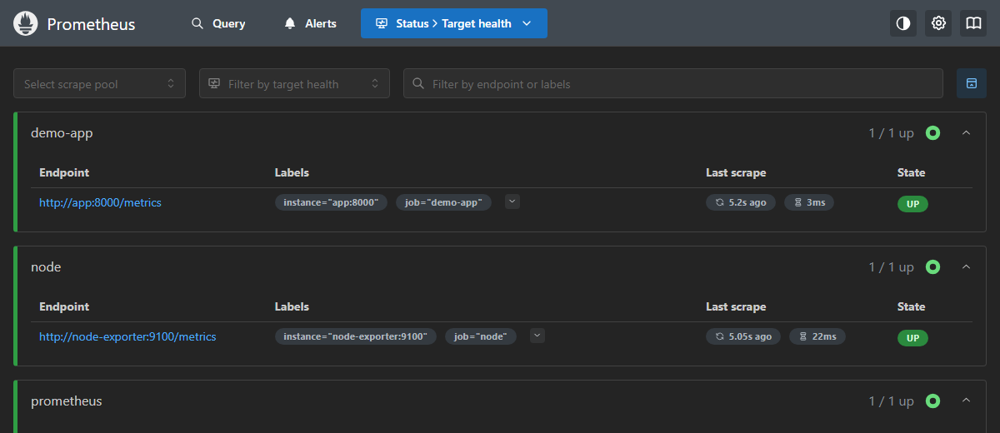
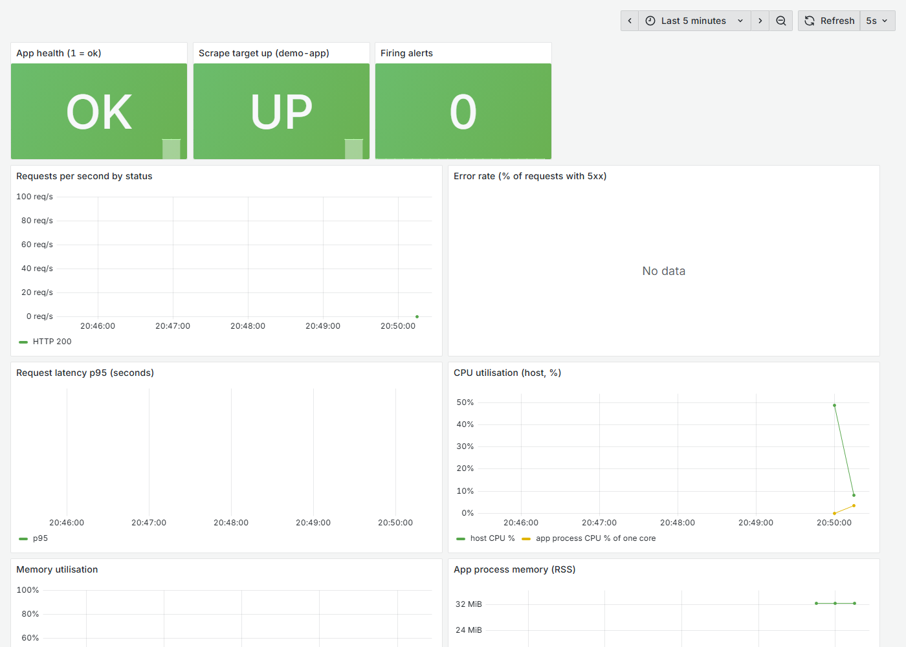
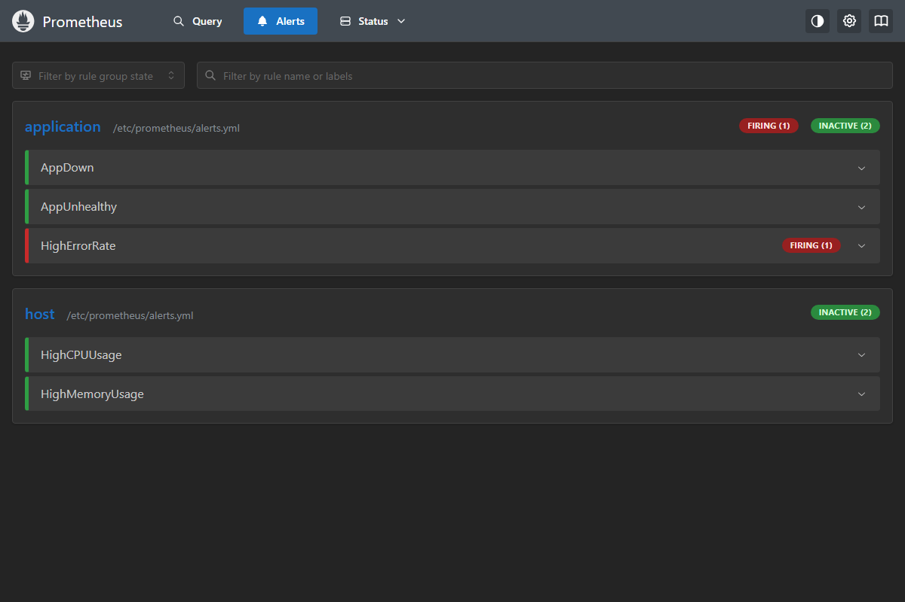
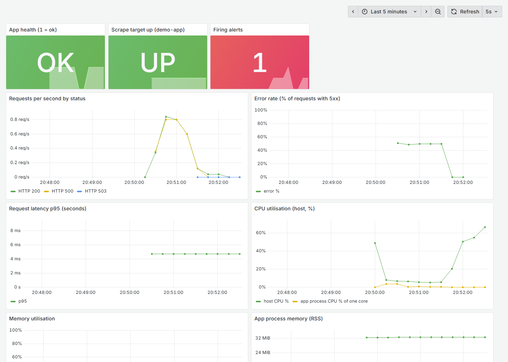
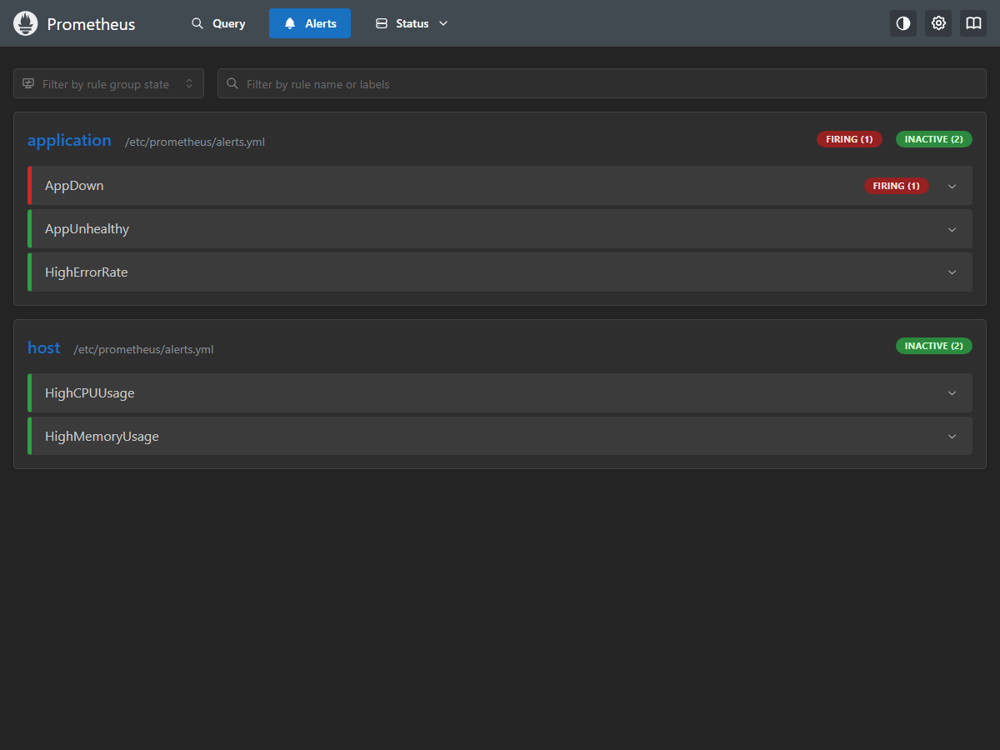

# Session 20: Monitoring, Observability and GitOps

**Name:** Yash Gaikwad  |  **Roll No:** 24BCS10100

| Task | Topic | Where |
|---|---|---|
| 1 | Monitoring: metrics, logs, alerts, CPU utilisation, memory utilisation, application health (demo) | [Task 1](#task-1-monitoring) |
| 2 | Observability: the three pillars, why it is needed, tools, Kubernetes observability | [Task 2](#task-2-observability) and [observability/README.md](observability/README.md) |
| 3 | GitOps: concepts and a hands-on Argo CD demo (also the session's mini project) | [Task 3](#task-3-gitops) and [gitops/README.md](gitops/README.md) |

**Deliverables:** monitoring demo ([`monitoring-demo/`](monitoring-demo)), observability documentation, GitOps demo ([`gitops/`](gitops)), screenshots, this README.

**Environment:** Windows 11 with Docker Desktop (Task 1 runs in plain Docker), Minikube (Docker driver, Kubernetes v1.37.0) with Argo CD for Task 3. All output and screenshots are real; the screenshots come from a headless Microsoft Edge pointed at the live services.

---

## Task 1: Monitoring

**Monitoring** means collecting numbers about a running system, showing them, and getting alerted when they look wrong. This demo covers the six things the task lists: **metrics, logs, alerts, CPU utilisation, memory utilisation and application health**.

### The setup

```
 curl / load ---> [ demo app :8000 ]  --/metrics--+
                  (Flask, JSON logs,              |
                   /healthz, /metrics)            v
 [ node-exporter ]  --/metrics----------->  [ Prometheus :9090 ] --alerts--> [ Alertmanager :9093 ]
 (host CPU, memory)                                |
                                                   v
                                            [ Grafana :3000 ]  (dashboard)
```

| Component | Role |
|---|---|
| **demo app** | my small Flask application: counts requests (`app_http_requests_total`), measures latency, exposes `app_healthy`, `/healthz` and `/metrics`, and writes **JSON logs** to stdout |
| **node-exporter** | CPU and memory of the host the containers run on |
| **Prometheus** | scrapes the metrics every 5 s, stores them, evaluates the **alert rules** |
| **Alertmanager** | receives firing alerts, groups them and routes them (placeholder receiver here) |
| **Grafana** | dashboard built from PromQL queries (provisioned from files) |

All files are in [`monitoring-demo/`](monitoring-demo/). Everything below was run for real with Docker Desktop.

_The alert rules: AppDown, AppUnhealthy, HighErrorRate (application) and HighCPUUsage, HighMemoryUsage (host). `for:` means the condition must hold that long before the alert fires._

```console
$ cat monitoring-demo/prometheus/alerts.yml
groups:
  - name: application
    rules:
      - alert: AppDown
        expr: up{job="demo-app"} == 0
        for: 15s
        labels:
          severity: critical
        annotations:
          summary: "demo-app is down (Prometheus cannot scrape it)"

      - alert: AppUnhealthy
        expr: app_healthy == 0
        for: 10s
        labels:
          severity: critical
        annotations:
          summary: "demo-app reports itself unhealthy (/healthz returns 503)"

      - alert: HighErrorRate
        expr: |
          sum(rate(app_http_requests_total{status=~"5.."}[30s]))
            / sum(rate(app_http_requests_total[30s])) > 0.2
        for: 10s
        labels:
          severity: warning
        annotations:
          summary: "More than 20% of the requests fail with a 5xx error"

  - name: host
    rules:
      - alert: HighCPUUsage
        expr: 100 - (avg(rate(node_cpu_seconds_total{mode="idle"}[30s])) * 100) > 40
        for: 10s
        labels:
          severity: warning
        annotations:
          summary: "CPU utilisation is above 40%"

      - alert: HighMemoryUsage
        expr: (1 - node_memory_MemAvailable_bytes / node_memory_MemTotal_bytes) * 100 > 85
        for: 30s
        labels:
          severity: warning
        annotations:
          summary: "Memory utilisation is above 85%"
```

_Start the whole stack (build my app image, start Prometheus, Alertmanager, node-exporter and Grafana)._

```console
$ cd monitoring-demo && docker compose up -d --build 2>&1 | tail -n 8
 Container s20mon-app Starting 
 Container s20mon-app Started 
 Container s20mon-node-exporter Started 
 Container s20mon-alertmanager Started 
 Container s20mon-prometheus Starting 
 Container s20mon-prometheus Started 
 Container s20mon-grafana Starting 
 Container s20mon-grafana Started 
```

_Five containers running._

```console
$ cd monitoring-demo && docker compose ps --format 'table {{.Service}}\t{{.Image}}\t{{.Status}}\t{{.Ports}}'
SERVICE         IMAGE                       STATUS          PORTS
alertmanager    prom/alertmanager:v0.27.0   Up 27 seconds   0.0.0.0:9093->9093/tcp, [::]:9093->9093/tcp
app             s20mon-app                  Up 27 seconds   0.0.0.0:8000->8000/tcp, [::]:8000->8000/tcp
grafana         grafana/grafana:12.1.1      Up 26 seconds   0.0.0.0:3000->3000/tcp, [::]:3000->3000/tcp
node-exporter   prom/node-exporter:v1.8.2   Up 27 seconds   9100/tcp
prometheus      prom/prometheus:v3.5.0      Up 27 seconds   0.0.0.0:9090->9090/tcp, [::]:9090->9090/tcp
```

### 1. Metrics

_Ask Prometheus with PromQL: `up` is 1 for every target it can scrape successfully (the second number of each pair)._

```console
$ curl -s localhost:9090/api/v1/query --data-urlencode 'query=up' | grep -o '"job":"[a-z-]*"\|"value":\[[^]]*\]' | paste - -
"job":"prometheus"	"value":[1792336801.956,"1"]
"job":"demo-app"	"value":[1792336801.956,"1"]
"job":"node"	"value":[1792336801.956,"1"]
```



_Send some traffic to the app and read the raw metrics it exposes: a request counter per path and status, the health gauge, and the process memory and CPU time._

```console
$ for i in $(seq 1 25); do curl -s -o /dev/null localhost:8000/; done; for i in 1 2 3 4 5; do curl -s -o /dev/null "localhost:8000/work?ms=150"; done; curl -s localhost:8000/ ; echo; curl -s localhost:8000/metrics | grep -E "^app_http_requests_total|^app_healthy|^process_resident_memory_bytes|^process_cpu_seconds_total"
{"message":"Hello from the monitoring demo"}

process_resident_memory_bytes 3.3869824e+07
process_cpu_seconds_total 1.23
app_http_requests_total{path="/",status="200"} 26.0
app_http_requests_total{path="/work",status="200"} 5.0
app_healthy 1.0
```

### 2. Logs

The app writes one JSON object per request to stdout, which the container runtime stores.

_The last log lines (structured JSON: easy to filter and parse)._

```console
$ docker logs s20mon-app --tail 6
{"time": "2026-10-18T15:20:08", "level": "INFO", "message": "GET /work -> 200"}
{"time": "2026-10-18T15:20:08", "level": "INFO", "message": "GET /work -> 200"}
{"time": "2026-10-18T15:20:09", "level": "INFO", "message": "GET /work -> 200"}
{"time": "2026-10-18T15:20:09", "level": "INFO", "message": "GET /work -> 200"}
{"time": "2026-10-18T15:20:09", "level": "INFO", "message": "GET /work -> 200"}
{"time": "2026-10-18T15:20:09", "level": "INFO", "message": "GET / -> 200"}
```

_I trigger three failing requests and filter the log for errors. In a real cluster the same job is done centrally by Loki or an ELK/EFK stack (see the observability notes), and `kubectl logs` does it per Pod._

```console
$ for i in 1 2 3; do curl -s -o /dev/null localhost:8000/error; done; docker logs s20mon-app 2>&1 | grep "\"ERROR\"" | tail -n 3; echo "total INFO lines: $(docker logs s20mon-app 2>&1 | grep -c "\"INFO\"")  total ERROR lines: $(docker logs s20mon-app 2>&1 | grep -c "\"ERROR\"")"
{"time": "2026-10-18T15:20:10", "level": "ERROR", "message": "GET /error -> 500"}
{"time": "2026-10-18T15:20:10", "level": "ERROR", "message": "GET /error -> 500"}
{"time": "2026-10-18T15:20:10", "level": "ERROR", "message": "GET /error -> 500"}
total INFO lines: 31  total ERROR lines: 3
```

### 3. Application health

_The health endpoint: 200 means the application says it is fine._

```console
$ curl -s -w "  -> HTTP %{http_code}\n" localhost:8000/healthz; docker inspect -f "container state: {{.State.Status}}" s20mon-app
{"status":"ok"}
  -> HTTP 200
container state: running
```

### 4. The Grafana dashboard (healthy baseline)

Panels: app health, scrape target status, firing alerts, requests per second by status, error rate, latency p95, CPU utilisation, memory utilisation and the app's own memory.



### 5. Alerts

I now cause four different problems and watch the matching alert go from *pending* to *firing* in Prometheus and Alertmanager.

**Alert 1: high error rate** (half of the requests fail for about 40 seconds)

_Prometheus reports the alert HighErrorRate in state `firing` (it had to hold for 10 s first)._

```console
$ for i in $(seq 1 40); do curl -s -o /dev/null localhost:8000/error; curl -s -o /dev/null localhost:8000/; sleep 1; done; curl -s localhost:9090/api/v1/alerts | grep -o '"alertname":"[A-Za-z]*"\|"state":"[a-z]*"' | paste - -
"alertname":"HighErrorRate"	"state":"firing"
```

_The alert reached Alertmanager (state `active`)._

```console
$ curl -s localhost:9093/api/v2/alerts | grep -o '"alertname":"[A-Za-z]*"\|"state":"[a-z]*"'
"state":"active"
"alertname":"HighErrorRate"
```



**Alert 2: application health** (the app starts failing its health check)

_The health endpoint now returns 503, `app_healthy` becomes 0 and the AppUnhealthy alert fires._

```console
$ curl -s localhost:8000/break; echo; curl -s -w "  -> HTTP %{http_code}\n" localhost:8000/healthz; sleep 22; curl -s localhost:9090/api/v1/alerts | grep -o "\"alertname\":\"[A-Za-z]*\"\|\"state\":\"[a-z]*\"" | paste - -
{"status":"now unhealthy"}

{"status":"unhealthy"}
  -> HTTP 503
"alertname":"AppUnhealthy"	"state":"firing"
"alertname":"HighErrorRate"	"state":"firing"
```

_Repair it._

```console
$ curl -s localhost:8000/fix; echo; curl -s -w "  -> HTTP %{http_code}\n" localhost:8000/healthz
{"status":"healthy again"}

{"status":"ok"}
  -> HTTP 200
```

**Alert 3: CPU utilisation** (a stress container uses six CPU cores for about a minute)

_Start the CPU stress container._

```console
$ docker run -d --rm --name s20-stress --cpus=6 alpine sh -c "for i in 1 2 3 4 5 6; do (while :; do :; done) & done; sleep 70"
1f69075a193968fdd935964f7ef324b33d0641f7775ff56082cf955f51db8ffe
```

_**CPU utilisation** of the host (the second number, in percent) is well above the 40% threshold and HighCPUUsage is firing._

```console
$ curl -s localhost:9090/api/v1/query --data-urlencode 'query=100 - (avg(rate(node_cpu_seconds_total{mode="idle"}[30s])) * 100)' | grep -o '"value":\[[^]]*\]'; curl -s localhost:9090/api/v1/alerts | grep -o '"alertname":"[A-Za-z]*"\|"state":"[a-z]*"' | paste - -
"value":[1792336938.598,"54.6278886799742"]
"alertname":"HighCPUUsage"	"state":"firing"
```

The dashboard during the incident: the CPU panel shows the jump, the "firing alerts" tile is red, and the error rate and health panels show the earlier problems:



_**Memory utilisation:** the host memory in percent (below the 85% threshold, so no memory alert), and the memory of the app process in MiB._

```console
$ curl -s localhost:9090/api/v1/query --data-urlencode 'query=(1 - node_memory_MemAvailable_bytes / node_memory_MemTotal_bytes) * 100' | grep -o '"value":\[[^]]*\]'; curl -s localhost:9090/api/v1/query --data-urlencode 'query=process_resident_memory_bytes{job="demo-app"}/1024/1024' | grep -o '"value":\[[^]]*\]'
"value":[1792336947.189,"20.663285020404953"]
"value":[1792336947.317,"32.42578125"]
```

**Alert 4: the application disappears** (I stop its container)

_Prometheus can no longer scrape the target (`up` = 0), so **AppDown** fires. The earlier alerts had already resolved by then, so only AppDown is listed._

```console
$ docker stop s20mon-app && sleep 28 && curl -s localhost:9090/api/v1/alerts | grep -o '"alertname":"[A-Za-z]*"\|"state":"[a-z]*"' | paste - -
s20mon-app
"alertname":"AppDown"	"state":"firing"
```

_Start it again: the target is back (`up` = 1) and the alert resolves._

```console
$ docker start s20mon-app && sleep 20 && curl -s localhost:9090/api/v1/query --data-urlencode "query=up{job=\"demo-app\"}" | grep -o "\"value\":\[[^]]*\]"
s20mon-app
"value":[1792337037.114,"1"]
```



_After the problems are fixed and the stress container has ended, no alert is firing._

```console
$ curl -s localhost:9090/api/v1/alerts | grep -o '"alertname":"[A-Za-z]*"\|"state":"[a-z]*"' | paste - - ; echo '(empty = nothing is firing any more)'
(empty = nothing is firing any more)
```

### What each alert taught

| Alert | Metric used | Cause I created | Typical real-world meaning |
|---|---|---|---|
| HighErrorRate | `app_http_requests_total{status=~"5.."}` | `/error` requests | a bad release or a broken dependency |
| AppUnhealthy | `app_healthy` | `/break` | the app knows it cannot work (database lost...) |
| HighCPUUsage | `node_cpu_seconds_total` | stress container | load spike, runaway process, time to scale |
| AppDown | `up` | stopped container | crash, node failure, wrong network config |

Memory follows the same pattern (`HighMemoryUsage` on `node_memory_MemAvailable_bytes`); I checked its current value above.

_Cleanup: stop and remove the whole demo stack._

```console
$ cd monitoring-demo && docker compose down -v --rmi local 2>&1 | tail -n 8
 Container s20mon-alertmanager Removed 
 Container s20mon-app Stopped 
 Container s20mon-app Removing 
 Container s20mon-app Removed 
 Image s20mon-app:latest Removing 
 Network s20mon_default Removing 
 Image s20mon-app:latest Removed 
 Network s20mon_default Removed 
```

---

## Task 2: Observability

**Monitoring** answers questions I thought of in advance ("is the CPU above 40%?", "is the app down?"). **Observability** is the ability to answer questions I did **not** think of in advance by looking at what the system emits. It rests on three pillars:

| Pillar | What it is | Answers | Typical tools | In my demo (Task 1) |
|---|---|---|---|---|
| **Metrics** | numbers sampled over time (counters, gauges, histograms) | *how much / how fast / how often?* | Prometheus, Grafana, Datadog | Prometheus scraped `/metrics`; Grafana dashboard; alert rules |
| **Logs** | timestamped records of events, ideally structured (JSON) | *what exactly happened?* | Loki, ELK/EFK, Fluent Bit, `kubectl logs` | the app's JSON logs, filtered with `docker logs` and `grep` |
| **Traces** | the path of one request across services, with the time spent in each | *where did this request spend its time, and where did it fail?* | OpenTelemetry, Jaeger, Tempo | **not implemented** in the demo (a single-service app has nothing to trace across); explained in the notes |

**Why observability is required:** modern systems are distributed and change often, so failures are novel. Good signals reduce the time to detect and to repair (MTTD, MTTR), let teams define SLOs and alert on user impact instead of guessing, and make the difference between "the server is up" and "users can check out".

**Kubernetes observability** is built from the same pieces: the metrics-server (`kubectl top`, the HPA), `kubectl logs` and `kubectl get events` for logs and cluster events, kube-state-metrics and node-exporter for object and node metrics, and Prometheus with Grafana on top. I used these for real in earlier sessions: `kubectl top` and the HPA metrics in [Session 13](../session13-storage-hpa-probes/README.md), events, logs and `describe` as the main diagnostic tools in [Session 14](../session14-kubernetes-troubleshooting/README.md), and Prometheus scraping the real StockPilot backend in the [final project](../session21-final-devops-project/final-devops-project/README.md#11-monitoring).

The full written notes (tools per pillar, golden signals, RED and USE methods, example PromQL and an alert rule) are in [observability/README.md](observability/README.md).

---

## Task 3: GitOps

The concepts (Git as the source of truth, declarative configuration, continuous reconciliation, the workflow, Kubernetes + GitOps, Argo CD vs Flux) are explained in [gitops/README.md](gitops/README.md). This section is the **hands-on demo** on my Minikube cluster, which is also the **mini project**: *Kubernetes + Git + GitOps + Argo CD* with a namespace, a Deployment with `replicas: 2`, a Service and an Argo CD Application.

```
   Git (desired state)                 Argo CD (in the cluster)                  Kubernetes
 gitops/app/*.yaml  ----pull----->  compares Git with the live state  ----apply---->  Namespace, Deployment, Service
        ^                                        |                                          |
        |                         self-heal: reverts manual changes  <------watch-----------+
   git commit + push  (the ONLY way to change the application)
```

### The application in Git

Three small manifests in [`gitops/app/`](gitops/app): a Namespace (`gitops-demo`), a Deployment `web` with **2 replicas** (the `traefik/whoami` image) and a Service.

_The Deployment (2 replicas) and the Argo CD `Application` that points at this folder of my GitHub repository, with automated sync, **prune** and **self-heal**._

```console
$ cat gitops/app/deployment.yaml | head -n 12; echo ...; cat gitops/argocd-application.yaml
apiVersion: apps/v1
kind: Deployment
metadata:
  name: web
  namespace: gitops-demo
  labels:
    app: web
spec:
  replicas: 2
  selector:
    matchLabels:
      app: web
...
# Argo CD Application: "keep the cluster equal to what is in Git at this path".
# Apply this file ONCE with kubectl; after that, every change goes through Git.
apiVersion: argoproj.io/v1alpha1
kind: Application
metadata:
  name: gitops-demo
  namespace: argocd
spec:
  project: default
  source:
    repoURL: https://github.com/Yash-1706/devops-git-assgn.git
    targetRevision: main
    path: session20-monitoring-observability-gitops/gitops/app
  destination:
    server: https://kubernetes.default.svc
    namespace: gitops-demo
  syncPolicy:
    automated:
      prune: true # delete cluster objects that were removed from Git
      selfHeal: true # undo manual changes made directly in the cluster
    syncOptions:
      - CreateNamespace=true
```

### Install Argo CD

_Install Argo CD from its official manifest (`--server-side` because the CRDs are large). The last lines of the output are shown._

```console
$ kubectl create namespace argocd 2>&1; kubectl apply -n argocd --server-side --force-conflicts -f https://raw.githubusercontent.com/argoproj/argo-cd/stable/manifests/install.yaml 2>&1 | tail -n 5
namespace/argocd created
networkpolicy.networking.k8s.io/argocd-dex-server-network-policy serverside-applied
networkpolicy.networking.k8s.io/argocd-notifications-controller-network-policy serverside-applied
networkpolicy.networking.k8s.io/argocd-redis-network-policy serverside-applied
networkpolicy.networking.k8s.io/argocd-repo-server-network-policy serverside-applied
networkpolicy.networking.k8s.io/argocd-server-network-policy serverside-applied
```

_Wait until the Argo CD components are running: the application controller (compares and syncs), the repo server (reads Git and renders manifests), the API server, Redis and the others._

```console
$ kubectl rollout status statefulset/argocd-application-controller -n argocd --timeout=300s && kubectl wait --for=condition=available deployment --all -n argocd --timeout=300s && kubectl get pods -n argocd
Waiting for 1 pods to be ready...
partitioned roll out complete: 1 new pods have been updated...
deployment.apps/argocd-applicationset-controller condition met
deployment.apps/argocd-dex-server condition met
deployment.apps/argocd-notifications-controller condition met
deployment.apps/argocd-redis condition met
deployment.apps/argocd-repo-server condition met
deployment.apps/argocd-server condition met
NAME                                                READY   STATUS    RESTARTS      AGE
argocd-application-controller-0                     1/1     Running   0             105s
argocd-applicationset-controller-66d7f7865d-v4tj2   1/1     Running   0             105s
argocd-dex-server-6d8ddc4748-2zx24                  1/1     Running   1 (32s ago)   105s
argocd-notifications-controller-6bdf867f45-79bbr    1/1     Running   0             105s
argocd-redis-5fbd54c8cc-2md5x                       1/1     Running   0             105s
argocd-repo-server-66875c66b4-lmrs8                 1/1     Running   0             105s
argocd-server-7f85776b5c-khlm6                      1/1     Running   0             105s
```

### Create the Application: Git becomes the source of truth

_This is the **only** `kubectl apply` I run for the application: it tells Argo CD where the desired state lives._

```console
$ kubectl apply -f gitops/argocd-application.yaml
application.argoproj.io/gitops-demo created
```

_Argo CD fetches the repository, finds a difference between Git and the cluster and syncs it. SYNC STATUS goes `OutOfSync` -> `Synced`, HEALTH goes `Progressing` -> `Healthy`._

```console
$ for i in 1 2 3 4 5 6 7 8; do echo "[$(date +%T)] $(kubectl get application gitops-demo -n argocd --no-headers 2>&1)"; sleep 8; done
[21:03:49] gitops-demo         
[21:03:58] gitops-demo   Synced   Healthy
[21:04:06] gitops-demo   Synced   Healthy
[21:04:15] gitops-demo   Synced   Healthy
[21:04:23] gitops-demo   Synced   Healthy
[21:04:31] gitops-demo   Synced   Healthy
[21:04:40] gitops-demo   Synced   Healthy
[21:04:48] gitops-demo   Synced   Healthy
```

_Everything that is in Git now exists in the cluster: the namespace was created by Argo CD (`CreateNamespace=true`), the Deployment has 2 Pods, the Service exists._

```console
$ kubectl get all -n gitops-demo
NAME                       READY   STATUS    RESTARTS   AGE
pod/web-6959bcf466-cdr7c   1/1     Running   0          62s
pod/web-6959bcf466-ssw2w   1/1     Running   0          62s

NAME          TYPE        CLUSTER-IP     EXTERNAL-IP   PORT(S)   AGE
service/web   ClusterIP   10.96.39.121   <none>        80/TCP    62s

NAME                  READY   UP-TO-DATE   AVAILABLE   AGE
deployment.apps/web   2/2     2            2           62s

NAME                             DESIRED   CURRENT   READY   AGE
replicaset.apps/web-6959bcf466   2         2         2       62s
```

_Argo CD records which Git commit the cluster matches._

```console
$ kubectl get application gitops-demo -n argocd -o jsonpath="repo: {.spec.source.repoURL}{\"\\n\"}path: {.spec.source.path}{\"\\n\"}synced revision: {.status.sync.revision}{\"\\n\"}sync: {.status.sync.status}  health: {.status.health.status}{\"\\n\"}"
repo: https://github.com/Yash-1706/devops-git-assgn.git
path: session20-monitoring-observability-gitops/gitops/app
synced revision: 35ce6ed6982ac0d061268125709b07c47ef383ce
sync: Synced  health: Healthy
```

### Self-healing: manual changes are reverted

**Drift 1: someone scales the Deployment by hand** (the cluster now differs from Git).

_The manual change to 5 replicas did not survive: at the first check, 3 seconds later, Argo CD had already set it back to the 2 replicas declared in Git (the events at the end of this section show the matching partial syncs)._

```console
$ kubectl scale deployment web -n gitops-demo --replicas=5; sleep 3; echo "right after the manual change:"; kubectl get deployment web -n gitops-demo; sleep 25; echo "25 seconds later:"; kubectl get deployment web -n gitops-demo
deployment.apps/web scaled
right after the manual change:
NAME   READY   UP-TO-DATE   AVAILABLE   AGE
web    2/2     2            2           66s
25 seconds later:
NAME   READY   UP-TO-DATE   AVAILABLE   AGE
web    2/2     2            2           91s
```

**Drift 2: someone deletes the Service by hand.**

_Argo CD recreates the deleted object because Git still declares it._

```console
$ kubectl delete service web -n gitops-demo; sleep 20; kubectl get service -n gitops-demo
service "web" deleted from gitops-demo namespace
NAME   TYPE        CLUSTER-IP      EXTERNAL-IP   PORT(S)   AGE
web    ClusterIP   10.102.178.88   <none>        80/TCP    20s
```

### Change the application through Git

The right way to change the application: edit the file, commit, push. I change `replicas: 2` to `replicas: 3`.

_**Edit, commit and push.** (Two real commits on my repository; the second one reverts the first.)_

```console
$ sed -i 's/replicas: 2/replicas: 3/' session20-monitoring-observability-gitops/gitops/app/deployment.yaml && git diff --stat && git commit -q session20-monitoring-observability-gitops/gitops/app/deployment.yaml -m 'Scale web to 3 replicas (gitops demo)' && git push -q origin main && git log --oneline -n 2
 session20-monitoring-observability-gitops/gitops/app/deployment.yaml | 2 +-
 1 file changed, 1 insertion(+), 1 deletion(-)
181d002 Scale web to 3 replicas (gitops demo)
35ce6ed Add README index
```

_Argo CD normally polls Git every 3 minutes; I ask it to refresh now. It detects the new commit and the Deployment grows to 3 replicas, with no `kubectl` change from me._

```console
$ kubectl annotate application gitops-demo -n argocd argocd.argoproj.io/refresh=hard --overwrite >/dev/null; for i in 1 2 3 4 5 6 7 8; do echo "[$(date +%T)] $(kubectl get deployment web -n gitops-demo --no-headers)  |  $(kubectl get application gitops-demo -n argocd --no-headers | tr -s " " | cut -d" " -f2-3)"; sleep 6; done
[21:05:51] web   2/2   2     2     117s  |  Synced Healthy
[21:05:58] web   3/3   3     3     2m3s  |  Synced Healthy
[21:06:05] web   3/3   3     3     2m10s  |  Synced Healthy
[21:06:11] web   3/3   3     3     2m16s  |  Synced Healthy
[21:06:18] web   3/3   3     3     2m23s  |  Synced Healthy
[21:06:24] web   3/3   3     3     2m29s  |  Synced Healthy
[21:06:31] web   3/3   3     3     2m36s  |  Synced Healthy
[21:06:37] web   3/3   3     3     2m43s  |  Synced Healthy
```

_Three Pods, and the synced revision is the commit I just pushed._

```console
$ kubectl get pods -n gitops-demo; kubectl get application gitops-demo -n argocd -o jsonpath="synced revision: {.status.sync.revision}{\"\\n\"}"
NAME                   READY   STATUS    RESTARTS   AGE
web-6959bcf466-7r8bv   1/1     Running   0          50s
web-6959bcf466-cdr7c   1/1     Running   0          2m49s
web-6959bcf466-ssw2w   1/1     Running   0          2m49s
synced revision: 181d002af154c4c378117189fb1a8c992293f60d
```

### Rollback with `git revert`

In GitOps a rollback is just another commit.

_**Revert the commit and push.**_

```console
$ git revert --no-edit HEAD >/dev/null && git push -q origin main && git log --oneline -n 3
822b347 Revert "Scale web to 3 replicas (gitops demo)"
181d002 Scale web to 3 replicas (gitops demo)
35ce6ed Add README index
```

_The cluster follows Git back to 2 replicas._

```console
$ kubectl annotate application gitops-demo -n argocd argocd.argoproj.io/refresh=hard --overwrite >/dev/null; for i in 1 2 3 4 5 6 7 8; do echo "[$(date +%T)] $(kubectl get deployment web -n gitops-demo --no-headers)"; sleep 6; done
[21:06:49] web   3/3   3     3     2m54s
[21:06:55] web   2/2   2     2     3m
[21:07:01] web   2/2   2     2     3m6s
[21:07:08] web   2/2   2     2     3m13s
[21:07:14] web   2/2   2     2     3m19s
[21:07:20] web   2/2   2     2     3m25s
[21:07:27] web   2/2   2     2     3m32s
[21:07:33] web   2/2   2     2     3m38s
```

_Final state: Synced, Healthy, 2 replicas: exactly what Git says._

```console
$ kubectl get application gitops-demo -n argocd --no-headers; kubectl get deployment web -n gitops-demo
gitops-demo   Synced   Healthy
NAME   READY   UP-TO-DATE   AVAILABLE   AGE
web    2/2     2            2           3m45s
```

_Argo CD keeps an event log of every sync (the commits it applied)._

```console
$ kubectl describe application gitops-demo -n argocd | sed -n "/^Events:/,\$p" | cut -c1-170
Events:
  Type    Reason              Age    From                           Message
  ----    ------              ----   ----                           -------
  Normal  OperationStarted    3m45s  argocd-application-controller  Initiated automated sync to '35ce6ed6982ac0d061268125709b07c47ef383ce'
  Normal  ResourceUpdated     3m45s  argocd-application-controller  Updated sync status:  -> OutOfSync
  Normal  ResourceUpdated     3m45s  argocd-application-controller  Updated health status:  -> Missing
  Normal  ResourceUpdated     3m45s  argocd-application-controller  Updated health status: Missing -> Healthy
  Normal  OperationCompleted  3m45s  argocd-application-controller  Sync operation to 35ce6ed6982ac0d061268125709b07c47ef383ce succeeded
  Normal  ResourceUpdated     3m45s  argocd-application-controller  Updated sync status: OutOfSync -> Synced
  Normal  ResourceUpdated     3m45s  argocd-application-controller  Updated health status: Healthy -> Progressing
  Normal  ResourceUpdated     3m42s  argocd-application-controller  Updated health status: Progressing -> Healthy
  Normal  OperationStarted    2m43s  argocd-application-controller  Initiated automated sync to '35ce6ed6982ac0d061268125709b07c47ef383ce'
  Normal  ResourceUpdated     2m43s  argocd-application-controller  Updated sync status: Synced -> OutOfSync
  Normal  ResourceUpdated     2m43s  argocd-application-controller  Updated health status: Healthy -> Progressing
  Normal  OperationCompleted  2m42s  argocd-application-controller  Partial sync operation to 35ce6ed6982ac0d061268125709b07c47ef383ce succeeded
  Normal  ResourceUpdated     2m42s  argocd-application-controller  Updated sync status: OutOfSync -> Synced
  Normal  ResourceUpdated     2m42s  argocd-application-controller  Updated health status: Progressing -> Healthy
  Normal  OperationStarted    2m13s  argocd-application-controller  Initiated automated sync to '35ce6ed6982ac0d061268125709b07c47ef383ce'
  Normal  ResourceUpdated     2m13s  argocd-application-controller  Updated sync status: Synced -> OutOfSync
  Normal  OperationCompleted  2m13s  argocd-application-controller  Partial sync operation to 35ce6ed6982ac0d061268125709b07c47ef383ce succeeded
  Normal  ResourceUpdated     2m13s  argocd-application-controller  Updated sync status: OutOfSync -> Synced
  Normal  OperationStarted    107s   argocd-application-controller  Initiated automated sync to '181d002af154c4c378117189fb1a8c992293f60d'
  Normal  ResourceUpdated     107s   argocd-application-controller  Updated sync status: Synced -> OutOfSync
  Normal  OperationCompleted  106s   argocd-application-controller  Sync operation to 181d002af154c4c378117189fb1a8c992293f60d succeeded
  Normal  ResourceUpdated     106s   argocd-application-controller  Updated sync status: OutOfSync -> Synced
  Normal  ResourceUpdated     106s   argocd-application-controller  Updated health status: Healthy -> Progressing
  Normal  ResourceUpdated     104s   argocd-application-controller  Updated health status: Progressing -> Healthy
  Normal  OperationStarted    49s    argocd-application-controller  Initiated automated sync to '822b347ed4ecd1b1f0c495d74e7d1feb5fa1dbd3'
  Normal  ResourceUpdated     49s    argocd-application-controller  Updated sync status: Synced -> OutOfSync
  Normal  OperationCompleted  48s    argocd-application-controller  Sync operation to 822b347ed4ecd1b1f0c495d74e7d1feb5fa1dbd3 succeeded
  Normal  ResourceUpdated     48s    argocd-application-controller  Updated sync status: OutOfSync -> Synced
```

_Cleanup of the demo application (Argo CD itself stays for the final project demo)._

```console
$ kubectl delete application gitops-demo -n argocd; kubectl delete namespace gitops-demo --wait=true; kubectl get ns
application.argoproj.io "gitops-demo" deleted from argocd namespace
namespace "gitops-demo" deleted
NAME              STATUS   AGE
argocd            Active   5m51s
default           Active   155m
ingress-nginx     Active   94m
kube-node-lease   Active   155m
kube-public       Active   155m
kube-system       Active   155m
```

### Push-based CI/CD versus pull-based GitOps (what I saw)

| | Push (CI/CD runs `kubectl apply`) | Pull (Argo CD) |
|---|---|---|
| Who changes the cluster | the pipeline, with cluster credentials | a controller **inside** the cluster; CI needs no cluster access |
| Manual change in the cluster | stays until the next deploy | **reverted in seconds** (drift 1 and 2 above) |
| Rollback | re-run an old pipeline | `git revert` |
| Audit trail | pipeline logs | Git history (who, when, why, reviewed in a PR) |

## What I learned

- Git is the **single source of truth**: the application changed three ways (create, scale, revert) and I never ran `kubectl apply` on the application manifests after the first Application.
- **Self-heal** keeps the cluster equal to Git; **prune** removes what leaves Git. Manual edits do not survive.
- A rollback is a commit (`git revert`), which also leaves an auditable history.
- Argo CD polls Git (every 3 minutes by default), so a refresh or a webhook is used when speed matters.
