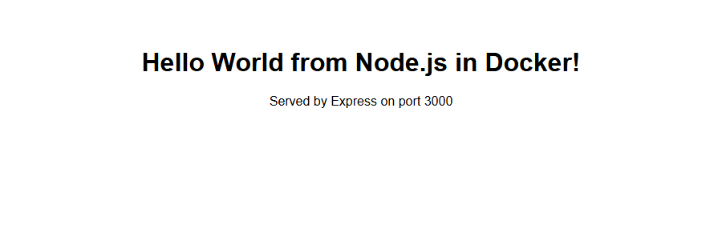
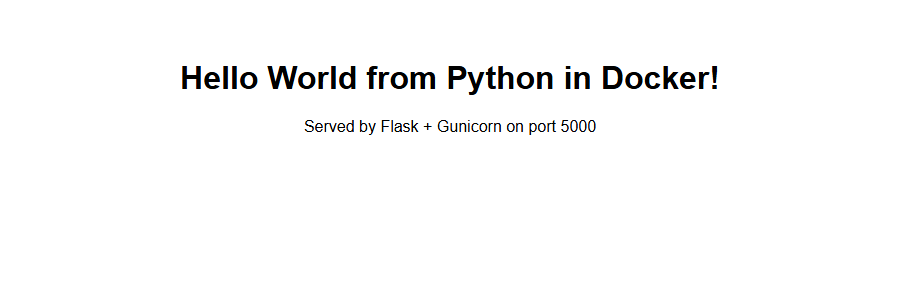
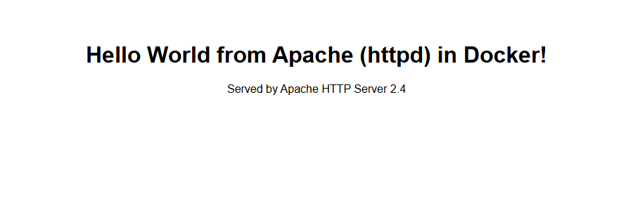
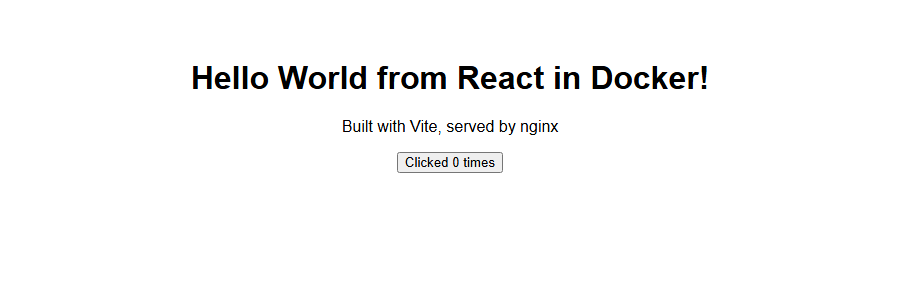
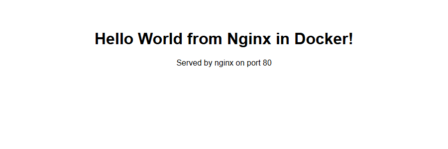

# Session 6: Docker Hello World Applications

**Name:** Yash Gaikwad  |  **Roll No:** 24BCS10100

## Task

Create simple Hello World web applications in Docker for six technologies. For each one: a separate folder, the application code, a `Dockerfile`, build the image, run the container and check that **Hello World is displayed on a web page**.

| Folder | Technology | Base image | Container port | Host URL |
|---|---|---|---|---|
| [`nodejs-app`](nodejs-app) | Node.js + Express | `node:24-alpine` | 3000 | http://localhost:3000 |
| [`python-app`](python-app) | Python + Flask (Gunicorn) | `python:3.12-slim` | 5000 | http://localhost:5000 |
| [`java-app`](java-app) | Java 17 (JDK built-in HTTP server) | `eclipse-temurin:17` (multi-stage) | 8080 | http://localhost:8081 |
| [`Apache-app`](Apache-app) | Apache HTTP Server 2.4 | `httpd:2.4-alpine` | 80 | http://localhost:8082 |
| [`React-app`](React-app) | React 18 + Vite (multi-stage, served by nginx) | `node:24-alpine` then `nginx:alpine` | 80 | http://localhost:8083 |
| [`nginx-app`](nginx-app) | Nginx static page | `nginx:alpine` | 80 | http://localhost:8084 |

Each app uses a different **host** port so all six can run at the same time. Everything was built and run with Docker Desktop (Docker 29) on Windows 11. Every output below is real; the builds use `--no-cache` and only the last lines of each build log are shown. The screenshots are taken from a real (headless) Microsoft Edge browser pointed at the URL in the caption.

### Commands used in this session

| Command | Purpose |
|---|---|
| `docker build -t name:tag <folder>` | Build an image from a Dockerfile |
| `docker run -d --name n -p host:container image` | Start a container in the background and publish a port |
| `docker ps` | List running containers |
| `docker images` | List local images and sizes |
| `docker logs n` | Show container output |
| `docker rm -f n` | Stop and remove a container |

---

## 1. Node.js application (nodejs-app)


_The Dockerfile._

```console
$ cat nodejs-app/Dockerfile
FROM node:24-alpine

WORKDIR /app

# copy manifests first so the dependency layer is cached
COPY package*.json ./
RUN npm ci --omit=dev

COPY server.js .

EXPOSE 3000

# run as the unprivileged user that ships with the node image
USER node

CMD ["npm", "start"]
```

_Build the image (last lines of the build log)._

```console
$ docker build --no-cache -t hello-node:1.0 ./nodejs-app 2>&1 | tail -n 6
#10 exporting manifest list sha256:692d70a8675e1e6ae1f3d7b870b8c149554d87e1652a8a19092e3658c995256f
#10 exporting manifest list sha256:692d70a8675e1e6ae1f3d7b870b8c149554d87e1652a8a19092e3658c995256f 0.0s done
#10 naming to docker.io/library/hello-node:1.0 done
#10 unpacking to docker.io/library/hello-node:1.0
#10 unpacking to docker.io/library/hello-node:1.0 0.9s done
#10 DONE 1.7s
```

_Run the container in the background; -p publishes container port 3000 on host port 3000. The long string is the container ID._

```console
$ docker run -d --name hello-node -p 3000:3000 hello-node:1.0
3be0ae9f364b854183c3b4e6e49cfb9833bfb43e704eb07e1c7cfe4b693ff2a7
```

_Container logs, then the page the app returns._

```console
$ docker logs hello-node 2>&1 | tail -n 3; echo ---; curl -s http://localhost:3000 | head -n 12
> node server.js

Server running on port 3000
---
<!DOCTYPE html>
<html>
  <head><title>Node.js Hello World</title></head>
  <body style="font-family: sans-serif; text-align: center; margin-top: 60px;">
    <h1>Hello World from Node.js in Docker!</h1>
    <p>Served by Express on port 3000</p>
  </body>
</html>
```

_Browser view of http://localhost:3000 (headless Edge)_



---

## 2. Python application (python-app)


_The Dockerfile._

```console
$ cat python-app/Dockerfile
FROM python:3.12-slim

WORKDIR /app

# install dependencies first so this layer is cached
COPY requirements.txt .
RUN pip install --no-cache-dir -r requirements.txt

COPY app.py .

EXPOSE 5000

# production-style server instead of Flask's dev server
CMD ["gunicorn", "--bind", "0.0.0.0:5000", "app:app"]
```

_Build the image (last lines of the build log)._

```console
$ docker build --no-cache -t hello-python:1.0 ./python-app 2>&1 | tail -n 6
#10 exporting manifest list sha256:38617a72b190f49d6024e41296195c382f0fb6e941a8f2ba35f7960cf258d8d1
#10 exporting manifest list sha256:38617a72b190f49d6024e41296195c382f0fb6e941a8f2ba35f7960cf258d8d1 0.0s done
#10 naming to docker.io/library/hello-python:1.0 done
#10 unpacking to docker.io/library/hello-python:1.0
#10 unpacking to docker.io/library/hello-python:1.0 0.8s done
#10 DONE 2.2s
```

_Run the container in the background; -p publishes container port 5000 on host port 5000. The long string is the container ID._

```console
$ docker run -d --name hello-python -p 5000:5000 hello-python:1.0
f1d90da59420055bca9a91cb2d580548bf7dff9473707c20a2df708ecb69fb20
```

_Container logs, then the page the app returns._

```console
$ docker logs hello-python 2>&1 | tail -n 3; echo ---; curl -s http://localhost:5000 | head -n 12
[2026-10-18 12:34:08 +0000] [1] [INFO] Using worker: sync
[2026-10-18 12:34:08 +0000] [7] [INFO] Booting worker with pid: 7
[2026-10-18 12:34:08 +0000] [1] [INFO] Control socket listening at /root/.gunicorn/gunicorn.ctl
---
<!DOCTYPE html>
<html>
  <head><title>Python Hello World</title></head>
  <body style="font-family: sans-serif; text-align: center; margin-top: 60px;">
    <h1>Hello World from Python in Docker!</h1>
    <p>Served by Flask + Gunicorn on port 5000</p>
  </body>
</html>
```

_Browser view of http://localhost:5000 (headless Edge)_



---

## 3. Java application (java-app)


_The Dockerfile._

```console
$ cat java-app/Dockerfile
# ---- stage 1: compile with the JDK ----
FROM eclipse-temurin:17-jdk-alpine AS build
WORKDIR /src
COPY Main.java .
RUN javac -d /out Main.java

# ---- stage 2: run on the much smaller JRE ----
FROM eclipse-temurin:17-jre-alpine
WORKDIR /app
COPY --from=build /out .

EXPOSE 8080

CMD ["java", "-cp", "/app", "Main"]
```

_Build the image (last lines of the build log)._

```console
$ docker build --no-cache -t hello-java:1.0 ./java-app 2>&1 | tail -n 6
#13 exporting attestation manifest sha256:ec2743ce47fef25e43028b99f92563d3bff3c750f8f898ed4730e656a8233855 0.1s done
#13 exporting manifest list sha256:5bc416ad9129ae819fffa771f40a3bc97221d478ff0c612426e297bff48d35d9
#13 exporting manifest list sha256:5bc416ad9129ae819fffa771f40a3bc97221d478ff0c612426e297bff48d35d9 0.0s done
#13 naming to docker.io/library/hello-java:1.0 done
#13 unpacking to docker.io/library/hello-java:1.0 0.0s done
#13 DONE 0.4s
```

_Run the container in the background; -p publishes container port 8080 on host port 8081. The long string is the container ID._

```console
$ docker run -d --name hello-java -p 8081:8080 hello-java:1.0
1ee7daebf2ddb5ced34f865232c45feb3b8db24b9ed44f9c609cbed0c54e77a5
```

_Container logs, then the page the app returns._

```console
$ docker logs hello-java 2>&1 | tail -n 3; echo ---; curl -s http://localhost:8081 | head -n 12
Server running on port 8080
---
<!DOCTYPE html><html><head><title>Java Hello World</title></head><body style="font-family: sans-serif; text-align: center; margin-top: 60px;"><h1>Hello World from Java in Docker!</h1><p>Served by the JDK built-in HTTP server on port 8080</p></body></html>
```

_Browser view of http://localhost:8081 (headless Edge)_


---

## 4. Apache web server (Apache-app)


_The Dockerfile._

```console
$ cat Apache-app/Dockerfile
FROM httpd:2.4-alpine

# Apache serves files from this folder
COPY index.html /usr/local/apache2/htdocs/index.html

EXPOSE 80
```

_Build the image (last lines of the build log)._

```console
$ docker build --no-cache -t hello-apache:1.0 ./Apache-app 2>&1 | tail -n 6
#7 exporting attestation manifest sha256:3d199d01545931519c90bfa69803364e4ae0524da095a1c8b85700556585eee5 0.1s done
#7 exporting manifest list sha256:cc5d98d2b3d30b56d37ad78c31d54e11826ecebbc42076046d428a3c59580c36
#7 exporting manifest list sha256:cc5d98d2b3d30b56d37ad78c31d54e11826ecebbc42076046d428a3c59580c36 0.0s done
#7 naming to docker.io/library/hello-apache:1.0 done
#7 unpacking to docker.io/library/hello-apache:1.0 0.1s done
#7 DONE 0.4s
```

_Run the container in the background; -p publishes container port 80 on host port 8082. The long string is the container ID._

```console
$ docker run -d --name hello-apache -p 8082:80 hello-apache:1.0
039cc052fdbfea50e9dfe7e2109f6416985b73ce5ebbd46bcdfc3ecf184912cd
```

_Container logs, then the page the app returns._

```console
$ docker logs hello-apache 2>&1 | tail -n 3; echo ---; curl -s http://localhost:8082 | head -n 12
AH00558: httpd: Could not reliably determine the server's fully qualified domain name, using 172.17.0.5. Set the 'ServerName' directive globally to suppress this message
[Sun Oct 18 12:34:33.263182 2026] [mpm_event:notice] [pid 1:tid 1] AH00489: Apache/2.4.69 (Unix) configured -- resuming normal operations
[Sun Oct 18 12:34:33.263297 2026] [core:notice] [pid 1:tid 1] AH00094: Command line: 'httpd -D FOREGROUND'
---
<!DOCTYPE html>
<html>
  <head>
    <title>Apache Hello World</title>
  </head>
  <body style="font-family: sans-serif; text-align: center; margin-top: 60px;">
    <h1>Hello World from Apache (httpd) in Docker!</h1>
    <p>Served by Apache HTTP Server 2.4</p>
  </body>
</html>
```

_Browser view of http://localhost:8082 (headless Edge)_



---

## 5. React application (React-app)


_The Dockerfile._

```console
$ cat React-app/Dockerfile
# ---- stage 1: build the static files with Node ----
FROM node:24-alpine AS build
WORKDIR /app
COPY package*.json ./
RUN npm ci
COPY . .
RUN npm run build

# ---- stage 2: serve the build output with nginx ----
FROM nginx:alpine
COPY --from=build /app/dist /usr/share/nginx/html

EXPOSE 80
```

_Build the image (last lines of the build log)._

```console
$ docker build --no-cache -t hello-react:1.0 ./React-app 2>&1 | tail -n 6
#14 exporting attestation manifest sha256:34380cfac2f1f273705dff87388969ba8055c4baed6390d7174da5e2eeb52106 0.0s done
#14 exporting manifest list sha256:3b29989b56ad7791f2b81e7f82716e8a029d401800c6ced4f9bb305a31edc38a
#14 exporting manifest list sha256:3b29989b56ad7791f2b81e7f82716e8a029d401800c6ced4f9bb305a31edc38a 0.0s done
#14 naming to docker.io/library/hello-react:1.0 done
#14 unpacking to docker.io/library/hello-react:1.0 0.1s done
#14 DONE 0.4s
```

_Run the container in the background; -p publishes container port 80 on host port 8083. The long string is the container ID._

```console
$ docker run -d --name hello-react -p 8083:80 hello-react:1.0
edac31aaa6edb4429b85e510ae957f2c5488142e4dacfddb445f81a7fd15d3d6
```

_Container logs, then the page the app returns._

```console
$ docker logs hello-react 2>&1 | tail -n 3; echo ---; curl -s http://localhost:8083 | head -n 12
2026/10/18 12:34:54 [notice] 1#1: start worker process 39
2026/10/18 12:34:54 [notice] 1#1: start worker process 40
2026/10/18 12:34:54 [notice] 1#1: start worker process 41
---
<!DOCTYPE html>
<html lang="en">
  <head>
    <meta charset="UTF-8" />
    <meta name="viewport" content="width=device-width, initial-scale=1.0" />
    <title>React Hello World</title>
    <script type="module" crossorigin src="/assets/index-DUn9OUeC.js"></script>
  </head>
  <body>
    <div id="root"></div>
  </body>
</html>
```

_Browser view of http://localhost:8083 (headless Edge)_



---

## 6. Nginx application (nginx-app)


_The Dockerfile._

```console
$ cat nginx-app/Dockerfile
FROM nginx:alpine

# nginx serves files from this folder
COPY index.html /usr/share/nginx/html/index.html

EXPOSE 80
```

_Build the image (last lines of the build log)._

```console
$ docker build --no-cache -t hello-nginx:1.0 ./nginx-app 2>&1 | tail -n 6
#7 exporting attestation manifest sha256:83f89bb1ed31423c6d4651bae46372686fb7b689ec79b8b036dc90ec4b24b496 0.1s done
#7 exporting manifest list sha256:7fe4e9a5bb607a775fb344d28a01cbde3f881a61b3c4d052d7c1c2d7db9c3a08
#7 exporting manifest list sha256:7fe4e9a5bb607a775fb344d28a01cbde3f881a61b3c4d052d7c1c2d7db9c3a08 0.0s done
#7 naming to docker.io/library/hello-nginx:1.0 done
#7 unpacking to docker.io/library/hello-nginx:1.0 0.1s done
#7 DONE 0.4s
```

_Run the container in the background; -p publishes container port 80 on host port 8084. The long string is the container ID._

```console
$ docker run -d --name hello-nginx -p 8084:80 hello-nginx:1.0
1e48890c690bfa20fbaa76d7b892d4892be4492cdb4000c2b49bab1606feec61
```

_Container logs, then the page the app returns._

```console
$ docker logs hello-nginx 2>&1 | tail -n 3; echo ---; curl -s http://localhost:8084 | head -n 12
2026/10/18 12:35:05 [notice] 1#1: start worker process 39
2026/10/18 12:35:05 [notice] 1#1: start worker process 40
2026/10/18 12:35:05 [notice] 1#1: start worker process 41
---
<!DOCTYPE html>
<html>
  <head>
    <title>Nginx Hello World</title>
  </head>
  <body style="font-family: sans-serif; text-align: center; margin-top: 60px;">
    <h1>Hello World from Nginx in Docker!</h1>
    <p>Served by nginx on port 80</p>
  </body>
</html>
```

_Browser view of http://localhost:8084 (headless Edge)_



---

## All six together

_Six containers running side by side, each on its own host port._

```console
$ docker ps --format 'table {{.Names}}\t{{.Image}}\t{{.Ports}}\t{{.Status}}'
NAMES          IMAGE              PORTS                                         STATUS
hello-nginx    hello-nginx:1.0    0.0.0.0:8084->80/tcp, [::]:8084->80/tcp       Up 9 seconds
hello-react    hello-react:1.0    0.0.0.0:8083->80/tcp, [::]:8083->80/tcp       Up 20 seconds
hello-apache   hello-apache:1.0   0.0.0.0:8082->80/tcp, [::]:8082->80/tcp       Up 41 seconds
hello-java     hello-java:1.0     0.0.0.0:8081->8080/tcp, [::]:8081->8080/tcp   Up 53 seconds
hello-python   hello-python:1.0   0.0.0.0:5000->5000/tcp, [::]:5000->5000/tcp   Up About a minute
hello-node     hello-node:1.0     0.0.0.0:3000->3000/tcp, [::]:3000->3000/tcp   Up About a minute
```

_Image sizes. The static sites (nginx, Apache, React) are the smallest because they only need a web server plus a few files, Node and Python carry their language runtime, and Java is the largest here because the Temurin runtime image includes a full JVM. The next section measures what multi-stage builds save._

```console
$ docker images --format 'table {{.Repository}}\t{{.Tag}}\t{{.Size}}' | grep -E 'REPOSITORY|hello-'
REPOSITORY                  TAG         SIZE
hello-nginx                 1.0         102MB
hello-react                 1.0         102MB
hello-apache                1.0         105MB
hello-java                  1.0         265MB
hello-python                1.0         200MB
hello-node                  1.0         255MB
```

_Cleanup: stop and remove the containers (the images are kept for the next sessions)._

```console
$ docker rm -f hello-node hello-python hello-java hello-apache hello-react hello-nginx
hello-node
hello-python
hello-java
hello-apache
hello-react
hello-nginx
```


## Multi-stage builds, measured

The Java and React Dockerfiles have two stages. To see what the second stage saves, I also built only the first stage with `--target build` (temporary images, deleted afterwards) and compared the sizes:

```console
$ docker build -q --target build -t tmp-java-buildstage ./java-app
$ docker build -q --target build -t tmp-react-buildstage ./React-app
$ docker images --format 'table {{.Repository}}\t{{.Tag}}\t{{.Size}}' | grep -E "REPOSITORY|tmp-|hello-java|hello-react"
REPOSITORY                  TAG         SIZE
hello-react                 1.0         102MB
tmp-react-buildstage        latest      334MB
hello-java                  1.0         265MB
tmp-java-buildstage         latest      520MB
```

| App | Build stage only | Final multi-stage image | Saved |
|---|---|---|---|
| `java-app` | 520 MB (JDK + compiler) | 265 MB (JRE + compiled classes) | about 49% |
| `React-app` | 334 MB (Node, `node_modules`, source) | 102 MB (nginx + static files) | about 69% |

Only the compiled result is copied into the final image, so the compiler, `node_modules` and source code never ship to production.

## What I learned

- A `Dockerfile` is a recipe of layers. Copying `package.json` / `requirements.txt` **before** the source code keeps the slow dependency-install layer cached when only the code changes.
- **Multi-stage builds** (Java and React) compile in a big image (JDK / Node) and copy only the result into a small runtime image (JRE / nginx), which makes the final image smaller and safer.
- `EXPOSE` only documents the port; `-p host:container` is what actually publishes it. Different host ports let many containers share one machine.
- A client-side app like React returns an almost empty HTML file to `curl` (the heading is drawn by JavaScript), so a real browser is needed to see "Hello World".
- The Node image runs as the unprivileged `node` user, and Python runs under Gunicorn rather than Flask's development server, both small production-minded improvements.
