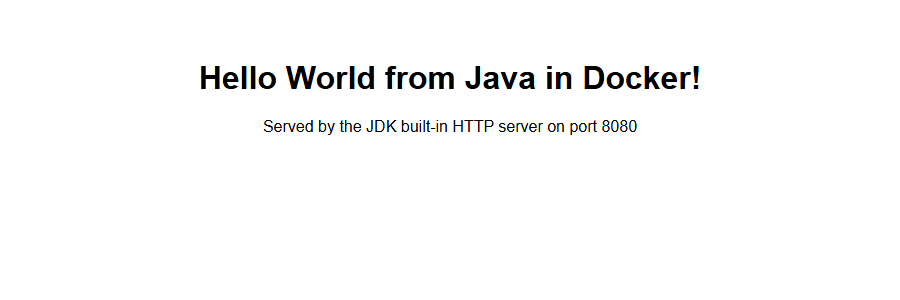

# Session 7: Docker Multi-Stage Build

| | |
|---|---|
| **Name** | Yash Gaikwad |
| **Enrollment number** | 24BCS10100 |

## What this file covers

1. **Task 1:** clone the course repository, build its multi-stage Dockerfile, run it, open the app, verify with `docker ps` and confirm it listens on **port 8080**.
2. **Task 2:** documentation: name, enrollment number, screenshot of the running app and of `docker ps` (this file).
3. **Task 3:** deploy three different application types (Node.js, Python, Java) with Docker.

All outputs are real, captured on Docker Desktop (Docker 29) on Windows 11 with Git Bash. Screenshots are taken from a real headless Microsoft Edge browser.

---

## Task 1: Run the multi-stage Dockerfile

### What a multi-stage Dockerfile is

One Dockerfile with several `FROM` lines. Each `FROM` starts a **stage**; later stages can copy files from earlier ones with `COPY --from=<stage>`. Only the **last** stage becomes the final image, so build tools and intermediate files are left behind.

### Step 1: Clone the repository

_Clone the repository that contains the multi-stage Dockerfile (shallow clone, only the latest commit)._

```console
$ git clone --depth 1 https://github.com/Nency-Ravaliya/devops-heros.git 2>&1 | tail -n 2
Cloning into 'devops-heros'...
```

_The folder holds the app (server.js, package.json) and the Dockerfile with two stages: "builder" installs everything, "production" installs only production dependencies and copies in server.js._

```console
$ cd devops-heros/session6-7-docker/multi-stage-dockerfile && ls && echo "-----" && cat Dockerfile
Dockerfile
package.json
server.js
-----
# -------------------------
# Stage 1: Build
# -------------------------
FROM node:24-alpine AS builder
WORKDIR /app
COPY package*.json ./
RUN npm install
COPY . .

# -------------------------
# Stage 2: Production
# -------------------------
FROM node:24-alpine AS production
WORKDIR /app
COPY --from=builder /app/package*.json ./
RUN npm install --omit=dev
COPY --from=builder /app/server.js ./
EXPOSE 3000
CMD ["npm", "start"]
```

_The app: an Express server on port 3000 that answers with a Hello World heading._

```console
$ cd devops-heros/session6-7-docker/multi-stage-dockerfile && cat server.js
const express = require("express");

const app = express();
const PORT = 3000;

app.get("/", (req, res) => {
  res.send("<h1>Hello World from Docker Multi-Stage Build!</h1>");
});

app.listen(PORT, () => {
  console.log(`Server running on port ${PORT}`);
});
```

### Step 2: Build the image

_Build the image from the multi-stage Dockerfile (last lines of the log)._

```console
$ cd devops-heros/session6-7-docker/multi-stage-dockerfile && docker build --no-cache -t multistage-hello:1.0 . 2>&1 | tail -n 8
#13 exporting config sha256:bed73fd3dceb9fe906c276ebcbf4fe638b561f61ecb66ae4d25f026fd2d0e586 0.0s done
#13 exporting attestation manifest sha256:372b39cdf91ef5d84e789408c2b1708bdb863a684008b1bddacd7f1631e2058b 0.1s done
#13 exporting manifest list sha256:bb6e1cfe89aac74454928df95deafcd34a1fced974a674a66c78d6692b9daefb
#13 exporting manifest list sha256:bb6e1cfe89aac74454928df95deafcd34a1fced974a674a66c78d6692b9daefb 0.0s done
#13 naming to docker.io/library/multistage-hello:1.0 done
#13 unpacking to docker.io/library/multistage-hello:1.0
#13 unpacking to docker.io/library/multistage-hello:1.0 0.9s done
#13 DONE 1.7s
```

_The final image only._

```console
$ docker images --format 'table {{.Repository}}\t{{.Tag}}\t{{.Size}}' | grep -E 'REPOSITORY|multistage'
REPOSITORY                  TAG         SIZE
multistage-hello            1.0         255MB
```

### Step 3: Run a container on port 8080

The app listens on **3000 inside** the container, so I publish it on **8080 on the host**: `-p 8080:3000`.

_Run in the background and map host port 8080 to container port 3000._

```console
$ docker run -d --name multistage-app -p 8080:3000 multistage-hello:1.0
5e0a57a3eed205a4daec4dd511614365725c5d5595fcaf8f20f922e919d21dcb
```

_The application log confirms the server started._

```console
$ docker logs multistage-app

> docker-hello-world@1.0.0 start
> node server.js

Server running on port 3000
```

### Step 4: Access the application and verify

_Fetch the page from port 8080._

```console
$ curl -s http://localhost:8080
<h1>Hello World from Docker Multi-Stage Build!</h1>
```

_Screenshot of http://localhost:8080 in a browser:_


> **Note on the message:** the homework text says *"Hello World from Docker multi-stage build"*. The app in the course repository prints **"Hello World from Docker Multi-Stage Build!"**: the same sentence with title-case capitals and an exclamation mark. I did not change the instructor's code.

### Step 5: `docker ps` shows the container on port 8080

_The running container. The PORTS column shows 0.0.0.0:8080->3000/tcp: host port 8080 is forwarded to the app._

```console
$ docker ps --filter name=multistage-app --format 'table {{.ID}}\t{{.Image}}\t{{.Command}}\t{{.Status}}\t{{.Ports}}\t{{.Names}}'
CONTAINER ID   IMAGE                  COMMAND                  STATUS         PORTS                                         NAMES
5e0a57a3eed2   multistage-hello:1.0   "docker-entrypoint.s…"   Up 8 seconds   0.0.0.0:8080->3000/tcp, [::]:8080->3000/tcp   multistage-app
```

_Confirm the mapping explicitly._

```console
$ docker port multistage-app
3000/tcp -> 0.0.0.0:8080
3000/tcp -> [::]:8080
```

### Why multi-stage? Image size comparison

I built the same app a second time with only the **first** stage (`--target builder`) to compare it with the final image:

_Builder stage (all dependencies, dev tools) versus the final production image._

```console
$ cd devops-heros/session6-7-docker/multi-stage-dockerfile && docker build -q --target builder -t tmp-builder-stage . >/dev/null 2>&1; docker images --format "table {{.Repository}}\t{{.Tag}}\t{{.Size}}" | grep -E "REPOSITORY|tmp-builder-stage|multistage"; docker rmi tmp-builder-stage >/dev/null 2>&1
REPOSITORY                  TAG         SIZE
multistage-hello            1.0         255MB
tmp-builder-stage           latest      261MB
```

For **this** app the saving is small (261 MB vs 255 MB) because it has no compiler and no dev dependencies: the first stage only runs `npm install`, which the final stage repeats with `--omit=dev`. The big wins appear when the first stage contains heavy build tools: in [Session 6](../session6-docker-hello-world#multi-stage-builds-measured) the Java build stage was 520 MB against a 265 MB final image, and the React build stage was 334 MB against 102 MB. The multi-stage pattern is still good practice here because it separates build from runtime and keeps `devDependencies` out of production.

---

## Task 3: Deploy three different application types

I reused the three apps built in [Session 6](../session6-docker-hello-world): **Node.js**, **Python** and **Java**. They are different ecosystems, but Docker runs them the same way.

_Start the Node.js, Python and Java containers._

```console
$ docker run -d --name deploy-node -p 3000:3000 hello-node:1.0 && docker run -d --name deploy-python -p 5000:5000 hello-python:1.0 && docker run -d --name deploy-java -p 8081:8080 hello-java:1.0
e2c0cdbb219129bfaaf2840058beb94d0c24695a500e67b4c613b2fc15dff677
df7e4dcee6eddc9e8ad5695844b64b98ece46b828dd4e56376daee5e72784440
f483c43e05a5d6ab633e9346700b88891e4a3eb4a3475666fe19500de44fb7c0
```

_Three application types running at the same time._

```console
$ docker ps --filter name=deploy- --format 'table {{.Names}}\t{{.Image}}\t{{.Ports}}\t{{.Status}}'
NAMES           IMAGE              PORTS                                         STATUS
deploy-java     hello-java:1.0     0.0.0.0:8081->8080/tcp, [::]:8081->8080/tcp   Up 6 seconds
deploy-python   hello-python:1.0   0.0.0.0:5000->5000/tcp, [::]:5000->5000/tcp   Up 8 seconds
deploy-node     hello-node:1.0     0.0.0.0:3000->3000/tcp, [::]:3000->3000/tcp   Up 9 seconds
```

_Each app answers with its own Hello World._

```console
$ for p in 3000 5000 8081; do printf "localhost:%s -> " $p; curl -s http://localhost:$p | grep -o "<h1>[^<]*</h1>"; done
localhost:3000 -> <h1>Hello World from Node.js in Docker!</h1>
localhost:5000 -> <h1>Hello World from Python in Docker!</h1>
localhost:8081 -> <h1>Hello World from Java in Docker!</h1>
```

_Three different runtimes inside three containers, no installation needed on my machine._

```console
$ docker exec deploy-node node --version; docker exec deploy-python python --version; docker exec deploy-java java -version 2>&1 | head -n 1
v24.22.0
Python 3.12.15
openjdk version "17.0.20.1" 2026-08-18
```

| Node.js (port 3000) | Python (port 5000) | Java (port 8081) |
|---|---|---|
|  |  |  |

### Cleanup

_Remove the containers._

```console
$ docker rm -f multistage-app deploy-node deploy-python deploy-java
multistage-app
deploy-node
deploy-python
deploy-java
```

## What I learned

- Multi-stage builds keep build tools out of the image that ships, which usually makes the image smaller and reduces the attack surface.
- `-p HOST:CONTAINER` is why the app can be reached on 8080 even though it listens on 3000 inside.
- `docker ps` PORTS column (`0.0.0.0:8080->3000/tcp`) is the quickest check that a port mapping exists.
- Different languages (Node.js, Python, Java) all deploy the same way once they are in an image.
