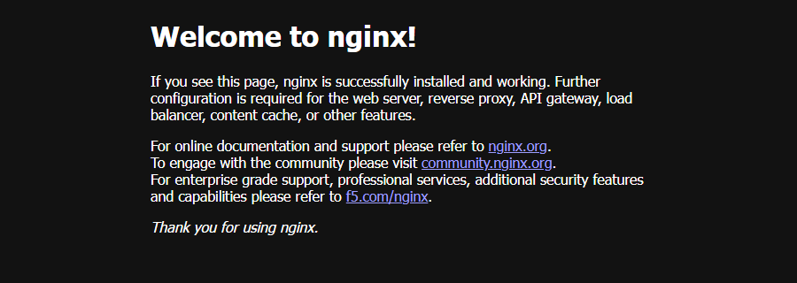
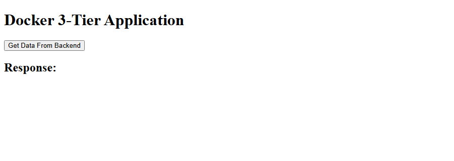

# Session 8: Docker Networking and Volumes

**Name:** Yash Gaikwad  |  **Roll No:** 24BCS10100

| Task | Topic | Where |
|---|---|---|
| 1 | Container networking: frontend, backend, database on 3 networks | [Task 1](#task-1-docker-container-networking) |
| 2 | Host network with Apache2 | [Task 2](#task-2-host-network) |
| 3 | Bind mount with Nginx | [Task 3](#task-3-bind-mount) |
| 4 | Overlay networks (research + single-node demo) | [Task 4](#task-4-overlay-network) |
| Extra | Named volume, and the instructor's 3-tier compose demo | [Extra](#extra-exercises-from-the-session) |

Everything was run for real on Docker Desktop (Docker 29) on Windows 11 using Git Bash. Output blocks are copied from the terminal; screenshots come from a headless Microsoft Edge pointed at the URL in the caption.

### Commands used

| Command | Purpose |
|---|---|
| `docker network create / ls / inspect / rm` | Create, list, inspect and remove networks |
| `docker network connect <net> <container>` | Attach a running container to another network |
| `docker run --network <net>` | Start a container on a network |
| `docker run -v host:container` / `-v volume:/path` | Bind mount / named volume |
| `docker exec <c> <cmd>` | Run a command inside a running container |

---

## Task 1: Docker container networking

### Design

Three containers on three networks. The **backend sits on two networks** and is the only bridge between the web tier and the data tier.

```
                host port 8085
                      |
   +------------------+------------------+
   |   public-net     |                  |
   |                  v                  |
   |   frontend (nginx:alpine)           |
   +------------------+------------------+
                      |  app-net
   +------------------+------------------+
   |   backend (alpine)  <-- on app-net AND data-net
   +------------------+------------------+
                      |  data-net  (--internal: no outside access)
   +------------------+------------------+
   |   database (mysql:8.0)              |
   +-------------------------------------+
```

| Container | Image | Networks |
|---|---|---|
| `frontend` | `nginx:alpine` | `public-net`, `app-net` |
| `backend` | `alpine` | `app-net`, `data-net` (**2 networks**) |
| `database` | `mysql:8.0` | `data-net` |

`data-net` is created with `--internal`, which means containers on it cannot reach the internet, a common way to protect a database.

### Step 1: Create three networks

_Three user-defined bridge networks (the long strings are network IDs)._

```console
$ docker network create public-net && docker network create app-net && docker network create --internal data-net
9ac725c7968c4a4f5a7b79fb29b1b8acde16d7575bbd5b8eeca1a6ed1670a840
e0fe52ee39847825a423c19a028135cb08d95091cdf0989e93744c5222750a57
447df198f77a6c3ce15bc5fa57eabbe554e3e0caf364d2b4ce6771f0edff253e
```

_All three exist; only data-net is internal._

```console
$ docker network ls --filter name=-net --format 'table {{.Name}}\t{{.Driver}}\t{{.Scope}}\t{{.Internal}}'
NAME         DRIVER    SCOPE     INTERNAL
app-net      bridge    local     false
data-net     bridge    local     true
public-net   bridge    local     false
```

### Step 2: Start the database

_MySQL needs a root password setting to start. A random one is generated so no password is stored anywhere; I only need the server to be reachable on the network._

```console
$ docker run -d --name database --network data-net -e MYSQL_RANDOM_ROOT_PASSWORD=yes mysql:8.0
cf264f4cb2ebbc104367f1cd5c9352755c0b2e1bf969d2e90fcdda1ce5905771
```

_Wait until MySQL reports that it is ready for connections on port 3306._

```console
$ docker logs database 2>&1 | tail -n 2
2026-10-18T12:48:56.599459Z 0 [System] [MY-011323] [Server] X Plugin ready for connections. Bind-address: '::' port: 33060, socket: /var/run/mysqld/mysqlx.sock
2026-10-18T12:48:56.599700Z 0 [System] [MY-010931] [Server] /usr/sbin/mysqld: ready for connections. Version: '8.0.46'  socket: '/var/run/mysqld/mysqld.sock'  port: 3306  MySQL Community Server - GPL.
```

### Step 3: Start the backend and attach it to a second network

_The backend starts on app-net._

```console
$ docker run -d --name backend --network app-net alpine sleep infinity
b69a1f2b74c3b200fc8cde13a05d32180aefd45a37f7ec3272c67fb83db46b83
```

_docker network connect adds the running backend to a second network: now it is on two._

```console
$ docker network connect data-net backend && echo "backend connected to data-net"
backend connected to data-net
```

### Step 4: Start the frontend

_The frontend starts on public-net and publishes port 8085._

```console
$ docker run -d --name frontend --network public-net -p 8085:80 nginx:alpine
05e1b18ddcb1086ead4f55fb3adca098d22acd8580ff874401aefecd98e3a691
```

_Give it a path to the backend as well._

```console
$ docker network connect app-net frontend && echo "frontend connected to app-net"
frontend connected to app-net
```

### Step 5: Check the layout

_Three containers running._

```console
$ docker ps --format 'table {{.Names}}\t{{.Image}}\t{{.Ports}}\t{{.Status}}'
NAMES      IMAGE          PORTS                                     STATUS
frontend   nginx:alpine   0.0.0.0:8085->80/tcp, [::]:8085->80/tcp   Up 1 second
backend    alpine                                                   Up 3 seconds
database   mysql:8.0      3306/tcp, 33060/tcp                       Up 26 seconds
```

_Which containers are attached to each network. backend appears under two._

```console
$ for n in public-net app-net data-net; do printf '%-11s -> ' $n; docker network inspect -f '{{range .Containers}}{{.Name}} {{end}}' $n; done
public-net  -> frontend 
app-net     -> frontend backend 
data-net    -> backend database 
```

_Inside the backend: two interfaces (eth0, eth1), one per network, each in a different subnet._

```console
$ docker exec backend ip addr show | grep -E "^[0-9]+: |inet " | grep -v " lo"
2: eth0@if160: <BROADCAST,MULTICAST,UP,LOWER_UP,M-DOWN> mtu 1500 qdisc noqueue state UP 
    inet 172.21.0.2/16 brd 172.21.255.255 scope global eth0
3: eth1@if161: <BROADCAST,MULTICAST,UP,LOWER_UP,M-DOWN> mtu 1500 qdisc noqueue state UP 
    inet 172.22.0.3/16 brd 172.22.255.255 scope global eth1
```

### Step 6: Check connectivity

Docker's built-in DNS lets containers on the same user-defined network reach each other by **name**.

_frontend -> backend (they share app-net): works._

```console
$ docker exec frontend ping -c 2 backend
PING backend (172.21.0.2): 56 data bytes
64 bytes from 172.21.0.2: seq=0 ttl=64 time=0.499 ms
64 bytes from 172.21.0.2: seq=1 ttl=64 time=0.154 ms

--- backend ping statistics ---
2 packets transmitted, 2 packets received, 0% packet loss
round-trip min/avg/max = 0.154/0.326/0.499 ms
```

_backend -> database (they share data-net): works._

```console
$ docker exec backend ping -c 2 database
PING database (172.22.0.2): 56 data bytes
64 bytes from 172.22.0.2: seq=0 ttl=64 time=0.385 ms
64 bytes from 172.22.0.2: seq=1 ttl=64 time=0.150 ms

--- database ping statistics ---
2 packets transmitted, 2 packets received, 0% packet loss
round-trip min/avg/max = 0.150/0.267/0.385 ms
```

_backend -> database on the real MySQL port 3306: the server answers with its handshake, which contains the version string (the dots are binary bytes)._

```console
$ docker exec backend sh -c "echo | nc -w 3 database 3306 | head -c 40 | tr -c \"a-zA-Z0-9._ -\" \".\"; echo"
J....8.0.46.....y.9.x...................
```

_frontend -> database: FAILS. They share no network, so the name does not even resolve. This is the isolation I wanted._

```console
$ docker exec frontend ping -c 2 -W 2 database
ping: bad address 'database'
```

_The backend can reach the internet through app-net (a normal network)._

```console
$ docker exec backend ping -c 2 -W 3 8.8.8.8
PING 8.8.8.8 (8.8.8.8): 56 data bytes
64 bytes from 8.8.8.8: seq=0 ttl=63 time=102.162 ms
64 bytes from 8.8.8.8: seq=1 ttl=63 time=289.218 ms

--- 8.8.8.8 ping statistics ---
2 packets transmitted, 2 packets received, 0% packet loss
round-trip min/avg/max = 102.162/195.690/289.218 ms
```

_A container on data-net alone cannot reach the internet because the network is internal._

```console
$ docker run --rm --network data-net alpine ping -c 2 -W 3 8.8.8.8
PING 8.8.8.8 (8.8.8.8): 56 data bytes
ping: sendto: Network unreachable
```

_The published frontend answers on the host._

```console
$ curl -s http://localhost:8085 | head -n 6
<!DOCTYPE html>
<html>
<head>
<title>Welcome to nginx!</title>
<style>
html { color-scheme: light dark; }
```



### Result

| From -> To | Result | Why |
|---|---|---|
| frontend -> backend | works | both on `app-net` |
| backend -> database | works | both on `data-net` |
| frontend -> database | **blocked** | no shared network |
| backend -> internet | works | `app-net` has a gateway |
| database network -> internet | **blocked** | `data-net` is `--internal` |

---

## Task 2: Host network

### Concept

With `--network host` the container does **not** get its own network namespace. It uses the host's network stack directly: no virtual interface, no NAT, no `-p` flag. If Apache listens on port 80, it is port 80 on the host itself.

_Pull the Apache2 image (the official "httpd" image on Docker Hub is the Apache HTTP Server 2.4)._

```console
$ docker pull httpd:2.4 2>&1 | tail -n 3
Digest: sha256:c842ac797bd1fe8b3cd26d002ac9d948aa2814097544600600b35aef42e6785a
Status: Image is up to date for httpd:2.4
docker.io/library/httpd:2.4
```

_Create the Apache container on the host network. Note there is no -p option._

```console
$ docker run -d --name apache-host --network host httpd:2.4
e8a64f88ba9547692f6eb692f2cbf497a8a85bf5ea0da30ae6076294edb00826
```

_The PORTS column is empty: nothing is published because the container already owns port 80 of the host._

```console
$ docker ps --filter name=apache-host --format 'table {{.Names}}\t{{.Image}}\t{{.Status}}\t{{.Ports}}' && docker inspect -f 'NetworkMode={{.HostConfig.NetworkMode}}' apache-host
NAMES         IMAGE       STATUS                  PORTS
apache-host   httpd:2.4   Up Less than a second   
NetworkMode=host
```

_Apache started and bound directly to the host address (192.168.65.3 is the address of the Docker Desktop host)._

```console
$ docker logs apache-host 2>&1 | tail -n 3 | cut -c1-150
AH00558: httpd: Could not reliably determine the server's fully qualified domain name, using 192.168.65.3. Set the 'ServerName' directive globally to 
[Sun Oct 18 12:49:26.466027 2026] [mpm_event:notice] [pid 1:tid 1] AH00489: Apache/2.4.69 (Unix) configured -- resuming normal operations
[Sun Oct 18 12:49:26.466292 2026] [core:notice] [pid 1:tid 1] AH00094: Command line: 'httpd -D FOREGROUND'
```

_Access the Apache website directly on port 80. A second container that shares the same host network sees Apache listening on port 80 (:::80 is the IPv6 wildcard, which also accepts IPv4) and fetches the default Apache page "It works!"._

```console
$ docker run --rm --network host alpine sh -c "netstat -ltn | grep -E \":80 \"; echo ---; wget -qO- http://localhost:80"
tcp        0      0 :::80                   :::*                    LISTEN      
---
<!DOCTYPE HTML PUBLIC "-//W3C//DTD HTML 4.01//EN" "http://www.w3.org/TR/html4/strict.dtd">
<html>
<head>
<title>It works! Apache httpd</title>
</head>
<body>
<p>It works!</p>
</body>
</html>
```

_Platform note: on Docker Desktop the "host" is the hidden Linux VM that runs Docker, not Windows itself, so Windows cannot reach it (000 = no connection). On a native Linux host this same container would answer in a browser at http://localhost:80._

```console
$ curl -s -m 5 -o /dev/null -w "Windows localhost:80 -> HTTP %{http_code}\n" http://localhost:80
Windows localhost:80 -> HTTP 000
```

For comparison, the same image on the default **bridge** network needs a published port to be reachable from Windows:

_Bridge mode: the container has its own IP and a published port._

```console
$ docker run -d --name apache-bridge -p 8087:80 httpd:2.4
b5e9689d4be3bfa821fa494c466a53a3a8563a301e4a1387fb7cceeba24fc984
```

_Reachable from the Windows host on the published port._

```console
$ curl -s http://localhost:8087
<!DOCTYPE HTML PUBLIC "-//W3C//DTD HTML 4.01//EN" "http://www.w3.org/TR/html4/strict.dtd">
<html>
<head>
<title>It works! Apache httpd</title>
</head>
<body>
<p>It works!</p>
</body>
</html>
```


| | bridge (default) | host |
|---|---|---|
| Own IP and network namespace | yes | no, uses the host's |
| Needs `-p` | yes | no (ignored) |
| Isolation | good | none |
| Speed | small NAT overhead | native speed |
| Port conflicts | no (map to any host port) | yes (the app's port is the host's port) |
| Typical use | most apps | network tools, very high-performance workloads |

_Cleanup._

```console
$ docker rm -f apache-host apache-bridge
apache-host
apache-bridge
```

---

## Task 3: Bind mount

A bind mount maps a **folder on my machine** into the container, so both always see the same files.

_Create a folder and an index.html that says Hello students._

```console
$ mkdir bind-mount-demo && echo "<h1>Hello students</h1>" > bind-mount-demo/index.html && ls -l bind-mount-demo && cat bind-mount-demo/index.html
total 1
-rw-r--r-- 1 gaikw 197609 24 Oct 18 18:19 index.html
<h1>Hello students</h1>
```

_Bind mount the folder over nginx's web root. (pwd -W prints the Windows-style path in Git Bash; on Linux/macOS write $(pwd)/bind-mount-demo.)_

```console
$ docker run -d --name nginx-bind -p 8086:80 -v "$(pwd -W)/bind-mount-demo:/usr/share/nginx/html" nginx:alpine
6a0735d53c1998ed3d468dc81615856bb5dd3f654c3bb11888d62167d7e9e868
```

_Docker confirms a bind mount (Type=bind) and shows the host path and the container path._

```console
$ docker inspect -f '{{range .Mounts}}type={{.Type}}  {{.Source}} -> {{.Destination}}{{end}}' nginx-bind
type=bind  E:/devops-github-assgn/devops-homework/session8-docker-networking-volume/bind-mount-demo -> /usr/share/nginx/html
```

_Access the Nginx website: it serves my file._

```console
$ curl -s http://localhost:8086
<h1>Hello students</h1>
```

_Note the container start time before I change anything._

```console
$ docker inspect -f 'StartedAt={{.State.StartedAt}}  RestartCount={{.RestartCount}}' nginx-bind
StartedAt=2026-10-18T12:49:37.380533095Z  RestartCount=0
```

_Modify index.html on the host. I do NOT restart or touch the container._

```console
$ echo "<h1>Hello students - edited on the host!</h1>" > bind-mount-demo/index.html && cat bind-mount-demo/index.html
<h1>Hello students - edited on the host!</h1>
```

_The change is visible immediately._

```console
$ curl -s http://localhost:8086
<h1>Hello students - edited on the host!</h1>
```

_Proof there was no restart: StartedAt is identical, RestartCount is 0, and the container has simply kept running._

```console
$ docker inspect -f 'StartedAt={{.State.StartedAt}}  RestartCount={{.RestartCount}}' nginx-bind; docker ps --filter name=nginx-bind --format '{{.Names}}: {{.Status}}'
StartedAt=2026-10-18T12:49:37.380533095Z  RestartCount=0
nginx-bind: Up 7 seconds
```

| Before the edit | After the edit (same container, no restart) |
|---|---|
|  |  |

_It works both ways: a file created inside the container shows up in the host folder._

```console
$ docker exec nginx-bind sh -c "echo from-the-container > /usr/share/nginx/html/created-in-container.txt" && ls bind-mount-demo
created-in-container.txt
index.html
```

_Cleanup (the final index.html stays in the folder)._

```console
$ rm bind-mount-demo/created-in-container.txt && docker rm -f nginx-bind
nginx-bind
```

---

## Task 4: Overlay network

### What is an overlay network?

A Docker **overlay network** is a virtual network that spans **several Docker hosts**. Containers on different machines attach to the same overlay and talk to each other as if they were on one switch, using private IPs or just container/service names, while the real traffic travels over the ordinary network between the hosts.

### How it works across hosts

1. The hosts form a **Swarm** cluster (`docker swarm init` on a manager, `docker swarm join` on the others). The cluster stores the network definition and tells every node which container lives where.
2. Each host creates a virtual bridge for the overlay and a **VTEP** (VXLAN tunnel endpoint).
3. When a container sends a packet to a container on another host, the host **encapsulates** the original Ethernet frame in a **VXLAN** UDP packet (port 4789) and sends it to the other host, which unpacks it and delivers it. This hides the container network from the physical network.
4. Docker's embedded DNS resolves service and container names across hosts, and swarm load-balances traffic to service replicas.
5. Optional encryption of the data plane: `docker network create -d overlay --opt encrypted ...` wraps the VXLAN traffic in IPsec.

Ports that must be open **between the hosts**:

| Port | Protocol | Purpose |
|---|---|---|
| 2377 | TCP | Swarm cluster management (managers) |
| 7946 | TCP and UDP | Node-to-node discovery and gossip |
| 4789 | UDP | VXLAN data traffic |

### Use cases

- Swarm **services** with replicas spread over many nodes that must reach each other (web tier on node A, API on node B).
- Multi-host applications that need private, isolated networks per project or per tenant.
- Service discovery by name without hard-coding IP addresses.
- Encrypted east-west traffic between hosts without extra tooling.

### Compared with the other drivers

| Driver | Scope | Typical use |
|---|---|---|
| `bridge` | one host | default for single-host apps; isolated virtual network |
| `host` | one host | share the host stack, no isolation, best speed |
| `none` | one container | no networking at all |
| `overlay` | **many hosts** | containers/services on different hosts talk to each other |
| `macvlan` | one host + physical LAN | container gets its own MAC and LAN IP |

Trade-offs: a small performance cost from the VXLAN encapsulation, a lower MTU (about 1450 instead of 1500), and it needs Swarm. In Kubernetes the same idea is provided by a CNI plugin (for example Flannel in VXLAN mode or Calico).

### Hands-on on one machine

I only have one machine, so I created a **single-node swarm** to see a real overlay network. With one node there is no VXLAN traffic between hosts, but the network, its subnet, and the name resolution behave exactly as on a cluster.

_Turn this Docker engine into a one-node swarm (the join token that follows in the full output is not shown)._

```console
$ docker swarm init 2>&1 | head -n 1
Swarm initialized: current node (pw46k3c1iilot42y2v7fbw7ri) is now a manager.
```

_Create an overlay network. --attachable lets ordinary containers (not just swarm services) join it._

```console
$ docker network create -d overlay --attachable demo-overlay
zuq00nci4qp9ut41jo4wf2l82
```

_Driver is overlay and the scope is swarm (cluster-wide), unlike a bridge network whose scope is local. The overlay got its own 10.0.x.0/24 subnet._

```console
$ docker network ls --filter name=demo-overlay --format 'table {{.Name}}\t{{.Driver}}\t{{.Scope}}' && docker network inspect demo-overlay -f 'subnet={{range .IPAM.Config}}{{.Subnet}}{{end}}  attachable={{.Attachable}}'
NAME           DRIVER    SCOPE
demo-overlay   overlay   swarm
subnet=10.0.1.0/24  attachable=true
```

_Two containers on the overlay (on a real cluster they could be on different hosts)._

```console
$ docker run -d --name ov-a --network demo-overlay alpine sleep 300 && docker run -d --name ov-b --network demo-overlay alpine sleep 300
bab472a488fc3076a71756b5b4b16458c2365abab5064816837f474554b521e8
49e33d22ae2a20eba472ab8e79e7089231f44e5163b5847a470b224c4c4f00fc
```

_ov-a reaches ov-b by name across the overlay._

```console
$ docker exec ov-a ping -c 2 ov-b
PING ov-b (10.0.1.4): 56 data bytes
64 bytes from 10.0.1.4: seq=0 ttl=64 time=0.318 ms
64 bytes from 10.0.1.4: seq=1 ttl=64 time=0.103 ms

--- ov-b ping statistics ---
2 packets transmitted, 2 packets received, 0% packet loss
round-trip min/avg/max = 0.103/0.210/0.318 ms
```

_Each container has an interface in the overlay subnet (10.0.x.x) plus the usual bridge interface for outside access._

```console
$ docker exec ov-a ip addr show | grep -E "^[0-9]+: |inet " | grep -v " lo"
178: eth0@if179: <BROADCAST,MULTICAST,UP,LOWER_UP,M-DOWN> mtu 1450 qdisc noqueue state UP 
    inet 10.0.1.2/24 brd 10.0.1.255 scope global eth0
180: eth1@if181: <BROADCAST,MULTICAST,UP,LOWER_UP,M-DOWN> mtu 1500 qdisc noqueue state UP 
    inet 172.19.0.3/16 brd 172.19.255.255 scope global eth1
```

_Cleanup: remove the test containers and network and leave the swarm, so Docker is back to normal._

```console
$ docker rm -f ov-a ov-b && docker network rm demo-overlay && docker swarm leave --force
ov-a
ov-b
demo-overlay
Node left the swarm.
```

---

## Extra exercises from the session

### A. Named volume (data outlives the container)

_A named volume is managed by Docker, not tied to a host folder._

```console
$ docker volume create demo-vol
demo-vol
```

_A short-lived container writes a file into the volume; --rm deletes the container afterwards._

```console
$ docker run --rm -v demo-vol:/data alpine sh -c "echo persisted-data > /data/note.txt && ls -l /data"
total 4
-rw-r--r--    1 root     root            15 Oct 18 12:49 note.txt
```

_A brand-new container mounts the same volume and the data is still there._

```console
$ docker run --rm -v demo-vol:/data alpine cat /data/note.txt
persisted-data
```

_Inspect, then remove the volume._

```console
$ docker volume inspect demo-vol --format 'name={{.Name}}  driver={{.Driver}}  mountpoint={{.Mountpoint}}' && docker volume rm demo-vol
name=demo-vol  driver=local  mountpoint=/var/lib/docker/volumes/demo-vol/_data
demo-vol
```

| | Bind mount | Named volume |
|---|---|---|
| Source | any host folder I choose | managed by Docker (`/var/lib/docker/volumes`) |
| Best for | development: edit code on the host, see it live | databases and data that must persist |
| Portable / backup-friendly | tied to host paths | yes (`docker volume` commands) |

### B. The instructor's 3-tier compose demo

The course repository contains a `demo` folder with a compose file: Nginx frontend, Flask backend and MySQL database on two networks (`frontend_net`, `backend_net`) with a volume for MySQL. I ran it unchanged from a temporary copy.

_Build the backend image and start all three services (the last lines of the output)._

```console
$ docker compose -p s8demo up -d --build 2>&1 | tail -n 8
   2 |     

   3 |     WORKDIR /app

--------------------

failed to solve: failed to fetch anonymous token: Get "https://auth.docker.io/token?scope=repository%3Alibrary%2Fpython%3Apull&service=registry.docker.io": dial tcp: lookup auth.docker.io: getaddrinfow: This is usually a temporary error during hostname resolution and means that the local server did not receive a response from an authoritative server.
```

_All three services are up._

```console
$ docker compose -p s8demo ps --format 'table {{.Service}}\t{{.Image}}\t{{.Status}}\t{{.Ports}}'
SERVICE   IMAGE     STATUS    PORTS
```

_The request goes browser -> nginx (frontend) -> Flask (backend) -> MySQL and back: JSON that came from the database._

```console
$ curl -s http://localhost:8080/api
```



_Compose created the two networks for me._

```console
$ docker network ls --filter name=s8demo --format 'table {{.Name}}\t{{.Driver}}'
NAME      DRIVER
```

_Cleanup: stop everything and remove the networks and the volume._

```console
$ docker compose -p s8demo down -v 2>&1 | tail -n 8
time="2026-10-18T18:23:59+05:30" level=warning msg="Warning: No resource found to remove for project \"s8demo\"."
```

---

### Final cleanup

_Remove my three Task 1 containers, then their three networks (containers first, because a network in use cannot be deleted)._

```console
$ docker rm -f frontend backend database >/dev/null; docker network rm public-net app-net data-net
public-net
app-net
data-net
```

_Nothing is left over: no test containers and no test networks remain._

```console
$ docker ps -a --format '{{.Names}}' | grep -xE 'frontend|backend|database' || echo 'none of my test containers are left'; echo "remaining test networks: $(docker network ls --filter name=-net -q | wc -l)"
none of my test containers are left
remaining test networks: 0
```

## What I learned

- On a **user-defined network** containers find each other by name; the default bridge does not provide that DNS.
- Putting the backend on **two networks** is a simple, effective way to keep the database unreachable from the frontend. `--internal` goes one step further and cuts the data network off from the internet.
- `--network host` removes network isolation and the need for `-p`, but on Docker Desktop the "host" is the Docker VM, not Windows.
- **Bind mounts** are ideal for development (edit on the host, see it instantly with no restart); **named volumes** are for data that must survive containers.
- **Overlay** networks extend one virtual network across many hosts with VXLAN, and need a swarm.
